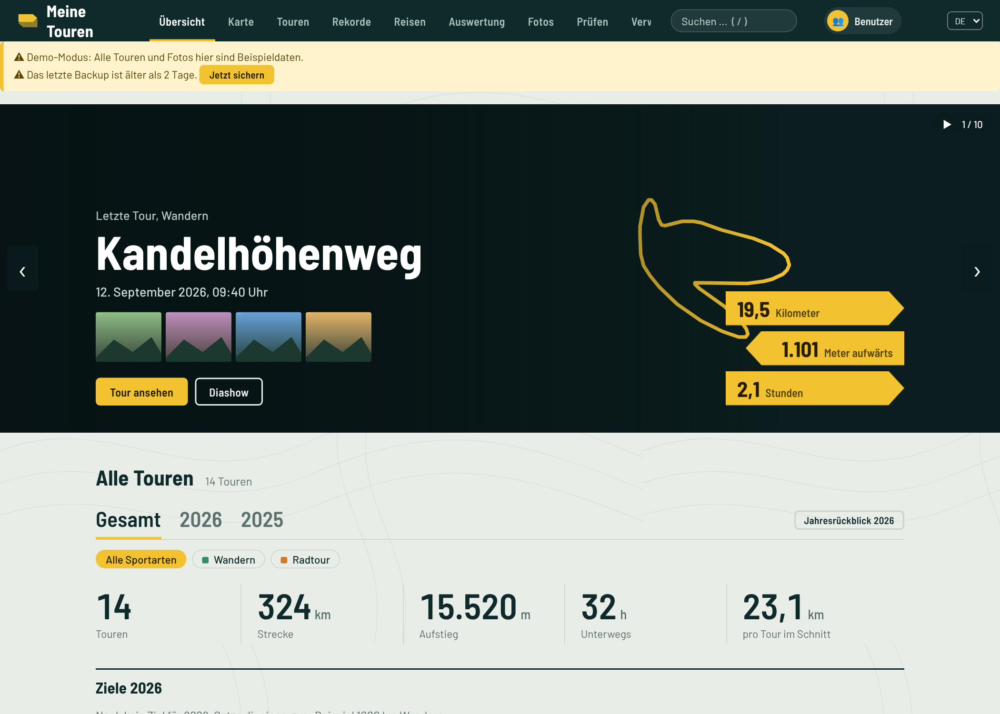
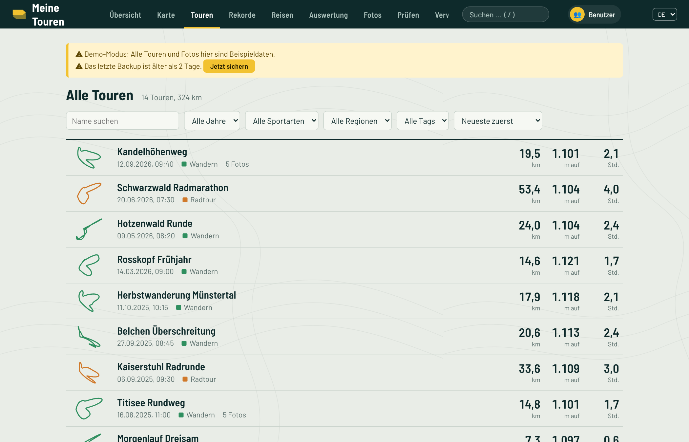
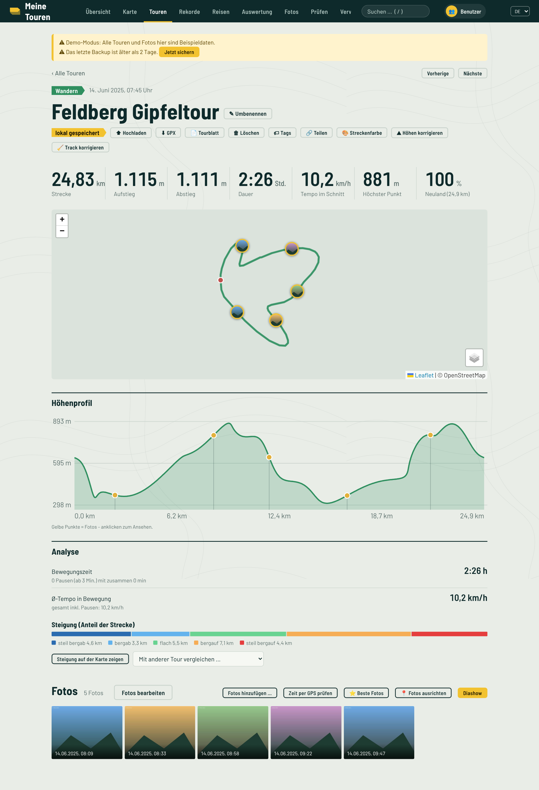
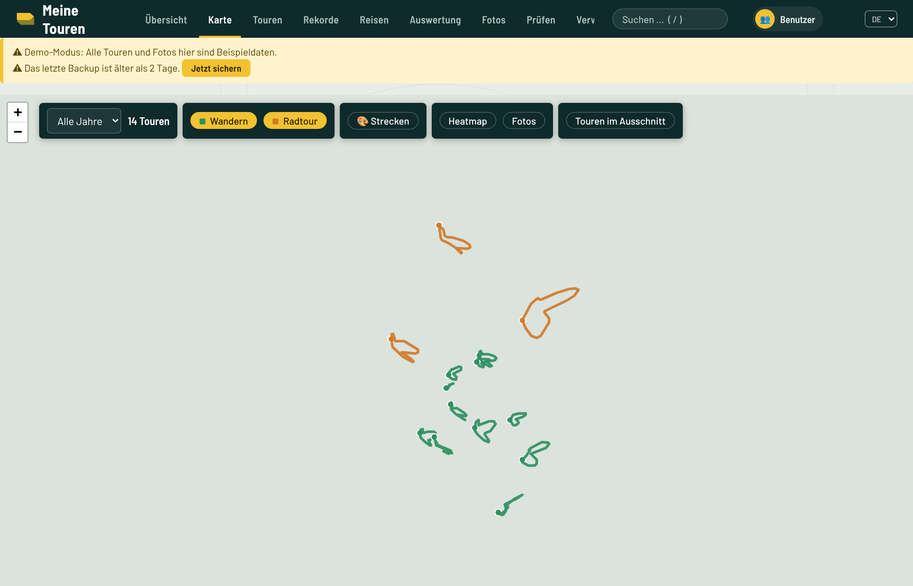
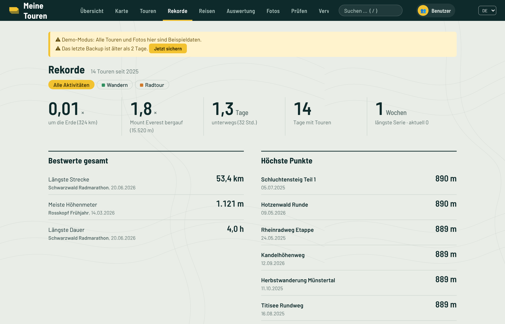
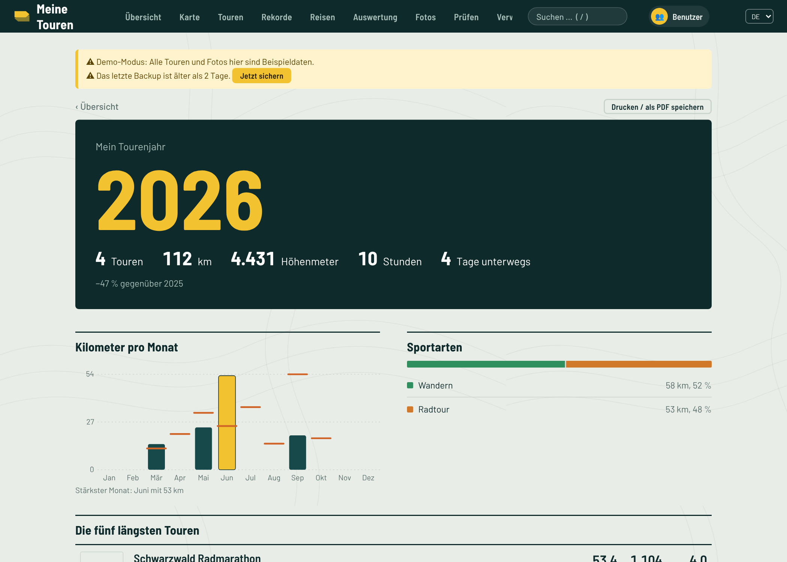
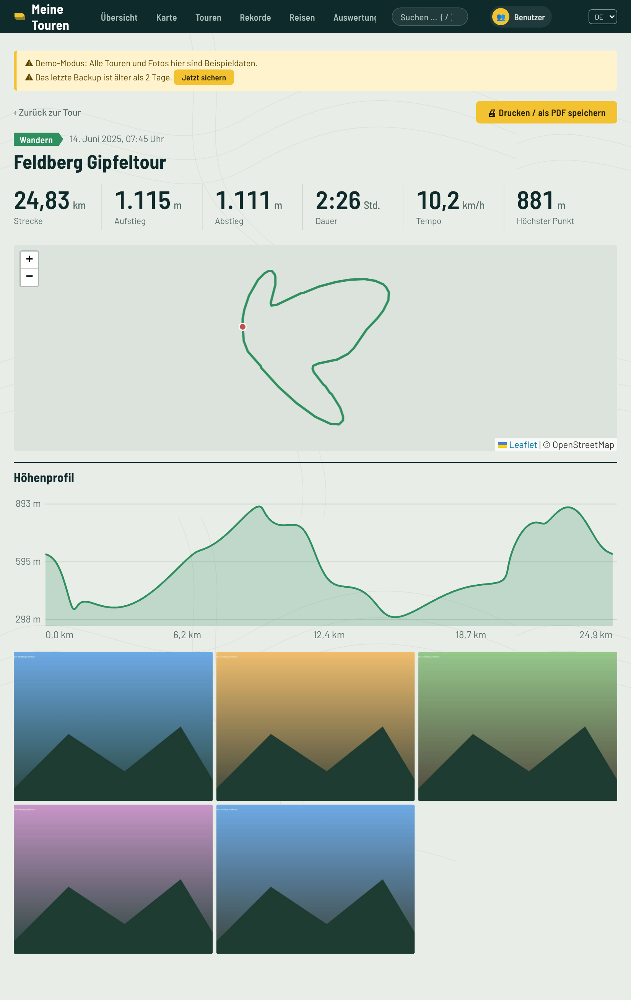
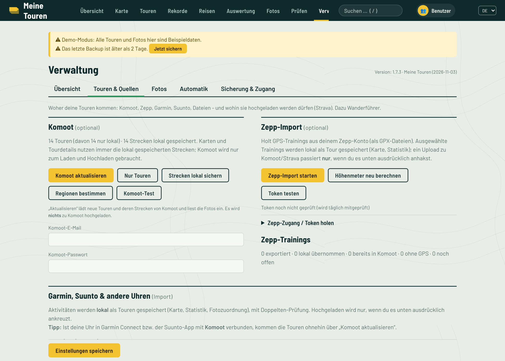
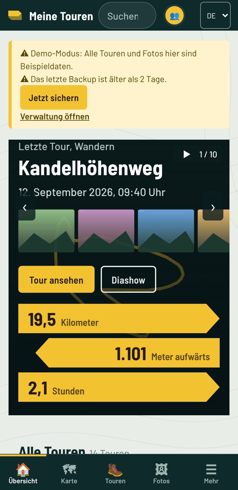

# Meine Touren

**Dein privates Tourenarchiv zum Selbsthosten** – Wanderungen, Radtouren und Co. mit Karte, Höhenprofil, Statistik und Fotos. Die Strecken liegen **lokal** bei dir; Komoot, Zepp und Strava sind optionale Anbindungen zum Laden und Hochladen.

> *English in short:* self-hosted tour archive (hikes, rides …) with maps, elevation profiles, stats and photos. Tracks are stored locally; Komoot/Zepp import and Komoot/Strava upload are optional. UI language: German. One-line install for Proxmox VE below.

**Bebilderte Kurzanleitung: [docs/ANLEITUNG.md](docs/ANLEITUNG.md)**

## Screenshots

Alle Bilder stammen aus dem **Demo-Modus** (`MT_DEMO=1 python3 -m app.demo`) und zeigen ausschließlich erfundene Beispieldaten. (Die Kartenkacheln fehlen in den Bildern – in der echten App ist die Karte sichtbar.)

| | |
|---|---|
|  **Übersicht** – letzte Tour, Fotos, Kennzahlen |  **Touren** – Liste mit Filtern und Streckenform |
|  **Tourdetail** – Höhenprofil mit Foto-Punkten |  **Karte** – alle Touren auf einen Blick |
|  **Rekorde** |  **Jahresrückblick** |
|  **Tourblatt** – druckbares Blatt einer Tour |  **Verwaltung** – übersichtlich in Reitern |

<p align="center"><br><b>Handy-Ansicht</b></p>

## Installation auf Proxmox VE (empfohlen)

Auf dem **Proxmox-Host** (Shell) ausführen – der Assistent legt einen Debian-13-Container an und installiert alles darin:

```bash
bash -c "$(curl -fsSL https://raw.githubusercontent.com/hilde0407/meine-touren/main/ct/meine-touren.sh)"
```

Standard: unprivilegierter LXC, 2 Kerne, 2 GB RAM, 20 GB Disk (die komprimierten Fotos brauchen je nach Menge 4–8 GB), Port 80. „Advanced“ im Assistenten erlaubt eigene IP, Speicher usw. Danach `http://<Container-IP>/` öffnen – beim ersten Besuch legst du den Administrator an.

Das Skript nutzt – wie die Skripte von [community-scripts.org](https://community-scripts.org/) – deren Container-Engine. Sie lädt die Engine von `community-scripts/core` und sendet auf Wunsch anonyme Diagnosedaten (im Assistenten abwählbar); der eigentliche Installer liegt in diesem Repository (`install/meine-touren-install.sh`).

**Aktualisieren:** im Container `meine-touren-update github` – oder auf dem Proxmox-Host das Skript erneut starten und „Update“ wählen. Vor jedem Update wird automatisch ein Backup angelegt.

## Manuelle Installation (jeder Debian/Ubuntu-Server)

```bash
apt update && apt install -y git
git clone https://github.com/hilde0407/meine-touren.git && cd meine-touren
bash deploy/install.sh
```

Installiert Python-venv, nginx, den Systemdienst `meine-touren` und ein tägliches Backup (03:40 Uhr, 14 Stück in `/var/backups/meine-touren`). Programm: `/opt/meine-touren`, Daten: `/var/lib/meine-touren`, Einstellungen: `/etc/meine-touren.env`. Direkt ohne nginx: `http://<IP>:8080/`. Protokoll: `journalctl -u meine-touren -f`.

## Funktionen

* **Übersicht, Karte, Touren:** letzte Tour mit Karte und Fotos (zum Durchzappen), Jahresstatistik, Bestwerte, Kalender, „An diesem Tag“; alle Touren auf einer Karte; Tourseite mit Höhenprofil, Fotos an der Strecke, 3D-Flug und Diashow; Streckenfarbe frei wählbar.
* **Lokale Strecken:** Karten und Tourdetails arbeiten nur mit gespeicherten Daten. Original-GPX lokaler Touren liegen im Datenordner und sind im Backup.
* **Import:** Zepp-Trainings (GPS als GPX), **Garmin, Suunto und andere Uhren** (FIT/GPX/TCX/ZIP, Garmin-Konto), Komoot-Touren und -Strecken, Fotos (Browser-Upload mit Verkleinerung, Eingangsordner, SMB, Mac-Skript).
* **Upload (nur auf ausdrücklichen Wunsch):** Komoot und Strava, einzeln oder gesammelt, mit Doppelten-Prüfung und Probelauf. GPX-Download jeder Tour.
* **Fotos:** automatisch über die Aufnahmezeit den Touren zugeordnet, manuelle Korrektur mit Zeitversatz, Karte mit Foto-Markern; Fotos lassen sich auf der Strecke „wie eine Perlenkette“ ausrichten.
* **Updates:** regelmäßige Prüfung auf GitHub, Installation per Knopfdruck (Administratoren), vorher automatische Sicherung.
* **Komfort:** Namensvorschläge aus Kartendaten/Wanderführern (z. B. Rother-GPX), Höhenkorrektur mit Geländemodell, Regionen-Suche, Rekorde, Alben/Reisen, Auswertung (Tempo, Wetter, Neuland), öffentliche Teilen-Links (widerrufbar), Webhook-Benachrichtigung, PWA.
* **Mehrere Benutzer:** getrennte Touren, Fotos und Einstellungen je Benutzer; Fotos pro Bibliothek oder Tour für einzelne Benutzer oder alle freigeben.
* **Smartphone-Ansicht:** automatisch ab ≤ 760 px, umschaltbar.

## Einrichten

1. `http://<IP>/` öffnen → Administrator anlegen (mind. 8 Zeichen Passwort).
2. *Verwaltung → Import*: Komoot-Zugang eintragen (optional) und „Komoot aktualisieren“, und/oder Zepp-Zugang bzw. GPX-Dateien importieren.
3. *Verwaltung → Upload-Portale → Strava*: eigene Strava-App anlegen (strava.com/settings/api), Client-ID/-Secret eintragen, „Mit Strava verbinden“.
4. Fotos: *Verwaltung → Fotos → „Ordner auswählen und hochladen …“* (im Browser verkleinert) oder `mac/fotos_senden.sh`.

## Daten, Backup, Update

* Pro Benutzer: `/var/lib/meine-touren/users/<Kennung>/` (Datenbank `komoot_hub.sqlite` – historischer Dateiname, Strecken, Fotos, `tracks/`). Gemeinsam: `system.sqlite` (Benutzer, Anmeldungen, Freigaben), `tilecache/`.
* Backups: `/var/backups/meine-touren/<Kennung>/…zip` (Datenbank + lokale GPX + System-Datenbank; Fotos nicht). Wiederherstellen: `meine-touren-restore <datei.zip>`.
* **Bestehende Installation unter dem alten Namen „komoot-hub“** bleibt mit ihren Pfaden und Befehlen (`komoot-hub-update` …) erhalten; die Skripte erkennen das selbst.

## Hinweise

* Komoot und Zepp bieten keine offizielle Schnittstelle für Privatpersonen; die Anbindungen nutzen inoffizielle Aufrufe und können jederzeit brechen. Prüfe die Nutzungsbedingungen der Dienste. Strava wird über die offizielle API angebunden.
* Dieses Projekt steht in keiner Verbindung zu Komoot, Strava, Zepp/Huami, Proxmox oder community-scripts. Alle Marken gehören ihren Inhabern.
* Es wird nie etwas bei Komoot, Zepp oder im Originalfotoordner gelöscht.
* Die Oberfläche braucht Internet für Kartenkacheln (OpenStreetMap u. a.), Höhen-/Wetterdaten und Ortsnamen (Open-Meteo, Nominatim, Overpass). Bitte die jeweiligen Nutzungsrichtlinien beachten.
* Läuft im Heimnetz; für Zugriff von außen ein VPN oder Reverse-Proxy mit HTTPS davorschalten.

## Entwicklung

```bash
pip install -r requirements.txt pytest httpx
python -m pytest -q tests
DATA_DIR=/tmp/mt uvicorn app.main:app --port 8080
```

Quellen/Lizenzen: Zepp-Anmeldung nach *huami-token* (MIT), Spurdekodierung nach *Mi-Fit-and-Zepp-workout-exporter* (MIT) und *MiFitDataExport*; Karten mit Leaflet (BSD-2) und MapLibre GL (BSD-3), Schrift Barlow (SIL OFL) – im Paket enthalten. Proxmox-Skripte im Stil von [community-scripts](https://github.com/community-scripts/ProxmoxVE) (MIT). Lizenz dieses Projekts: [MIT](LICENSE).

## Foto-Zeit-Abgleich (Mac, optional)

`mac/foto_zeit_abgleich.py` korrigiert die Aufnahmezeit exportierter JPEGs (z. B. aus Lightroom) anhand der RAW-Originale (ARW).
Festplatten nacheinander einlesen (`index /Volumes/Platte1`), dann `check` (nur Bericht) bzw. `fix` für den JPEG-Ordner; `undo` macht den letzten Lauf rückgängig. Nur Python 3 nötig. Details: `python3 mac/foto_zeit_abgleich.py -h`.


## Hilfe gesucht: Garmin und Suunto testen

Der Import von **Garmin-** und **Suunto-Aktivitäten** (FIT/GPX/TCX-Dateien und die Suunto-Anbindung) ist bisher nur mit selbst erzeugten Testdateien geprüft, nicht mit echten Geräten. Wer eine Garmin- oder Suunto-Uhr hat und die App ausprobiert, würde sehr helfen:

1. Eine echte Aktivität importieren (Verwaltung → Touren & Quellen → Garmin, Suunto & andere Uhren).
2. Prüfen, ob Strecke, Dauer, Höhenmeter und Sportart stimmen.
3. Rückmeldung als [GitHub-Issue](https://github.com/hilde0407/meine-touren/issues) geben – auch „hat gut funktioniert“ ist hilfreich. Bitte Gerätemodell, Dateiformat und App-Version nennen. Falls möglich, eine (anonymisierte) Beispieldatei anhängen.

## Lokal auf Windows

Für Tests oder den Einsatz auf einem einzelnen PC (der Dauerbetrieb gehört weiterhin auf einen Server).

1. Python 3.10 oder neuer installieren: `winget install Python.Python.3.12`
2. ZIP/Release entpacken und im Ordner `windows` die Datei `Meine-Touren-lokal.bat` doppelklicken. Beim ersten Start wird alles eingerichtet (eigene Python-Umgebung unter `%LOCALAPPDATA%\meine-touren-venv`).
3. Der Browser öffnet sich auf `http://localhost:8080` (anderer Port: `Meine-Touren-lokal.bat 9000`).

Daten liegen in `%USERPROFILE%\Meine-Touren-Daten` (Umgebungsvariable `MT_DATA` ändert das), die Fotoquelle ist standardmäßig „Eigene Bilder“ (`MT_FOTOS`). Updates lassen sich in der Oberfläche installieren; das Fenster startet die App danach selbst neu. Die automatischen Tests laufen bei jedem Commit auch auf Windows (GitHub Actions); unter **Windows 11** wurde Version 1.7.3 praktisch erprobt, es wurden keine Fehler gefunden (Stand 6. November 2026).

## Lokal auf dem Mac

Ohne Server: ZIP entpacken, im Ordner `mac` die Datei `Meine-Touren-lokal.command` per Doppelklick starten
(beim ersten Mal Rechtsklick → Öffnen). Sie richtet eine Python-Umgebung ein (Python ≥ 3.10, z. B. `brew install python`),
startet die App auf <http://127.0.0.1:8080> und öffnet den Browser. Die Daten liegen getrennt vom Server in
`~/Meine-Touren-Daten` (anderer Ort: Umgebungsvariable `MT_DATA`). Die Mac-Version nutzt dieselben Funktionen
(Komoot/Zepp-Import, Auswertung, Karte); Fotos per Browser-Upload oder Ordner einlesen.

### Foto-Werkzeuge für den Mac (Ordner `mac/`)

- `foto_auswahl.py` – wählt aus Lightroom-Fotos je Tag die besten aus und exportiert sie als druckfertige JPEGs nach `Aktivitäten/Jahr/Monat/Tag`.
- `foto_zeit_katalog.py` – ergänzt fehlende Aufnahmezeiten in exportierten JPEGs aus dem Lightroom-Katalog (`--undo` macht den letzten Lauf rückgängig).
- `foto_gps.py` – ergänzt GPS in den JPEGs aus den Strecken von „Meine Touren“: Die Aufnahmezeit wird mit den Tourzeiten verglichen, die Position auf der Strecke interpoliert. Probelauf ohne Option, `--anwenden` schreibt, `--undo` macht rückgängig. Fotos außerhalb jeder Tour (± 10 min) bleiben ohne GPS und stehen in `ohne_gps.txt`.

### Daten in eine neue Installation übernehmen

Den Datenordner der alten Installation (Standard `/var/lib/meine-touren`, enthält `system.sqlite` und `users/`) auf die neue Installation kopieren, **bevor** sie zum ersten Mal gestartet wird – oder bei gestoppter App – und die Rechte dem Dienstbenutzer geben. Einzelne Benutzer lassen sich über den Ordner `users/<name>` mitnehmen; Sicherungen (`*.zip`) enthalten dieselben Daten und können in der Verwaltung zurückgespielt werden.

### Foto-Auswahl in Meine Touren übernehmen

Die exportierten Fotos aus `Aktivitäten/` lassen sich über den Eingangsordner (`inbox/` des Benutzers, Standard `~/Meine-Touren-Daten/users/<Name>/inbox`) importieren: Dateien dorthin kopieren, Meine Touren erkennt sie nach wenigen Minuten selbst und ordnet sie den Touren zu. Alternativ in der Verwaltung „Fotos aus Ordner übernehmen“ (Ordner wählen).

`foto_gps.py` kennt zusätzlich `--tagesort` (Fotos ohne Tour erhalten die mittlere Position der GPS-Fotos desselben Tagesordners) und `--orte datei.csv` (Zeilen `JJJJ-MM-TT;Breite;Länge`, auch `JJJJ-MM` oder `JJJJ`).

### Garmin, Suunto und andere Uhren

**Verwaltung → „Garmin, Suunto & andere Uhren“.** Alles landet als *lokale* Tour (mit Doppelten-Prüfung gegen vorhandene Touren); zu Komoot/Strava wird nur auf ausdrücklichen Wunsch hochgeladen.

1. **Dateien (funktioniert immer, für jeden Hersteller):** FIT-, GPX-, TCX- oder ZIP-Dateien importieren. Eine ZIP darf beliebig viele Aktivitäten enthalten, auch verschachtelt – also genau das, was Garmin als Gesamtexport schickt. FIT-Dateien werden ohne Zusatzpaket gelesen (Sportart, GPS, Höhe); Dateien ohne GPS (Schlaf, Alltag, Indoor) werden übersprungen und gezählt.
   * *Garmin, alles:* [garmin.com/account/datamanagement](https://www.garmin.com/account/datamanagement/) → „Daten exportieren“ (Garmin schickt nach 1–2 Tagen eine ZIP per E-Mail).
   * *Garmin, einzeln:* Garmin Connect → Aktivität → ⚙ → „Original exportieren“ oder GPX.
   * *Suunto:* Suunto-App → Training → ⋮ → Exportieren → FIT oder GPX.
   * *Große ZIP-Dateien* (über 1 GB) statt per Browser einfach in den Ordner `inbox/touren/` des Benutzers legen; sie werden automatisch übernommen und nach `erledigt/` verschoben.
2. **Garmin-Konto (experimentell):** Anmeldung wie im Browser mit E-Mail und Passwort (inkl. Zwei-Faktor-Code) über das optionale Paket [`garminconnect`](https://github.com/cyberjunky/python-garminconnect) (braucht Python ≥ 3.12; `install.sh` versucht es zu installieren, sonst `pip install -r requirements-optional.txt` im venv). Das Passwort wird nicht gespeichert, nur der Anmelde-Schlüssel (verschlüsselt). Garmin bietet Privatpersonen **keine offizielle Schnittstelle**; die Anmeldung kann sich ändern oder zeitweise mit HTTP 429 gebremst werden – der Dateiweg bleibt davon unberührt. Optional: nur ab einem Datum, täglich automatisch.
3. **Suunto-Konto (nur mit API-Zugang):** Suunto vergibt seine Cloud-API ausschließlich an Firmen/Organisationen ([Partnerprogramm](https://apizone.suunto.com/how-to-start)), nicht an Privatpersonen. Wer einen Zugang hat, trägt Client-ID, Client-Secret und Subscription-Key ein und verbindet per OAuth.
4. **Über Komoot:** Garmin Connect und die Suunto-App können direkt mit Komoot verbunden werden; dann erscheinen die Touren ohnehin über „Komoot aktualisieren“.

> Garmin- und Suunto-Anbindung konnten vom Autor mangels Uhren nicht gegen echte Konten getestet werden; die Tests laufen gegen nachgebaute Antworten, der FIT-Leser gegen eine unabhängig erzeugte FIT-Datei. Rückmeldungen und Beispiel-Dateien sind willkommen.

### Fotos importieren und zuordnen

**Fotos → „Fotos importieren …“** (auch in der Verwaltung und im Tourdetail unter „Fotos hinzufügen …“): Ordner oder einzelne Fotos auswählen oder einfach ins Fenster ziehen. Die App liest Aufnahmezeit und Aufnahmeort aus den Bildern und zeigt vorab **je Aufnahmetag**, welcher Tour die Fotos zugeordnet werden; pro Tag lässt sich die Auswahl ändern („nach Uhrzeit“, andere Tour, „ohne Tour“, „nicht importieren“). Ein Klick startet den Import, danach steht da, wie viele Fotos Touren zugeordnet wurden.

Die Zuordnung nutzt Zeit **und** Ort: Überlappen sich Touren, entscheidet der Abstand des Fotos zur Strecke; ein Foto, das weit (über 10 km) von der Strecke aufgenommen wurde, wird nicht zugeordnet. Geht die Kamerauhr falsch (Zeitzone, nie gestellt), erkennt die App das an den Fotos mit Aufnahmeort und bietet beim Import eine **minutengenaue Zeitkorrektur** an; bei bereits importierten Fotos prüft **„Zeit per GPS prüfen“** im Tourdetail die Uhrzeiten und korrigiert sie nach Rückfrage.

### Fotos auf der Strecke ausrichten

Im Tourdetail öffnet **„📍 Fotos ausrichten“** die Karte im Ausrichtungsmodus: Ein Foto wird auf die Stelle der Strecke gezogen, an der man sicher ist, dass es dort entstand; alle anderen Fotos wandern wie auf einer Perlenkette im gleichen zeitlichen Abstand mit (mit Uhrzeit-Beschriftung). „Speichern“ verschiebt die Aufnahmezeiten dauerhaft um diesen Betrag (wahlweise auch die anderen Fotos desselben Tages); „Original-Zeiten“ nimmt jede Verschiebung zurück. Voraussetzung: die Strecke enthält Zeitstempel.

### Neu in Version 1.15

* **PDF-Berichte neu gestaltet:** Tourblatt, Reisebericht und Jahresrückblick haben jetzt einen farbigen Kopf mit Titel (auf Wunsch mit Titelfoto), Kennzahlen-Karten, Kartenbild mit Rahmen, Höhenprofil mit höchstem Punkt, Tabellen mit Zebra-Streifen und Tageszeilen, abgerundete Fotos mit Aufnahmezeit, Notiz und Bewertung (Tourblatt), Monatsdiagramm und Sportarten-Anteile (Jahresrückblick) sowie „Seite x von y“ in der Fußzeile.
* **Offline-Hinweis:** Ohne Verbindung zeigt die App oben einen gelben Hinweis; zuletzt gesehene Touren und Karten bleiben sichtbar (installierte App über HTTPS).

### Neu in Version 1.14

* **Teilen mit Meine Touren (Android):** Ist die App auf dem Handy installiert, erscheint sie im Teilen-Menü. GPX-, FIT-, TCX- und ZIP-Dateien (z. B. aus Garmin Connect oder Komoot) werden sofort als Tour übernommen, Fotos aus der Galerie landen im Eingang und werden im Hintergrund den Touren zugeordnet. Danach zeigt eine Ergebnisseite, was importiert wurde.
* **Handy-Installation:** Verwaltung → Übersicht → „Auf dem Handy“ erklärt die Installation, bietet „App installieren“ und zeigt, ob die Verbindung gesichert ist. Neu im Manifest: Verknüpfungen (Touren, Karte, Tour planen, Reisen) per langem Druck auf das App-Symbol.

#### Android-App (Version 2.0)

Im Ordner `android/` liegt eine kleine native Android-App („Hülle“) um die Weboberfläche. Sie bringt, was eine Webseite nicht kann:

- **GPS-Aufzeichnung** mit Vordergrunddienst – läuft auch bei ausgeschaltetem Bildschirm. Menüpunkt „● Aufzeichnen“ (erscheint nur in der App): Sportart wählen, Start, live Zeit/Strecke/Höhenmeter und Karte, Pause, Beenden, dann „Auf den Server speichern“. Wird der Server nicht erreicht, bleibt die Aufzeichnung auf dem Handy erhalten.
- **Teilen-Menü**: GPX/FIT/TCX/ZIP und Fotos aus anderen Apps direkt an Meine Touren senden (auch über HTTP, ohne HTTPS).
- **PDF-Downloads** landen im Download-Ordner des Handys.
- Die Serveradresse (auch `http://192.168.178.230`) wird beim ersten Start eingegeben und lässt sich in der Verwaltung ändern.

**Reisen (ab 2.2.1):** Als Reise zählen nur Gruppen über mindestens zwei Kalendertage. Tagesausflüge sind keine Reise, auch mit mehreren Aufzeichnungen am selben Tag. Eine fälschlich erkannte Reise lässt sich auf ihrer Seite mit „Keine Reise“ aus der Liste entfernen. Unten in der Reisenliste steht „Entfernte Reisen“ zum Wiederherstellen. Die Touren selbst bleiben immer erhalten.

**Teilen und Smartphone-Ansicht (ab 2.2):** Auf Tourseite, Reise und Jahresrückblick gibt es „Senden“. In der App öffnet es das Android-Auswahlmenü (WhatsApp, Signal, E-Mail …). Bei einer Tour wird dafür ein Link ohne Anmeldung erzeugt (Anfang und Ende ausgeblendet). Der Link funktioniert für Empfänger nur, wenn der Server von außen erreichbar ist (z. B. Tailscale Funnel). Die Übersicht und die Filterleiste der Tourenliste sind auf dem Handy deutlich kompakter.

**Push-Meldungen (ab 2.1):** Trage in der Verwaltung unter „Benachrichtigung“ eine ntfy-Adresse ein (z. B. `https://ntfy.sh/mein-geheimes-thema`). Dann kommen Warnungen und neue Touren (Aufzeichnung, Teilen-Menü, Import) als Meldung. In der Android-App: Verwaltung → Android-App → „ntfy-App holen“, danach „In ntfy abonnieren“. Das Abschalten der Tour-Meldungen geht im selben Panel.

**APK bauen:** Die APK entsteht auf GitHub (Actions → „Android-App“ → *Run workflow*, oder automatisch bei jeder Veröffentlichung; sie wird dann an das Release angehängt). Ohne Signierschlüssel wird eine Debug-APK gebaut – die lässt sich ebenfalls installieren („Aus unbekannten Quellen“ erlauben). Für eine signierte Release-APK unter *Settings → Secrets → Actions* hinterlegen: `ANDROID_KEYSTORE_BASE64`, `ANDROID_KEYSTORE_PASSWORD`, `ANDROID_KEY_ALIAS`, `ANDROID_KEY_PASSWORD`.

**Wichtig:** Hersteller wie Xiaomi, Samsung oder Huawei beenden Hintergrunddienste teils aggressiv. Für zuverlässige Aufzeichnungen die Akku-Optimierung für die App ausschalten (Verwaltung → Android-App → „Akku-Einstellungen“). Die App wurde ohne echtes Gerät entwickelt; bitte zuerst eine kurze Testrunde machen.

#### Handy und HTTPS
Android installiert die App nur bei einer **gesicherten Adresse (HTTPS)** wirklich – bei `http://192.168…` entsteht nur eine Verknüpfung ohne Teilen-Menü. Der einfachste Weg ist **Tailscale** (kostenlos): auf Server und Handy installieren, auf dem Server `tailscale serve --bg 80` ausführen und die angezeigte Adresse `https://…ts.net` am Handy öffnen. Alternativ ein Reverse-Proxy mit eigener Domain (Caddy, Nginx Proxy Manager).

### Neu in Version 1.13.1

* **Echte PDF-Berichte:** Tourblatt, Reisebericht und Jahresrückblick haben „⬇ PDF herunterladen“: Der Server erstellt eine fertige, saubere PDF-Datei (Text als Text, Karte mit Strecke, Höhenprofil als Grafik, Fotos, Statistik-Tabellen, Seitenzahlen) statt eines Bildschirmfotos. „Drucken“ bleibt als zusätzliche Möglichkeit. Fotos an/aus und Anzahl gelten auch hier. Neues Python-Paket: `reportlab` (wird beim Update automatisch installiert). Die Karte entsteht aus dem Kachel-Zwischenspeicher bzw. lädt fehlende Kacheln von OpenTopoMap; ohne Internet erscheint die Strecke auf heller Fläche.

### Neu in Version 1.13

* **Reisen bearbeiten:** In der Reise gibt es „✎ Reise bearbeiten“: Name und Zeitraum lassen sich ändern. Ein größerer Zeitraum nimmt alle Touren dieser Tage auf, ein kleinerer lässt Touren weg; Kilometer, Aufstieg und Statistik passen sich an. „Zurücksetzen“ stellt die automatische Erkennung wieder her.
* **Reisebericht als PDF:** „📄 Reisebericht (PDF)“ in der Reise öffnet eine druckbare Seite mit Karte (Tage in Farben), Statistik nach Aktivität, Tag-für-Tag-Liste und den besten Fotos. Als Datei über „⬇ PDF herunterladen“ (auch am Handy).
* **Fotos im PDF wählbar:** In Tourblatt, Reisebericht und Jahresrückblick lässt sich über „Fotos im PDF“ einstellen, ob Fotos dabei sind und wie viele (3 bis 24). Die Wahl gilt appweit und wird gespeichert.

### Neu in Version 1.12.2

* **Tourplanung komplett abschaltbar:** Ist „Tourplanung“ unter Verwaltung → „Touren & Quellen“ aus, sind neben den Schaltflächen und der Seite auch alle Planungs-Schnittstellen der App gesperrt.

### Neu in Version 1.12.1

* **Update aus der Oberfläche:** Nach dem Neustart wartet das Update-Skript bis zu 90 Sekunden auf den Dienst (vorher 2 Sekunden – bei großen Datenbanken ein falscher „fehlgeschlagen“-Alarm). Bei einem Fehler zeigt die Oberfläche jetzt die echte Ursache statt eines allgemeinen Hinweises; das vollständige Protokoll liegt unter `/var/lib/meine-touren/update.log`.

### Neu in Version 1.12

* **Tourplanung ein- und ausschaltbar:** Unter Verwaltung → „Touren & Quellen“ → „Tourplanung“. Ist sie aus, verschwinden alle „Tour planen“-Schaltflächen. Ist sie an, wählst du den Routing-Dienst: **brouter.de** (öffentlich), **eigener BRouter auf diesem Server** (mit Installationsbefehl direkt in der Oberfläche) oder **anderer BRouter-Server im Netz**. „Verbindung testen“ prüft die Adresse und meldet fehlende Karten-Kacheln.
* **Statistik nach Aktivität** bei Reisen, Alben und Etappen: je Sportart Touren, Kilometer, Aufstieg, Abstieg, Stunden, Ø km/h und längste Tour, dazu eine Gesamtzeile; die Kennzahlen oben zeigen jetzt auch den Gesamtabstieg.

### Neu in Version 1.11.1

* **Notizfeld:** Die Box wuchs beim Tippen mit jedem Zeichen weiter. Jetzt richtet sich die Höhe nach dem Text und nie darunter nach der gemerkten/gezogenen Größe.

### Neu in Version 1.11

* **Planung über bekannte Wege:** Die Punkte der Tourplanung werden jetzt über Wege und Straßen aus OpenStreetMap verbunden (Dienst [BRouter](https://brouter.de), Profil je nach Sportart: Wandern/Ski/Schneeschuh „hiking-mountain“, Rennrad „fastbike“, MTB „mtb“, sonst „trekking“). Gestrichelt gezeichnet wird eine gerade Linie, wo kein Weg gefunden wurde. Ein Klick auf einen Abschnitt wählt ihn aus; **„Alternativen anzeigen“** zeigt bis zu drei weitere Routen mit Länge und Aufstieg, ein Klick auf eine Alternative übernimmt sie. „Wegen folgen“ lässt sich ausschalten (gerade Linien; geladene GPX-Strecken und Wanderführer-Touren werden nie umgeroutet). Gespeicherte Pläne merken sich Punkte und gewählte Alternativen.
  **Datenschutz:** Zum Verbinden werden die Koordinaten der geplanten Punkte an brouter.de gesendet. Wer das nicht möchte, trägt unter Verwaltung → „Touren & Quellen“ → „Routenplanung“ die Adresse eines eigenen BRouter-Servers ein oder schaltet „Wegen folgen“ aus.

### Neu in Version 1.10

* **Touren planen:** Unter „Touren“ (und in der Wunschliste) führt „🗺 Tour planen“ zur Planung. Punkte in die Karte klicken (ziehen, Rechtsklick entfernt) oder eine **GPX-Datei laden** oder eine Tour aus dem **Wanderführer** übernehmen. Die App zeigt Länge, Auf- und Abstieg, höchsten Punkt und das Höhenprofil (Höhen aus dem Geländemodell) und schätzt die **Zeit nach deinem eigenen Tempo**: Aus deinen bisherigen Touren der Sportart wird gelernt, wie lange du je Kilometer und Höhenmeter brauchst (Gesamtzeit inklusive Pausen, mit Spanne). Bei zu wenig Archiv gelten Standardwerte. Pläne lassen sich mit Notiz speichern, wieder laden, löschen und als GPX herunterladen. Die Punkte werden geradlinig verbunden (kein Wege-Routing) – für Wege entlang von Pfaden also dicht klicken oder eine fertige GPX-Strecke laden.

### Neu in Version 1.9

* **Schneller Start der Übersicht:** Die Seite wartet nicht mehr auf die Streckenlinien und die „Wie oft gelaufen?“-Auswertung – beides wird nachgereicht (Mini-Strecken erscheinen kurz danach, 🔁 ebenso). Der Server hält die Streckenlinien fertig im Speicher (mit ETag, bei unveränderten Daten antwortet er nur noch „304“), rechnet die Wiederholungs-Auswertung nur neu, wenn sich Touren oder Strecken ändern (nicht mehr bei jeder Datenbankänderung), und erzeugt die Vorschaubilder der Übersicht nach dem Start im Hintergrund vor (gedrosselt, alle 3 Stunden nachgeholt).
* **Wetter und Schneelage:** Zur Tour zeigt die Wetterzeile bei Schnee zusätzlich Schneehöhe, Neuschnee der 3 Tage davor und Schneefall während der Tour (Open-Meteo, grobe Modelldaten). Ältere Wetterdaten werden dafür einmal nachgeladen.
* **Vergleich dieser Strecke:** Bei wiederholten Strecken zeigt ein Balkenvergleich alle Begehungen mit Dauer und Tempo, Bestzeit mit 🏆 und „x. schnellste von n“.
* **Tagebuch:** Eigene Bewertung mit 1–5 Sternen je Tour (★ in der Tourliste, Filter „Alle Bewertungen / ab ★★★ …“). Die Notiz zur Tour gibt es jetzt auch bei lokalen Touren; die Notizbox **merkt sich ihre Größe** und wächst mit dem Text, sodass er ganz lesbar ist.
* **Sicherheitsnotiz** bei Skitouren, Skifahren, Schneeschuh und Bergtouren: Lawinenwarnstufe 1–5, Gruppe, mitgeführte Notfallausrüstung (LVS, Sonde, Schaufel, Helm, Airbag …) und Notiz. Reine Dokumentation, kein Lawinenlagebericht.
* **Ziele je Sportart-Gruppe:** Ziele können jetzt auch für „Alle Rad-Sportarten“, „Alle Ski-Sportarten“, „Zu Fuß“ oder „Laufen und Langlauf“ gelten. Ohne Ziele im neuen Jahr bietet die Übersicht „Ziele aus dem Vorjahr übernehmen“ an.
* **Oberflächenpasswort in der Oberfläche:** Unter Verwaltung → „Sicherung & Zugang“ lässt sich das gemeinsame Passwort jetzt setzen, ändern und aufheben (nur Betrieb ohne Benutzerverwaltung; gespeichert wird nur ein Hash). Ein per `UI_PASSWORD` festgelegtes Passwort bleibt weiter möglich, ist dann aber nur dort änderbar.

### Neu in Version 1.8

* **Kennzahlen passend zur Sportart:** Unter den Grunddaten einer Tour steht eine zweite Zeile mit Werten, die zur Sportart passen – Wandern/Bergtour/Schneeschuh: Gehzeit, Pausen, Steigrate (m/h), steilster Abschnitt; Rad: Ø in Bewegung, Höchsttempo, Pausen, Anteil bergauf/bergab; Skitour/Skifahren: Aufstiegs- und Abfahrtszeit, Abfahrtshöhenmeter, Höchsttempo, steilster Abschnitt und Anteil der Strecke über 30°; Laufen: Pace. Die Werte werden aus den Streckenpunkten berechnet (GPS-Rauschen wird geglättet).
* **Steigung auf der Karte:** Der Knopf „⛰ Steigung“ direkt auf der Tourkarte färbt die Strecke nach Steilheit ein (mit Legende). Bei Skitouren und Schneeschuh-Touren sind Abschnitte über 30° Hangneigung violett markiert.
* **Jahreszeit:** In der Tourliste filtert „Sommerhalbjahr (Mai–Okt) / Winterhalbjahr (Nov–Apr)“. Touren auf der Wunschliste haben eine beste Jahreszeit (ganzjährig / Sommer / Winter); passt sie zur aktuellen Jahreszeit, steht „passt jetzt“ dabei.
* **Ausrüstung:** Unter „Auswertung“ legst du Rad, Schuhe, Ski … an (Name, Art, Sportarten, Zeitraum, optional „Wechsel-Hinweis ab … km“). Die App zählt Kilometer, Höhenmeter und Touren automatisch mit und warnt mit „bald wechseln“ (ab 90 %) und „Wechsel fällig“. Im Tourdetail steht die zugeordnete Ausrüstung; mit ✎ lässt sie sich für diese eine Tour ändern („automatisch nach Sportart und Datum“ oder eigene Auswahl).

### Version 1.7.3

* **Diashow mit Vollbild auf Touchgeräten:** Oben rechts erscheinen Knöpfe für Vollbild (⛶), Pause und Schließen; sie blenden sich nach 3 Sekunden aus und kommen per Tippen in die Bildmitte zurück. Tippen links/rechts oder Wischen blättert, der Bildschirm bleibt während der Diashow an (wo der Browser das erlaubt). Am Computer weiterhin Leertaste, Pfeiltasten und F. **iPhone:** Safari erlaubt dort keinen Vollbildmodus für Webseiten – die Seite zeigt einen Hinweis; mit „Zum Home-Bildschirm“ öffnet die App ohne Browserleiste (iPad und Android unterstützen Vollbild direkt).

### Version 1.7.2

* **Fehlerbehebung Updates (seit 1.7.0):** Durch die neue Reiter-Verwaltung wurde der Update-Bereich verschoben und doppelt angelegt; „Jetzt prüfen“ löste einen Fehler aus. Behoben. Außerdem nennt der Update-Bereich jetzt den Grund, wenn GitHub nicht erreichbar ist (z. B. keine Verbindung, Anfragelimit).

### Version 1.7.1

* **Unbenutzte Fotos aufräumen:** Auf der Seite „Fotos“ gibt es „🧹 Unbenutzte Fotos aufräumen …“, solange Fotos keiner Tour zugeordnet sind. Der Dialog zeigt Anzahl, Speicherplatz und eine Stichprobe und lässt dich **Jahre auswählen**; erst danach ist „Löschen“ möglich. Gelöscht werden nur die Kopien in der Fotobibliothek der App, nie Originale; die Fotos tauchen beim nächsten Import nicht wieder auf. Zum Zeitpunkt des Löschens wird neu geprüft, welche Fotos noch ohne Tour sind.

### Neu in Version 1.7

* **Verwaltung neu geordnet:** Statt einer langen Seite mit Klappbereichen gibt es fünf Reiter nach Aufgaben – *Übersicht* (Zustand, Updates, Protokoll, Selbsttest), *Touren & Quellen* (Komoot, Zepp, Garmin/Suunto/Dateien, Strava, Wanderführer), *Fotos*, *Automatik* und *Sicherung & Zugang* (Backup, Zugriffsschutz, Offline). „Einstellungen speichern“ bleibt auf jedem Reiter unten sichtbar. Der zuletzt gewählte Reiter wird gemerkt; Adressen wie `#/admin?tab=fotos` führen direkt hin.
* **Wie oft gelaufen?** Die App erkennt Touren, die dieselbe Strecke gehen (Länge ±20 %, mindestens 85 % der Strecke innerhalb von 60 m, auch in Gegenrichtung). In der Tourliste steht dann „🔁 3ד, im Tourdetail „Diese Strecke bist du schon 3-mal gegangen – das war das 2. Mal“ mit Links zu den anderen Begehungen.

### Version 1.6.3

* **Foto-Import, Kartenvorschau:** Aufnahmezeiten ohne Zeitzonenangabe werden in der Zeitzone des Servers gelesen, nicht in der des Browsers. Auf Reisen (Browser in anderer Zeitzone als der Server) stimmte sonst die Vorschau „x von y Fotos liegen auf der Strecke“ nicht. Der eigentliche Import war nicht betroffen.
* Automatische Tests auf GitHub: zwei fehlerhafte Annahmen in den Tests korrigiert (Dateireihenfolge, Backup-Ordner).

### Version 1.6.2

* **Fehlerbehebung Reisen:** Die Titelfotos der Mehrtagestouren fehlten bei Reihen, deren Fotos nicht unter den ersten 5000 Fotos der Bibliothek lagen. Die Kachel holt sich jetzt je Tour ein Foto direkt vom Server (`/api/tour-covers`).

### Version 1.6.1

* **Fehlerbehebung Höhenprofil:** Die gelben Foto-Marker erschienen nicht, wenn die Fotos keine GPS-Position haben (Zuordnung über die Aufnahmezeit rechnete mit falscher Zeitbasis). Jetzt werden sie über die Zeit richtig platziert.

### Neu in Version 1.6

* **Beste Fotos einer Tour:** Im Tourdetail wählt „⭐ Beste Fotos“ aus allen Fotos die 10 besten. Berücksichtigt werden Sternebewertungen aus Lightroom (aus der Datei oder einer gleichnamigen `.xmp`-Begleitdatei; „abgelehnt“ fällt heraus), die Schärfe (unscharfe Fotos fallen heraus) und die Verteilung über die Tour. Dazu gibt es „Diashow der besten“; das Tourblatt nutzt dieselbe Auswahl (6 Fotos). Ohne Sternebewertung entscheidet die Schärfe. Die Schärfe wird beim ersten Mal berechnet (bei vielen Fotos ein paar Sekunden) und gespeichert.

### Neu in Version 1.5

* **Kamerauhr-Hinweis:** Prüfen → „Kamerauhr“ zeigt Touren der letzten 90 Tage, bei denen die Foto-Zeiten nicht zum Aufnahmeort passen (Kamerauhr/Zeitzone falsch). „Korrigieren“ verschiebt die Fotos um die erkannte Differenz, „Ignorieren“ merkt sich die Tour.
* **Mehrtagestouren aufräumen:** Reisen → „＋ Mehrtagestour bilden …“ benennt Touren eines Zeitraums auf einen Schlag („Name – Tag N“); in der Gesamtansicht benennt „✎ Reihe umbenennen“ alle Etappen gemeinsam. Die Kacheln unter Reisen zeigen ein Foto aus der Mitte der Reihe.
* **Tourblatt:** Im Tourdetail „📄 Tourblatt“ – eine druckbare Seite mit Kennzahlen, Karte, Höhenprofil und bis zu 6 Fotos (Drucken → als PDF speichern).
* **Höhenprofil mit Fotos:** Gelbe Punkte im Profil markieren, wo ein Foto entstanden ist; Klick öffnet das Foto, der Mauszeiger darüber zeigt die Stelle auf der Karte.
* **Wunschliste:** Auswertung → Wanderführer: Touren aus den hinterlegten Wanderführern vormerken, mit Länge (und Aufstieg, wenn die GPX-Datei Höhen enthält). Bereits gegangene Touren sind markiert. Für schon früher hochgeladene Führer fehlt der Aufstieg, bis die GPX-Dateien erneut hochgeladen werden.
* **Jahresziele mit Prognose:** zusätzlich zur Hochrechnung das voraussichtliche Erreichungsdatum, bei Rückstand die nötige Wochenleistung.
* **Touren teilen (Familie):** Freigegebene Touren anderer Benutzer lassen sich unter „Geteilte Fotos“ samt Strecke und passenden Fotos in die eigene Sammlung übernehmen (als Kopie; der Besitzer behält seine Tour unverändert).
* **Offline-Nutzung:** Die Web-App merkt sich zuletzt geladene Daten, Karten und kleine Fotos; ohne Verbindung erscheint ein Hinweisband. Verwaltung → „Für Offline vorbereiten“ lädt die letzten 8 Touren samt Kartenkacheln vorab. Voraussetzung ist HTTPS (oder localhost). Beim Abmelden wird der Daten-Zwischenspeicher gelöscht.

### Neu in Version 1.4

* **Ursache statt Vermutung:** Unter Prüfen → Unplausible Touren steht bei jeder Tour, woran es liegt (nicht aufgezeichnete Zeiten, GPS-Ausreißer, Fahrt-Abschnitte, GPS-Zittern – oder „Track unauffällig, vermutlich falsche Sportart“) und der Knopf „🧹 Track korrigieren“ ist entsprechend hervorgehoben.
* **Zeit aus Foto-Positionen:** Liegen Fotos mit GPS-Position auf dem Track (mindestens drei, im Zeitablauf passend), kann die App daraus die Zeit entlang der ganzen Strecke ableiten – Pausen eingeschlossen, genauer als eine Schätzung. Option im Dialog „Track korrigieren“.
* **Mehrtagestouren:** Touren mit Namen wie „Alpenüberquerung E5 – Tag 6“ (auch „Etappe“, „Day“, „Stage“, „Jour“, „Día“) werden gruppiert: unter Reisen als eigene Karten, im Tourdetail als Hinweis mit Gesamtansicht (Karte, Summen, Fotos, 3D-Flug). Es braucht mindestens zwei verschiedene Tagesnummern.
* **Übersetzungen** (EN/FR/ES) deutlich erweitert (Dashboard, Tourdetail, Prüfen, Fotos, Verwaltungsüberschriften); sehr lange Erklärtexte der Verwaltung sind weiterhin deutsch.
* **Selbsttest** (Verwaltung → Wartung & Sicherheit) prüft zusätzlich Datenbank-Integrität, Schreibrechte der Foto-/Eingangs-/Backup-/Streckenordner, Stichproben der Foto-Dateien, HEIC-Unterstützung, auffällige Touren, Erreichbarkeit der GitHub-Update-Prüfung und den Update-Weg. Nach einem Update auf dem Server lohnt sich ein Durchlauf.

### GPS-Track korrigieren (ab 1.3.1)

Im Tourdetail öffnet **„🧹 Track korrigieren“** (und in Prüfen → Unplausible Touren der gleichnamige Knopf, bei ausgeblendeten Touren „Einblenden & Track korrigieren“) eine Karte mit den Auffälligkeiten:

* **Ausreißer** (rot): Punkte, die mit unmöglichem Tempo vom Weg wegspringen und dann zurückkehren. Sie werden aus dem Track gelöscht, die Länge sinkt entsprechend.
* **Schnelle Abschnitte** (orange): längere Stücke dauerhaft über dem zur Sportart passenden Tempo (Wandern ab 9 km/h, Laufen 20, Rad 45), z. B. Seilbahn, Bus oder Auto. Pro Abschnitt wählbar: als Fahrt aus **Strecke und Dauer** herausrechnen (der Weg bleibt sichtbar) oder behalten.

Das Original bleibt erhalten (**„Original wiederherstellen“**). Bei Komoot-Touren gilt die Korrektur nur hier und bleibt beim Abgleich erhalten, solange Komoot die Länge nicht selbst ändert. Ohne Zeitstempel im Track lassen sich nur große Sprünge erkennen.

### Neu in Version 1.3

* **Zeit nachträglich verschieben:** im Fotoraster Fotos auswählen → **„Zeit verschieben …“** (Stunden/Minuten, wahlweise nur Auswahl, ganzer Aufnahmetag oder alle noch nicht zugeordneten Fotos); die Zuordnung zu Touren wird danach neu berechnet. Ist die Strecke mit Zeitstempeln vorhanden, schlägt **„Zeit per GPS prüfen“** den Versatz vor.
* **Fehlerliste beim Import:** Fotos, die nicht gelesen oder hochgeladen werden konnten, stehen einzeln mit Grund da.
* **HEIC/HEIF (iPhone):** werden beim Import in JPEG umgewandelt, wenn das optionale Paket `pillow-heif` installiert ist (`pip install pillow-heif`; die Startskripte und `install.sh` versuchen es selbst). Ohne das Paket nennt die Fehlerliste den Grund.
* **Kartenvorschau** im Importfenster: pro Aufnahmetag die Strecke der Tour und die Fotostandorte.
* **„Jetzt sichern“** direkt in der Hinweisleiste und unter Verwaltung → Zustand.
* **Mac-Update per Doppelklick:** `mac/Meine-Touren-aktualisieren.command` lädt die neueste Version von GitHub und ersetzt die Programmdateien (Daten bleiben unberührt, die alte Fassung liegt in `.vorher/`).
* **Englische, französische und spanische Oberfläche (Beta):** Sprachauswahl (DE/EN/FR/ES) oben rechts; Standard nach Browsersprache. Die Übersetzung läuft über Wörterbücher (`app/static/js/00-i18n.js` für Englisch, `00-i18n-data.js` für Französisch und Spanisch; Zeilen „deutsch|übersetzung“ zum Ergänzen) und ist noch nicht vollständig – nicht Übersetztes bleibt deutsch; Meldungen vom Server sind überwiegend deutsch. Datums- und Zahlenformate wechseln mit.
* **Demo-Modus:** `mac/Meine-Touren-Demo.command` bzw. `windows/Meine-Touren-Demo.bat` (oder `python -m app.demo`) startet die App auf Port 8090 mit 14 erfundenen Touren und 15 Beispielfotos in einem eigenen Datenordner (`~/Meine-Touren-Demo`) – ohne eigene Daten, ohne Konten, ohne Netzwerk. Gut zum Ausprobieren und für Screenshots. Echte Daten werden nie angefasst.

### Updates aus der Oberfläche

Die App prüft alle 6 Stunden auf GitHub, ob eine neuere Version veröffentlicht ist (abschaltbar), und weist Administratoren darauf hin (Hinweisleiste, Verwaltung → Updates, optional Webhook). **„Installieren“** legt zuerst eine Sicherung für jeden Benutzer an und installiert dann:

* *Proxmox/Server:* Die App läuft ohne Root-Rechte und schreibt nur die gewünschte **Versionsnummer** nach `<Datenordner>/update-request`. Der kleine Systemdienst `<name>-update.path` (wird von `install.sh` eingerichtet) startet daraufhin `<name>-update auto` als root, das die Version `vX.Y.Z` selbst von GitHub lädt, prüft, dass sie neuer ist, und wie gewohnt installiert. Die App kann also keinen eigenen Programmcode einschleusen. **Einmalig** muss ein bestehender Container noch von Hand auf diese Version gebracht werden (`meine-touren-update github`); danach klappt es per Knopfdruck. Ablauf und Fehler stehen unter `journalctl -u meine-touren-update`.
* *Mac-Testversion:* Die App ersetzt ihre Programmdateien (alte Fassung in `.vorher/`) und startet über `Meine-Touren-lokal.command` neu.

### Verwaltung → Zustand

Die Verwaltung zeigt oben eine Zustandsprüfung (Komoot-Zugang, Backup, Datenbankgröße, freier Speicher, Touren ohne Strecke, Fotos ohne Tour) und – siehe unten – auf neuere Versionen auf GitHub.

### Zugangsdaten verschlüsselt

Komoot-Passwort, Strava- und Zepp-Zugangsdaten liegen verschlüsselt (AES-256-GCM) in der Datenbank. Der Schlüssel steht in `<Datenordner>/secret.key` (wird beim ersten Start angelegt, nur für den Dienstbenutzer lesbar) oder – wenn gesetzt – in der Umgebungsvariable `MT_SECRET_KEY`. Die Schlüsseldatei ist absichtlich **nicht** Teil der Sicherungen. Wer eine Sicherung auf einem neuen Rechner einspielt, kopiert `secret.key` mit oder gibt die Zugangsdaten danach in der Verwaltung neu ein. Vorhandene Klartext-Einträge älterer Versionen werden beim ersten Lesen automatisch verschlüsselt.

### Eigener BRouter-Server (Routenplanung ohne brouter.de)

Auf dem Server (Debian/Ubuntu, z. B. dem Proxmox-Container) als root:

```bash
bash deploy/brouter/install-brouter.sh                 # Standard: Deutschland/Alpenraum
bash deploy/brouter/install-brouter.sh E5_N45 W20_N25  # oder eigene 5°×5°-Kacheln
```

Das Skript installiert Java, lädt BRouter 1.7.7 und die Kartenkacheln (je ca. 100–400 MB, nur die, die du brauchst – Kachelname = untere linke Ecke, z. B. `W20_N25` für die Kanaren) und richtet den Dienst `brouter` auf Port 17777 ein. Danach unter Verwaltung → „Routenplanung“ eintragen: `http://<Server-IP>:17777/brouter`. Weitere Kacheln später mit `install-brouter.sh --nur-kacheln …`. Es verlassen dann keine Koordinaten mehr das Heimnetz.

## Für Entwickler

- Oberfläche ohne Build-Schritt: `app/static/js/01-grundlagen.js` … `12-start.js` werden in dieser Reihenfolge von `index.html` geladen (gemeinsamer globaler Bereich). Formatierung mit Prettier (`.prettierrc`): `npx prettier --write app/static/js/*.js`.
- Tests: `python -m pytest -q tests` – darunter Browsertests mit Playwright (`pip install playwright && python -m playwright install chromium`), die jede Ansicht mit Beispieldaten öffnen und auf JavaScript-Fehler prüfen.

**Betrachter und Standort (ab 2.3.0):** Unter Konto & Freigaben → „Neuer Benutzer“ gibt es die Rolle **Betrachter (nur ansehen)**. Ein Betrachter sieht die Touren, Fotos, Reisen, Auswertung und die Karte des gewählten Benutzers, kann aber nichts ändern, nichts hochladen und hat weder Verwaltung noch Einstellungen (der Server lehnt alles außer Ansehen mit „403“ ab). Unter Verwaltung → „Standort teilen“ wird festgelegt, ob die zuletzt gemeldete Position des Besitzers sichtbar ist (Aus / nur während einer Aufzeichnung / immer). Die Android-App meldet sie während einer Aufzeichnung alle 30 Sekunden (dafür die neue APK installieren); auf der Karte erscheint sie als roter Punkt mit „vor x Min.“. Der Knopf „⌖ Ich“ zeigt jedem Benutzer den eigenen Standort als blauen Punkt. Es wird nur die letzte Position gespeichert. Die mobile Karte füllt jetzt den Platz zwischen Kopfzeile und Tab-Leiste, und „Mehr“ trennt die Hauptpunkte (Reisen, Auswertung, Geteilte Fotos) von Einstellungen & Prüfung.

**Betrachter strenger (ab 2.3.1):** Ein Betrachter darf nur Daten abrufen: keine PDFs (Tourblatt, Reise, Jahresrückblick), kein Umbenennen, keine Höhen- oder Zeitkorrektur, keine Foto-Änderungen, keine Notizen/Bewertungen/Tags, kein Teilen-Link. Erlaubt sind der GPX-Download einer Tour, die Diashow und die Fotos in der Tour und auf der Karte. Der Server erlaubt für diese Rolle nur eine feste Liste von Abfragen; die Oberfläche blendet die Bedienelemente zusätzlich aus.

**Sicherung der Aufzeichnungen (ab Android-App 2.3.1):** Jede beendete Aufzeichnung wird vor dem Aufräumen zusätzlich auf dem Handy gesichert (die letzten 10). Unter „Aufzeichnen“ erscheinen sie als „Gesicherte Aufzeichnungen“ und lassen sich mit einem Tippen erneut auf den Server speichern. Ein Name ist nie nötig: bleibt das Feld leer, vergibt der Server einen automatischen Namen.

**Fehlerkorrektur 2.3.2 (verlorene App-Aufzeichnungen):** Bis 2.3.1 landeten Aufzeichnungen aus der Android-App (und Dateien über „Teilen“) bei mehreren Benutzern im Altbestand statt im eigenen Konto: der Server meldete „gespeichert“, die Tour war aber nirgends zu sehen. Ab 2.3.2 landen sie im richtigen Konto. Bereits verlorene Aufzeichnungen der letzten 30 Tage holt Verwaltung → „Verlorene App-Aufzeichnungen suchen“ (nur Administratoren) ins eigene Konto.

**Android-App 2.4.0:** Während einer Aufzeichnung gibt es den Knopf „📷 Foto aufnehmen“ (öffnet die Kamera-App; das Foto bekommt Aufnahmezeit und GPS-Position und landet zusätzlich in der Galerie unter „Meine Touren“). Vor dem Start wählst du, ob Fotos **sofort** auf den Server geladen werden (bei fehlender Verbindung wird automatisch erneut versucht) oder **gesammelt am Ende**, beim Speichern der Tour. Die Aufzeichnungsseite zeigt Zeit, Strecke, Auf- und Abstieg, aktuelle und höchste Höhe, Tempo, Durchschnitt und GPS-Genauigkeit. **Beenden** geht nur noch durch Gedrückthalten (1,5 Sekunden), versehentliches Antippen beendet nichts mehr. Auf der Karte steht beim eigenen Standort und beim Live-Standort der Benutzername. Fotos der Aufzeichnung kommen über `/api/rec-photos` in den Foto-Eingang und werden automatisch der Tour zugeordnet.

**Verwaltung neu geordnet (ab 2.4.1):** Sieben Reiter, jeder Bereich ist eine gleich gestaltete Karte: Übersicht (Zustand, Updates, Selbsttest, Protokoll), Touren holen (Komoot, Zepp, Uhren und Dateien, Wanderführer), Hochladen & Planen (Strava/Komoot-Upload, Tourplanung), Fotos, Automatik & Meldungen, Handy & App (Android-App, Standort teilen, verlorene Aufzeichnungen, App auf dem Startbildschirm) und Sicherung & Zugang. Das Protokoll ist eingeklappt; „Einstellungen speichern“ bleibt unten auf jedem Reiter erreichbar.

**Diashow per WhatsApp teilen (ab 2.5.0):** In der Tour gibt es neben „Senden“ den Knopf „Diashow senden“. Er erzeugt einen Link, der ohne Benutzerkonto funktioniert, und öffnet das Teilen-Menü (WhatsApp, Signal, E-Mail …). Wer den Link öffnet, sieht die Fotos der Tour als Vollbild-Diashow (automatischer Wechsel alle 5 s, Wischen, Pause, Vollbild, Karte mit dem Track). WhatsApp zeigt in der Vorschau Titel und erstes Foto. Es werden nur die Fotos dieser einen Tour freigegeben (keine Konten, keine anderen Touren); ausgeblendete Fotos fehlen. Der Link lässt sich unter „Teilen“ der Tour (Eintrag „Diashow“) widerrufen. Betrachter können keine Links erzeugen.

**Diashow-Links genauer (ab 2.5.1):** „Diashow senden“ fragt vorher nach den Fotos (alle oder nur die besten 20/50) und der Gültigkeit (7 Tage, 30 Tage, unbegrenzt). Abgelaufene Links zeigen „nicht mehr gültig“, auch die Fotos sind dann gesperrt. In „Tour teilen“ steht je Link, bis wann er gilt und wie oft die Diashow angesehen wurde. Die Diashow zeigt die Uhrzeit des Fotos und hat einen Tempo-Knopf (3/5/8 s).

**Fester App-Schlüssel (ab App 2.5.0):** Die APK wird jetzt immer mit demselben, im Repository liegenden Schlüssel (`android/app/mt-debug.jks`) signiert. Neue Versionen lassen sich dadurch **über die alte installieren, ohne zu deinstallieren** – die Aufzeichnungs-Backups auf dem Handy bleiben erhalten. *Einmalig* muss die bisherige App noch deinstalliert werden, weil sie mit einem anderen Schlüssel signiert war. Wer sicherer signieren will, hinterlegt wie bisher die vier GitHub-Secrets (siehe „APK bauen“); diese haben Vorrang. Hinweis: Der Schlüssel liegt öffentlich im Repository – das ist für eine privat genutzte App in Ordnung, ersetzt aber keine geheime Signatur.

**Testliste Fotos und Aufzeichnung (vor einer langen Tour, ca. 10 Minuten):**
1. Aufzeichnung starten, 2 Fotos aufnehmen (Modus „sofort“): Foto erscheint nach kurzer Zeit in der Tour, ohne Fehlermeldung.
2. Flugmodus an, ein Foto aufnehmen: Foto bleibt in „Wartende Fotos“; Flugmodus aus → wird hochgeladen.
3. Modus „am Ende“, Foto aufnehmen, Aufzeichnung beenden: Track und Foto kommen zusammen an.
4. Während der Aufnahme eine andere App öffnen und zurückkehren: Aufzeichnung läuft weiter, kein Punkteverlust.
5. „Beenden“ nur kurz antippen: nichts passiert; lange halten: Aufzeichnung stoppt.
6. In der Galerie prüfen, ob die Kopie der Fotos vorhanden ist.
Bei Fehlern: „Diagnose senden / kopieren“ (Verwaltung → Handy & App → Android-App) und mir schicken.


**Aufgeräumte Tour-Ansicht am Handy (ab 2.5.2):** Statt elf Einzelknöpfen gibt es zwei große Knöpfe. „Teilen & Senden“ enthält Link senden, Diashow senden, Links verwalten, GPX-Datei und Tourblatt; „Bearbeiten“ enthält Umbenennen, Tags, Streckenfarbe, Höhen und Track korrigieren, Hochladen, Komoot-Abgleich und (abgesetzt, rot) Löschen – jeweils mit kurzer Erklärung. Am Computer bleibt alles unverändert.

**E-Mail, Passwort vergessen und Zwei-Faktor-Anmeldung (ab 2.6.0):**
- **E-Mail-Adresse:** Beim Einrichten und beim Anlegen jedes Benutzers ist jetzt eine E-Mail-Adresse Pflicht. Bestehende Benutzer tragen sie unter „Konto & Freigaben“ nach (Bestätigung mit dem Passwort); Administratoren können sie dort auch für andere ändern.
- **E-Mail-Versand einrichten (Verwaltung → Automatik & Meldungen → „E-Mail-Versand“):** SMTP-Server, Port, Verschlüsselung, Benutzername und Passwort deines E-Mail-Anbieters (bei Yahoo, GMX, Gmail meist ein eigenes „App-Passwort“), Absenderadresse und die öffentliche Adresse der App (`https://…ts.net`), die in den Link der Mail kommt. Mit „Testmail an mich senden“ prüfen. Das Passwort liegt nur in der Systemdatenbank und wird nie wieder angezeigt.
- **Passwort vergessen:** Auf der Anmeldeseite „Passwort vergessen?“ → E-Mail-Adresse oder Name → Link per Mail (eine Stunde gültig, nur einmal benutzbar, höchstens 3 pro Stunde und Konto). Die Antwort ist immer gleich, man erfährt also nicht, ob eine Adresse bekannt ist. Nach dem Ändern werden alle Anmeldungen beendet und eine Hinweismail geschickt. Ohne eingerichteten Mailversand erscheint ein Hinweis, den Administrator zu bitten.
- **Zwei-Faktor-Anmeldung (Konto & Freigaben → „Zwei-Faktor-Anmeldung“):** jederzeit ein- und ausschaltbar. Einschalten: QR-Code mit einer Authenticator-App scannen (Google/Microsoft Authenticator, Aegis, 2FAS, Bitwarden …) und den Code bestätigen; danach werden 8 **Wiederherstellungscodes** einmalig angezeigt. Anmeldung: Name und Passwort, dann der 6-stellige Code (oder ein Wiederherstellungscode). Ausschalten und neue Wiederherstellungscodes brauchen Passwort **und** Code. Ein Code gilt nur einmal, nach 5 Fehlversuchen muss man neu beginnen. Geht das Handy verloren und es gibt keine Codes mehr, setzt ein Administrator die Zwei-Faktor-Anmeldung unter „Benutzer verwalten“ zurück.
- Hinweise: Das Zurücksetzen des Passworts umgeht die Zwei-Faktor-Anmeldung nicht. Betrachter-Zugänge (nur ansehen) haben keine Zwei-Faktor-Einstellung. Der QR-Code wird mit der mitgelieferten Bibliothek *qrcode-generator* (MIT) lokal erzeugt, es wird nichts nach außen geschickt.

**Reisen (ab 2.6.1):** Unter „Reisen“ stehen nur noch echte Reisen: Touren weit weg von zu Hause an mindestens **4 Tagen** am Stück. Wochenend- und Kurzausflüge (auch in Hessen) erscheinen dort nicht mehr; sie bleiben als normale Touren erhalten und lassen sich über Tags/Alben gruppieren. Eine Reise, die du selbst bearbeitet hast (Name/Zeitraum), bleibt immer sichtbar. Mehrere Reisen im selben Bundesland bekommen eindeutige Namen („Hessen – Rhön (Mai 2024)“). Die Mindestdauer steht in der Einstellung `trip_min_days` (Standard 4). **Heimatorte (ab 2.7.0):** Orte, an denen du dich allgemein aufhältst (Zuhause, Zweitwohnsitz, Stammgebiet), erkennt die App selbst – ein Gebiet von etwa 30 km, in dem sehr viele Touren (mindestens 8 und 10 % aller) über mindestens 8 verschiedene Monate gestartet wurden. Touren dort zählen nie als Reise; ein Urlaubsort, den man nur ab und zu besucht, bleibt eine Reise.

**Info (ab 2.7.0):** Im Menü „Mehr“ (Handy) bzw. im Benutzermenü (Computer) zeigt „Info“ die laufende Version der Android-App und des Servers sowie die Ersteller (Volker Hildebrand und Claude).

**Fotos auf der Karte (ab 2.7.1):** Der Knopf „Fotos“ zeigt jetzt auch Fotos ohne eigenen Aufnahmeort (GPS): ihre Position wird aus der Aufnahmezeit auf dem Track der Tour berechnet und als blassere Punkte gezeigt („Position aus der Uhrzeit berechnet“). Fotos mit GPS bleiben unverändert. Der Knopf zeigt die Anzahl, z. B. „Fotos (312)“.

**Abgelaufene Diashow-Links (ab 2.7.3):** Wer einen abgelaufenen oder zurückgezogenen Link öffnet, sieht eine verständliche Seite statt einer Fehlermeldung: bei Ablauf mit dem Datum und dem Hinweis, einen neuen Link anzufordern, sonst mit dem Hinweis auf einen abgeschnittenen oder zurückgezogenen Link.

**Fotos aus der App in einer anderen Zeitzone (ab Server 2.7.4 / App 2.5.1):** Die App schickt mit jedem Foto-Upload die Zeitzone des Telefons mit. Hat die Kamera keine Zeitzone ins Foto geschrieben, trägt der Server sie nach. Vorher wurde die Aufnahmezeit als Ortszeit des Servers gedeutet – war das Handy z. B. auf den Kanaren (UTC+0) und der Server in Deutschland, lag das Foto eine Stunde neben der Tour und wurde nicht zugeordnet.

**Offline, Live-Ansicht und Wegpunkte (ab Server 2.10–2.12 / App 2.7–2.8):** Die App speichert alles, was sie vom Server lädt (Seiten, Daten, Strecken, kleine Fotos, Kartenkacheln), auf dem Handy und zeigt es ohne Verbindung weiter an (Hinweisband „Offline“); unter *Verwaltung → Offline-Nutzung* lädt „Alle Touren offline“ Daten und Strecken aller Touren vor. Beim Aufzeichnen mit Route zeigt die Live-Ansicht die nächste Abbiegung, Rest-Kilometer, geschätzte Ankunft und das Höhenprofil mit dem eigenen Standort (das Profil wird beim Laden der Route einmal berechnet und auf dem Handy gemerkt); zusätzlich gibt es die Ansagen „Halbzeit“ und „Noch fünf Kilometer“. Mit **📍 Wegpunkt setzen** hält man unterwegs per Schnellnotiz (Rast, Aussicht, Quelle, Gabelung …) oder eigenem Text einen Ort fest; die Wegpunkte gehen als GPX-`wpt` mit der Tour auf den Server und erscheinen dort als Liste und Marker. **📖 Erzählung** (Tourseite) fügt Start, Wegpunkte, Foto-Gruppen und Ziel zu einer Zeitleiste mit Karte zusammen.

**Sprachansagen auf der Strecke (ab Server 2.8.0 / App 2.6.0; mehrsprachig ab Server 2.9.0 / App 2.6.1):** Vor dem Start unter *Aufzeichnen* eine **geplante Tour** (Verwaltung der Tourplanung) oder eine **frühere Tour zum Nachgehen** als „Route mit Sprachansagen“ wählen. Die App erkennt die Abbiegestellen selbst aus der Strecke und sagt sie in der Sprache der Oberfläche an (Deutsch, Englisch, Französisch oder Spanisch) – auch bei ausgeschaltetem Bildschirm und über Kopfhörer:
- „In 100 Metern rechts abbiegen“, kurz vorher „Jetzt rechts abbiegen“ (bei höherem Tempo früher); liegen zwei Abbiegungen dicht beieinander: „…, danach links abbiegen“. Leichte Richtungswechsel heißen „leicht links halten“, enge „scharf links abbiegen“, Spitzkehren „Kehre nach links“.
- „Du bist vom Weg abgekommen“ (mehr als 40 m neben der Strecke, bei schlechtem GPS entsprechend mehr) mit Abstand zur Route, alle 90 s wiederholt; „Wieder auf dem Weg“, sobald du zurück bist.
- „Noch ein Kilometer bis zum Ziel“ und „Du hast das Ziel erreicht“.
- Ist die Route beim Start noch weit weg, sagt die App das einmal und beginnt die Führung erst, wenn du auf der Strecke bist. Rundwege (Start = Ziel) werden richtig behandelt.
- Während der Aufnahme lassen sich die Ansagen mit einem Haken ein- und ausschalten; *Testansage* prüft Lautstärke und Stimme. Die Strecke erscheint blau auf der Karte der Aufzeichnung und wird nach dem Beenden wieder entfernt.
- Die Ansagen nutzen die Sprachausgabe von Android (Einstellungen → Sprachausgabe; für eine gute deutsche Stimme ggf. „Sprachdaten installieren“). Es gibt keine Kartendaten-Navigation: Die Abbiegungen kommen aus der Form der Strecke, es werden keine Wegnamen genannt.
