# Meine Touren

**Dein privates Tourenarchiv zum Selbsthosten** – Wanderungen, Radtouren und Co. mit Karte, Höhenprofil, Statistik und Fotos. Die Strecken liegen **lokal** bei dir; Komoot, Zepp, Garmin, Suunto und Strava sind optionale Anbindungen zum Laden (Komoot und Strava auch zum Hochladen). Die Seiten lassen sich selbst zusammenstellen, die Android-App zeichnet unterwegs auf.

> *English in short:* self-hosted tour archive (hikes, rides …) with maps, elevation profiles, stats and photos. Tracks are stored locally; Komoot/Zepp/Garmin/Suunto import and Komoot/Strava upload are optional. Customizable pages, Android app for recording. UI language: German (EN/FR/ES translations). One-line install for Proxmox VE below.

**Bebilderte Kurzanleitung: [docs/ANLEITUNG.md](docs/ANLEITUNG.md)** · **Versionsverlauf: [docs/VERSIONSVERLAUF.md](docs/VERSIONSVERLAUF.md)**

## Highlights (Stand Version 3.33.0)

* **Seiten selbst gestalten:** Tourseite, Übersicht, Statistik, Reise-Seite und Reisen-Übersicht bestehen aus **Bausteinen** („Seite anpassen“): verschieben, ausblenden, einklappen, Breite wählen, Bausteine aus einem Katalog hinzufügen, **Ansichten** und **Vorlagen** (z. B. „Wandern“, „Rad“, „Kompakt“), Export und Import. Ohne Anpassung sieht alles aus wie gewohnt.
* **Eigene Kennzahlen** ohne Programmierung, Hinweis-Bausteine (nur bei Anlass), die **Erinnerungen-Kachel** und ein globaler Filter (Aktivität, Zeitraum) in der Statistik.
* **Teilen:** Freigegebene Links an einem Ort verwalten, Tour-Links in einer **gewählten Ansicht** (z. B. nur Karte und Fotos), **Jahresrückblick als teilbare Seite**, **Diashow-Links** für Tour, Jahr oder Sammlung (Vollbild, ohne Konto, widerrufbar).
* **Uhren und Messwerte:** Zepp-, Garmin- und Suunto-Import (der Import-Knopf auf der Übersicht passt sich den verbundenen Konten an), Messwerte, „Meine Geräte“ mit Genauigkeit, Training laut Uhr, Belastung und Tempo nach Steigung.
* **Suche ohne Akzente:** „reunion“ findet „Réunion“, „strasse“ findet „Straße“.
* **Android-App** mit GPS-Aufzeichnung, Sprachansagen, Offline-Speicher, Fotos während der Aufnahme und Vollbild-Diashow; als Begleit-App gibt es **Mein Tourentagebuch** ([hilde0407/mein-tourentagebuch](https://github.com/hilde0407/mein-tourentagebuch)).

## Screenshots

Alle Bilder stammen aus dem **Demo-Modus** (`MT_DEMO=1 python3 -m app.demo`), ergänzt um einige weitere erfundene Touren (u. a. eine Hüttenwanderung als Reise, Touren mit Pulswerten), und zeigen ausschließlich Beispieldaten. (Die Kartenkacheln fehlen in den Bildern – in der echten App ist die Karte sichtbar.)

| | |
|---|---|
| 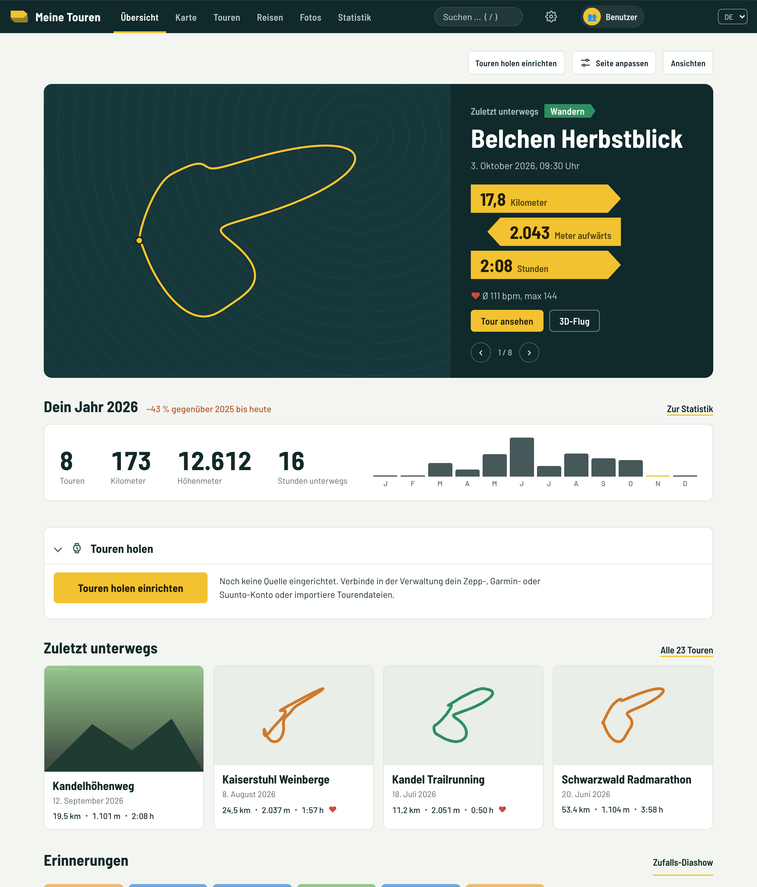 **Übersicht** – letzte Tour, Dein Jahr, Erinnerungen | 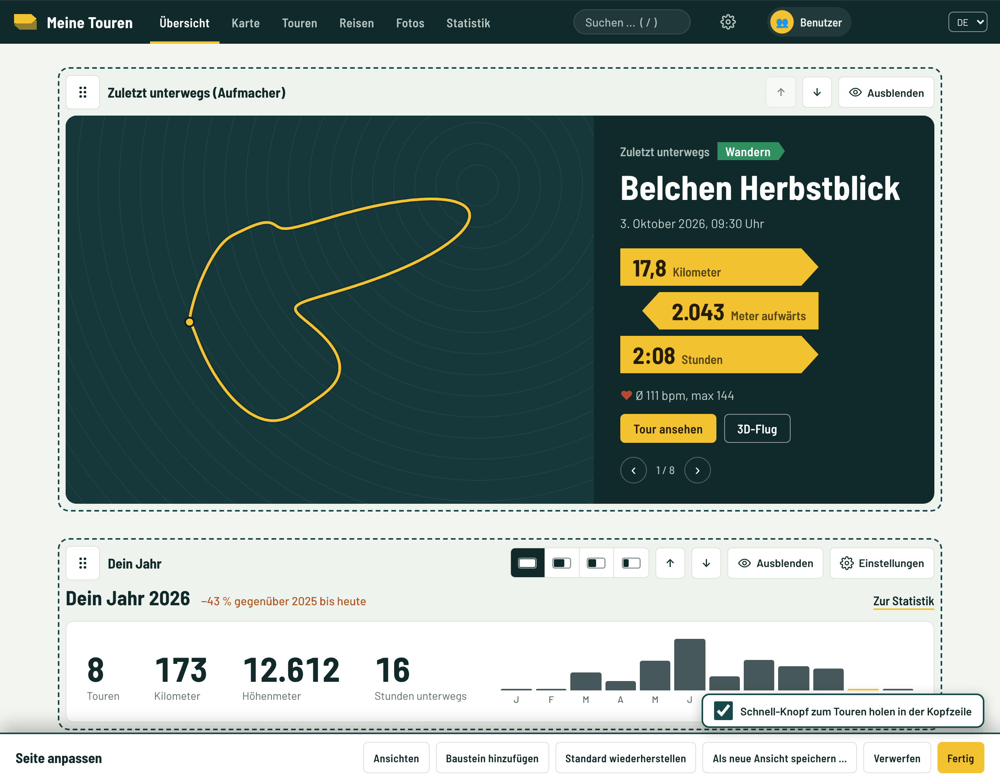 **Seite anpassen** – Bausteine verschieben, ausblenden, Breite wählen |
| 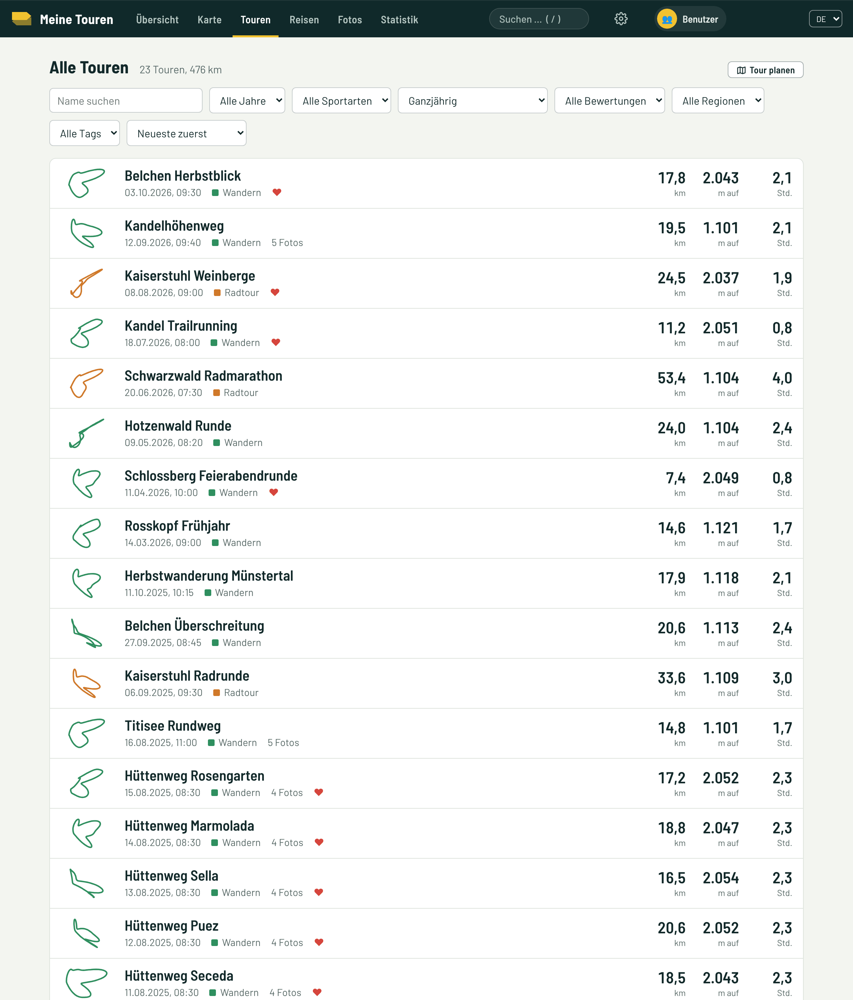 **Touren** – Liste mit Filtern und Streckenform | 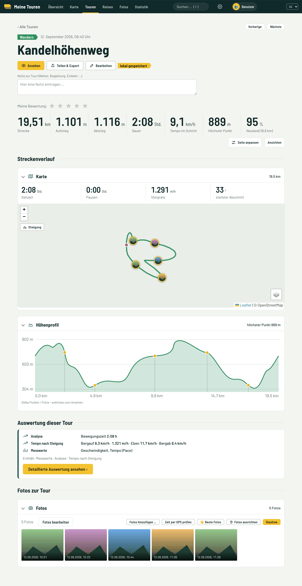 **Tourdetail** – Höhenprofil mit Foto-Punkten |
| 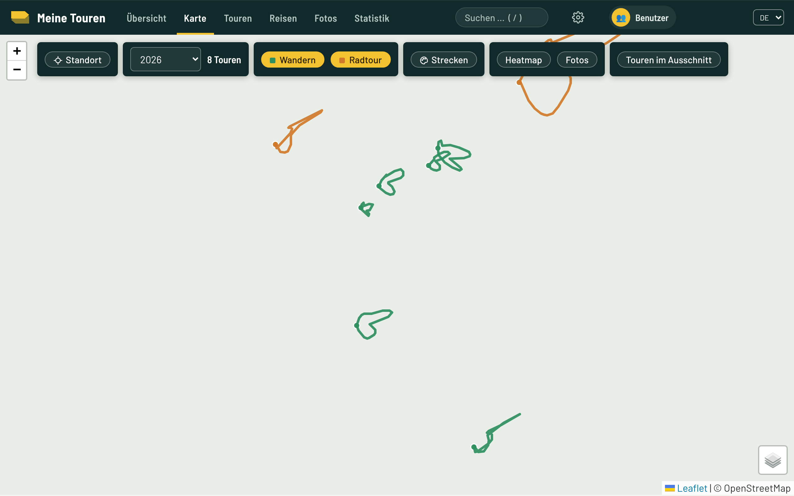 **Karte** – alle Touren auf einen Blick | 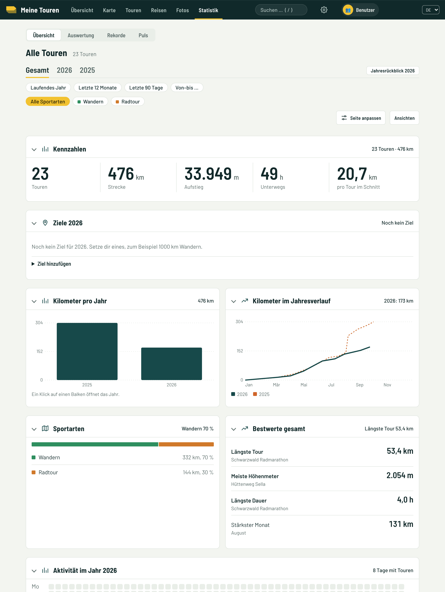 **Statistik** – Bausteine mit globalem Filter |
| 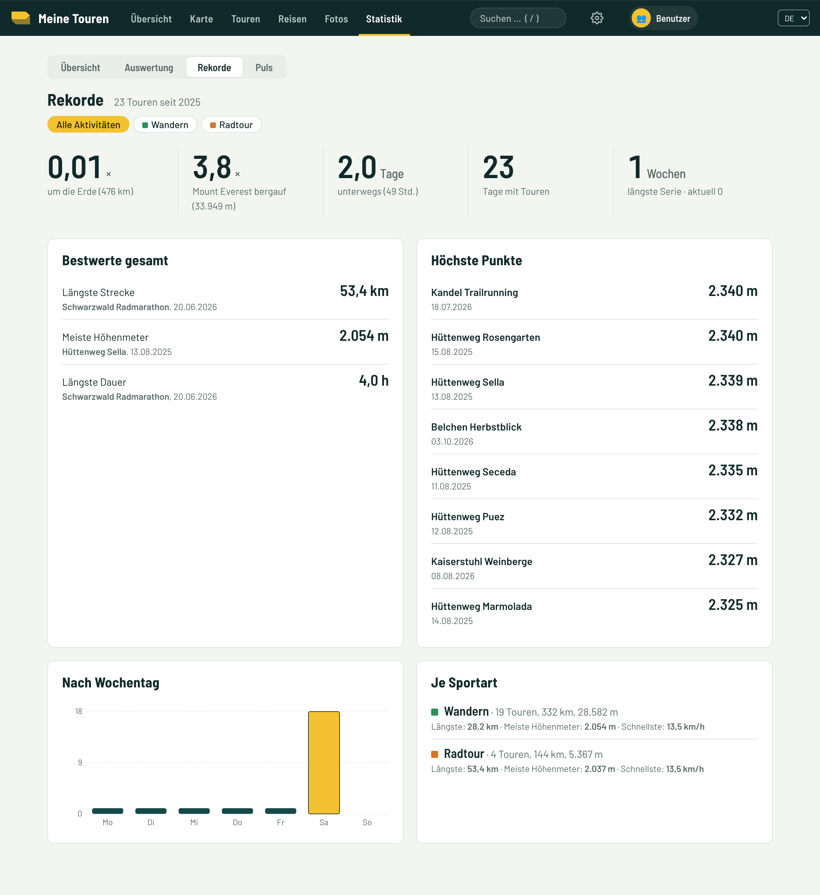 **Rekorde** (Statistik → Rekorde) | 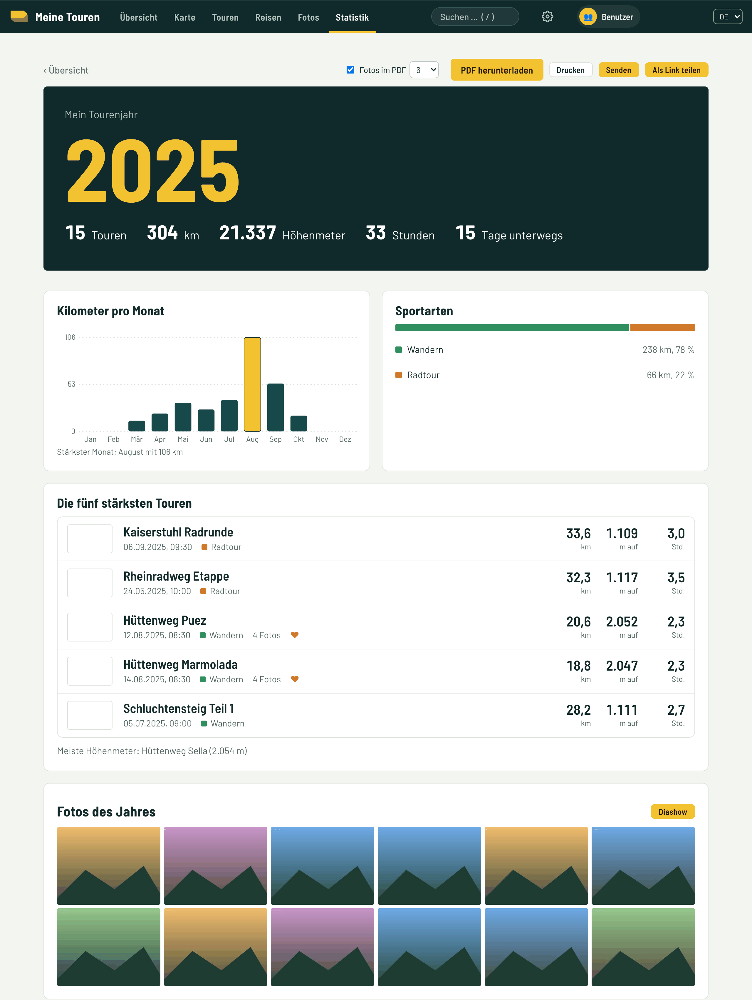 **Jahresrückblick** – auch als Link teilbar |
| 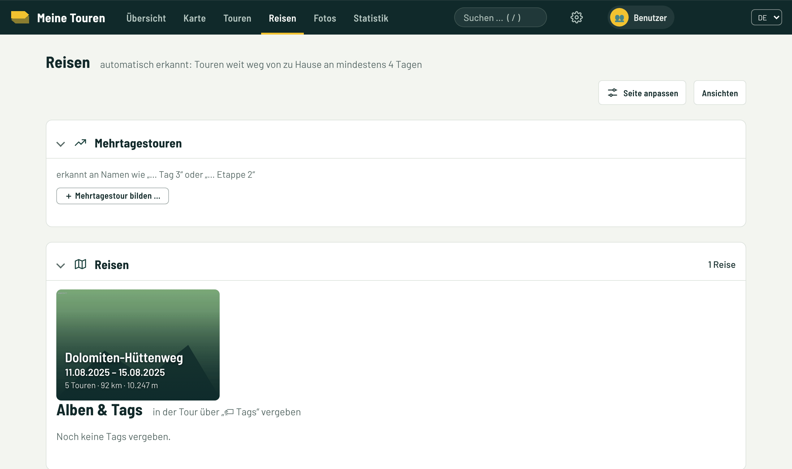 **Reisen** – automatisch erkannt, anpassbar | 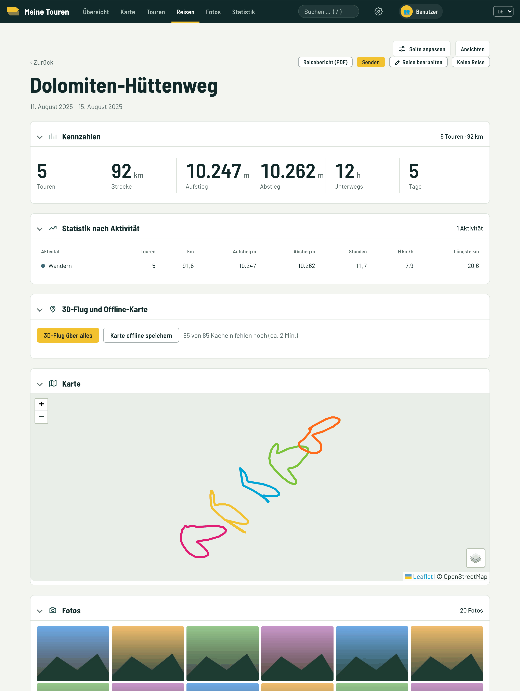 **Reise** – Kennzahlen, Karte, Fotos, Touren |
| 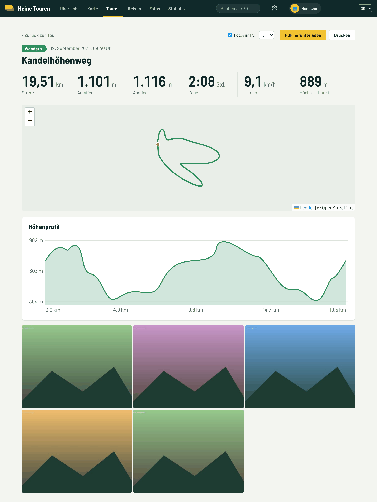 **Tourblatt** – druckbares Blatt einer Tour | 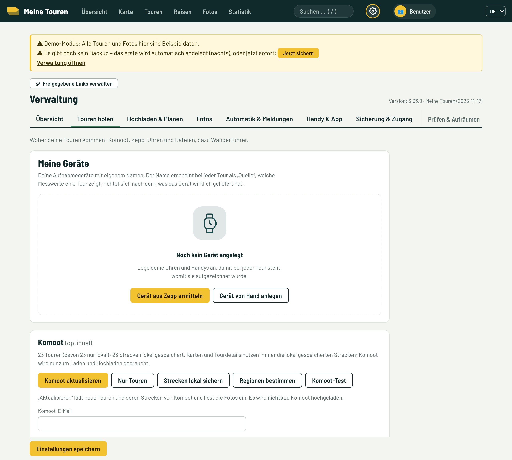 **Verwaltung** – übersichtlich in Reitern |

<p align="center">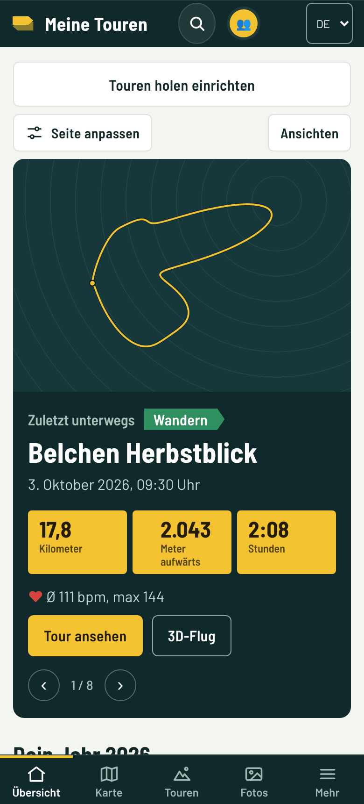<br><b>Handy-Ansicht</b></p>

## Installation auf Proxmox VE (empfohlen)

Auf dem **Proxmox-Host** (Shell) ausführen – der Assistent legt einen Debian-13-Container an und installiert alles darin:

```bash
bash -c "$(curl -fsSL https://raw.githubusercontent.com/hilde0407/meine-touren/main/ct/meine-touren.sh)"
```

Standard: unprivilegierter LXC, 2 Kerne, 2 GB RAM, 20 GB Disk (die komprimierten Fotos brauchen je nach Menge 4–8 GB), Port 80. „Advanced“ im Assistenten erlaubt eigene IP, Speicher usw. Danach `http://<Container-IP>/` öffnen – beim ersten Besuch legst du den Administrator an.

Das Skript nutzt – wie die Skripte von [community-scripts.org](https://community-scripts.org/) – deren Container-Engine. Sie lädt die Engine von `community-scripts/core` und sendet auf Wunsch anonyme Diagnosedaten (im Assistenten abwählbar); der eigentliche Installer liegt in diesem Repository (`install/meine-touren-install.sh`).

**Aktualisieren:** im Container `meine-touren-update github` – oder auf dem Proxmox-Host das Skript erneut starten und „Update“ wählen. Vor jedem Update wird automatisch ein Backup angelegt.

## Manuelle Installation (jeder Debian/Ubuntu-Server)

```bash
apt update && apt install -y git
git clone https://github.com/hilde0407/meine-touren.git && cd meine-touren
bash deploy/install.sh
```

Installiert Python-venv, nginx, den Systemdienst `meine-touren` und ein tägliches Backup (03:40 Uhr, 14 Stück in `/var/backups/meine-touren`). Programm: `/opt/meine-touren`, Daten: `/var/lib/meine-touren`, Einstellungen: `/etc/meine-touren.env`. Direkt ohne nginx: `http://<IP>:8080/`. Protokoll: `journalctl -u meine-touren -f`.

## Docker
Meine Touren läuft auch als Container (Linux-Image für `amd64` und `arm64`, also auch Raspberry Pi und Synology/QNAP mit Docker). Das Image wird bei jeder Release automatisch gebaut und liegt unter `ghcr.io/hilde0407/meine-touren`.

1. Ordner anlegen und die Datei [`docker-compose.yml`](docker-compose.yml) hineinkopieren.
2. `docker compose up -d` starten, dann `http://<Server>:8080` öffnen. Beim ersten Aufruf legst du den Administrator an.
3. **Daten** liegen im Ordner `./daten` (Volume `/data`: Datenbanken, Tracks, Fotos der App, Sicherungen, verschlüsselte Zugangsdaten). Diesen Ordner sicherst du regelmäßig; die App legt zusätzlich eigene Sicherungen darin ab.
4. **Originalfotos** (z. B. von einem NAS) bindest du mit `- /pfad/zu/fotos:/fotos:ro` ein und trägst in den Einstellungen den Ordner `/fotos` ein.
5. **Aktualisieren:** `docker compose pull && docker compose up -d`. Die Update-Schaltfläche in der Verwaltung zeigt neue Versionen an und nennt diesen Befehl, installiert aber nicht selbst.
6. **HTTPS und Zugriff von außen:** Setze `ports` auf `127.0.0.1:8080:8080` und veröffentliche den Port mit `tailscale serve --bg 8080` (siehe Abschnitt Tailscale) oder hinter einem Reverse-Proxy (Caddy, Nginx Proxy Manager). Der Container vertraut den `X-Forwarded-*`-Headern des Proxys, öffne ihn deshalb nicht ungeschützt ins Internet.
7. **Mit eingebautem Tailscale:** [`docker-compose.tailscale.yml`](docker-compose.tailscale.yml) startet neben der App einen Tailscale-Container. Einen Auth-Key in der Tailscale-Verwaltung erzeugen (*Settings → Keys*), dann `TS_AUTHKEY=tskey-auth-… docker compose -f docker-compose.tailscale.yml up -d`. Die App ist danach unter `https://touren.<dein-tailnet>.ts.net` erreichbar, ohne Port am Host. Voraussetzung wie oben: MagicDNS und HTTPS-Zertifikate im Tailnet aktiviert. Funnel ist ausgeschaltet; wer ihn will, setzt in `docker/tailscale-serve.json` `AllowFunnel` auf `true` und liest vorher die Risiken im Abschnitt Tailscale Funnel. Den Auth-Key danach nicht in Dateien im Repository speichern. Der Zustand liegt in `./ts-state`.
8. Selbst bauen statt ziehen: in der Compose-Datei `build: .` statt `image:` verwenden.

**TrueNAS SCALE (24.10 oder neuer):** *Apps → Discover Apps → Custom App (Install via YAML)*, den Inhalt von `docker-compose.yml` einfügen und anpassen: Port z. B. `30080:8080`, Volume auf ein eigenes Dataset (`/mnt/<Pool>/apps/meine-touren:/data`) und `PUID: 568`/`PGID: 568` (Benutzer „apps“). Das Dataset sollte dem Benutzer `apps` gehören. Das Start-Skript setzt die Rechte von `/data` beim Start selbst, solange das Dateisystem es zulässt. Der Pfad unterhalb von `/mnt/.ix-apps/` ist für eigene Daten ungeeignet. **Ausführliche Schritt-für-Schritt-Anleitung mit Tailscale, Funnel und 2FA: [docs/truenas-scale.md](docs/truenas-scale.md).**

Hinweise: Ein eigener BRouter-Server (Routenplanung) und das Einbinden von SMB-Freigaben per `mount` laufen nicht im Container. Dafür den BRouter als weiteren Container starten und dessen Adresse in den Einstellungen eintragen, die SMB-Freigabe auf dem Docker-Host einhängen und als `/fotos` durchreichen.

## Funktionen

* **Übersicht, Karte, Touren:** letzte Tour mit Karte und Fotos (zum Durchzappen), „Dein Jahr“ mit Vorjahresvergleich, Erinnerungen und „An diesem Tag“; alle Touren auf einer Karte; Tourseite mit Höhenprofil, Fotos an der Strecke, 3D-Flug und Diashow; Streckenfarbe frei wählbar.
* **Anpassbare Seiten (ab 3.17):** Tourseite, Übersicht, Statistik, Reise-Seite und Reisen-Übersicht über „Seite anpassen“ gestalten: Bausteine aus einem Katalog (je Seite passende), Raster mit wählbarer Breite, mehrere benannte **Ansichten**, fertige **Vorlagen**, Export/Import als Datei. Bausteine lassen sich einstellen (Aktivität, Zeitraum, Kennzahlen, Titel); **eigene Kennzahlen** und Hinweis-Bausteine (nur bei Anlass) gibt es dazu.
* **Statistik:** Übersicht, Auswertung (Tempo, Wetter, Neuland), Rekorde und Puls mit globalem Filter; Jahresrückblick, auch als Link teilbar und druckbar.
* **Lokale Strecken:** Karten und Tourdetails arbeiten nur mit gespeicherten Daten. Original-GPX lokaler Touren liegen im Datenordner und sind im Backup.
* **Import:** Zepp-Trainings (GPS als GPX), **Garmin, Suunto und andere Uhren** (FIT/GPX/TCX/ZIP, Garmin-Konto) mit einem Import-Knopf auf der Übersicht bzw. in der Kopfzeile, Komoot-Touren und -Strecken, Fotos (Browser-Upload mit Verkleinerung, Eingangsordner, SMB, Mac-Skript).
* **Uhren und Messwerte:** Messwerte der Geräte (Puls, Frequenz, Leistung …, nur was das Gerät lieferte), „Meine Geräte“ mit Genauigkeit, Training laut Uhr, Belastung und Tempo nach Steigung, Vergleich ähnlicher Touren.
* **Upload (nur auf ausdrücklichen Wunsch):** Komoot und Strava, einzeln oder gesammelt, mit Doppelten-Prüfung und Probelauf. GPX-Download jeder Tour.
* **Fotos:** automatisch über die Aufnahmezeit den Touren zugeordnet, manuelle Korrektur mit Zeitversatz, Karte mit Foto-Markern; Fotos lassen sich auf der Strecke „wie eine Perlenkette“ ausrichten.
* **Teilen:** Tour-Links (auch mit gewählter Ansicht), Jahresrückblick-Link, Diashow-Links für Tour, Jahr und Sammlung; alle Links unter „Freigegebene Links verwalten“, jederzeit widerrufbar.
* **Reisen:** Mehrtagesreisen weit weg von zu Hause werden erkannt (mindestens 4 Tage), Reise-Seite und Reisen-Übersicht sind anpassbar; Reisebericht als PDF.
* **Suche:** ohne Akzente und Apostrophe („reunion“ findet „Réunion“).
* **Android-App:** GPS-Aufzeichnung mit Sprachansagen, Offline-Speicher, Fotos während der Aufnahme, Teilen-Menü, Vollbild-Diashow (Abschnitt Android-App). Begleit-App: **Mein Tourentagebuch** ([hilde0407/mein-tourentagebuch](https://github.com/hilde0407/mein-tourentagebuch)).
* **Updates:** regelmäßige Prüfung auf GitHub, Installation per Knopfdruck (Administratoren), vorher automatische Sicherung.
* **Komfort:** Namensvorschläge aus Kartendaten/Wanderführern (z. B. Rother-GPX), Höhenkorrektur mit Geländemodell, Regionen-Suche, Alben, Tourplanung, Webhook-/ntfy-Benachrichtigung, PWA, Oberfläche auch auf Englisch, Französisch und Spanisch.
* **Mehrere Benutzer:** getrennte Touren, Fotos und Einstellungen je Benutzer; Fotos pro Bibliothek oder Tour für einzelne Benutzer oder alle freigeben.
* **Smartphone-Ansicht:** automatisch ab ≤ 760 px, umschaltbar.

**Ausführliches Handbuch mit Bildern:** [docs/HANDBUCH.md](docs/HANDBUCH.md) (Markdown) bzw. als [PDF](docs/Handbuch-Meine-Touren.pdf).

## Einrichten

1. `http://<IP>/` öffnen → Administrator anlegen (mind. 8 Zeichen Passwort).
2. *Verwaltung → Import*: Komoot-Zugang eintragen (optional) und „Komoot aktualisieren“, und/oder Zepp-Zugang bzw. GPX-Dateien importieren.
3. *Verwaltung → Upload-Portale → Strava*: eigene Strava-App anlegen (strava.com/settings/api), Client-ID/-Secret eintragen, „Mit Strava verbinden“.
4. Fotos: *Verwaltung → Fotos → „Ordner auswählen und hochladen …“* (im Browser verkleinert) oder `mac/fotos_senden.sh`.

## Daten, Backup, Update

* Pro Benutzer: `/var/lib/meine-touren/users/<Kennung>/` (Datenbank `komoot_hub.sqlite` – historischer Dateiname, Strecken, Fotos, `tracks/`). Gemeinsam: `system.sqlite` (Benutzer, Anmeldungen, Freigaben), `tilecache/`.
* Backups: `/var/backups/meine-touren/<Kennung>/…zip` (Datenbank + lokale GPX + System-Datenbank; Fotos nicht). Für einen Serverumzug: Verwaltung → „Umzugspaket erstellen“ (alles inkl. Fotos und Schlüssel). Wiederherstellen: `meine-touren-restore <datei.zip>`.
* **Sicherung zurückspielen (ab 3.40.0):** Administratoren können eine Tagessicherung auch in der Oberfläche zurückspielen: Verwaltung → Sicherung & Zugang → „Sicherung zurückspielen“. Sicherung des Servers wählen oder ZIP hochladen, das Ergebnis der Prüfung ansehen (Zahlen der Sicherung gegenüber heute), bestätigen. Vorher legt die App automatisch eine Sicherheitskopie des heutigen Stands an (in derselben Liste, „vor-wiederherstellung“), mit der sich der Schritt genauso rückgängig machen lässt. Ersetzt werden nur die eigenen Daten (Datenbank); Fotodateien, Zwischenspeicher, `secret.key` und die Benutzer bleiben, wie sie sind. Umzugspakete und Sicherungen anderer Benutzer weiterhin mit `meine-touren-restore`.
* **Bestehende Installation unter dem alten Namen „komoot-hub“** bleibt mit ihren Pfaden und Befehlen (`komoot-hub-update` …) erhalten; die Skripte erkennen das selbst.

## Hinweise

* Komoot und Zepp bieten keine offizielle Schnittstelle für Privatpersonen; die Anbindungen nutzen inoffizielle Aufrufe und können jederzeit brechen. Prüfe die Nutzungsbedingungen der Dienste. Strava wird über die offizielle API angebunden.
* Dieses Projekt steht in keiner Verbindung zu Komoot, Strava, Zepp/Huami, Proxmox oder community-scripts. Alle Marken gehören ihren Inhabern.
* Es wird nie etwas bei Komoot, Zepp oder im Originalfotoordner gelöscht.
* Die Oberfläche braucht Internet für Kartenkacheln (OpenStreetMap u. a.), Höhen-/Wetterdaten und Ortsnamen (Open-Meteo, Nominatim, Overpass). Bitte die jeweiligen Nutzungsrichtlinien beachten.
* Läuft im Heimnetz; für Zugriff von außen ein VPN oder Reverse-Proxy mit HTTPS davorschalten.

## Versionsverlauf

Neueste zuerst. Alle Versionen (bis 1.3) in **[docs/VERSIONSVERLAUF.md](docs/VERSIONSVERLAUF.md)**, Einzelbeschreibungen ab 3.7.2 in [docs/versionen/](docs/versionen/README.md).

* [3.33.0](docs/versionen/3.33.0.md) – Reisen als anpassbare Seiten (Bausteine, Ansichten, Vorlagen)
* [3.32.0](docs/versionen/3.32.0.md) – Erinnerungen-Kachel einstellbar
* [3.31.0](docs/versionen/3.31.0.md) – Import-Knopf je nach Uhr, Suche ohne Akzente (3.31.1: Tourname in Diashow-Links)
* [3.30.0](docs/versionen/3.30.0.md) – Zepp-Import auf der Übersicht
* [3.29.0](docs/versionen/3.29.0.md) – Diashow-Link für Jahr und Sammlung, Baustein „Ziele“
* [3.28.0](docs/versionen/3.28.0.md) – Eigene Kennzahlen
* [3.27.0](docs/versionen/3.27.0.md) – Geschwindigkeit bei vielen Touren, Vollbild in der Android-App
* [3.26.0](docs/versionen/3.26.0.md) – Jahresrückblick als teilbare Seite
* [3.25.0](docs/versionen/3.25.0.md) – Teilen mit Ansicht
* [3.24.0](docs/versionen/3.24.0.md) – Qualität und Feinschliff (3.24.1: zwei Fehler behoben)
* [3.23.0](docs/versionen/3.23.0.md) – Hinweis-Bausteine
* [3.22.0](docs/versionen/3.22.0.md) – Statistik als anpassbare Seite mit globalem Filter
* [3.21.0](docs/versionen/3.21.0.md) – Ansichten, Vorlagen, Export
* [3.17.0](docs/versionen/3.17.0.md) bis [3.20.0](docs/versionen/3.20.0.md) – Seite anpassen, Bausteine, Raster
* [3.9.0](docs/versionen/3.9.0.md) bis [3.16.1](docs/versionen/3.16.1.md) – Messwerte, Meine Geräte, Genauigkeit der Uhren, neue Tourseite
* 3.0 – die App begleitet die ganze Tour (Offline, Live-Ansicht, Sprachansagen) · 2.0 – Android-App · 1.x – Grundfunktionen, PDF-Berichte, Tourplanung

## Entwicklung

```bash
pip install -r requirements-dev.txt && python -m playwright install chromium
python scripts/test.py        # parallel, mit Wiederholung wackliger Tests wie in der CI (Hinweise: tests/README.md)
DATA_DIR=/tmp/mt uvicorn app.main:app --port 8080
```

Quellen/Lizenzen: Zepp-Anmeldung nach *huami-token* (MIT), Spurdekodierung nach *Mi-Fit-and-Zepp-workout-exporter* (MIT) und *MiFitDataExport*; Karten mit Leaflet (BSD-2) und MapLibre GL (BSD-3), Schrift Barlow (SIL OFL) – im Paket enthalten. Proxmox-Skripte im Stil von [community-scripts](https://github.com/community-scripts/ProxmoxVE) (MIT). Lizenz dieses Projekts: [MIT](LICENSE).

## Foto-Zeit-Abgleich (Mac, optional)

`mac/foto_zeit_abgleich.py` korrigiert die Aufnahmezeit exportierter JPEGs (z. B. aus Lightroom) anhand der RAW-Originale (ARW).
Festplatten nacheinander einlesen (`index /Volumes/Platte1`), dann `check` (nur Bericht) bzw. `fix` für den JPEG-Ordner; `undo` macht den letzten Lauf rückgängig. Nur Python 3 nötig. Details: `python3 mac/foto_zeit_abgleich.py -h`.

## Hilfe gesucht: Garmin und Suunto testen

Der Import von **Garmin-** und **Suunto-Aktivitäten** (FIT/GPX/TCX-Dateien und die Suunto-Anbindung) ist bisher nur mit selbst erzeugten Testdateien geprüft, nicht mit echten Geräten. Wer eine Garmin- oder Suunto-Uhr hat und die App ausprobiert, würde sehr helfen:

1. Eine echte Aktivität importieren (Verwaltung → Touren & Quellen → Garmin, Suunto & andere Uhren).
2. Prüfen, ob Strecke, Dauer, Aufstieg und Sportart stimmen.
3. Rückmeldung als [GitHub-Issue](https://github.com/hilde0407/meine-touren/issues) geben – auch „hat gut funktioniert“ ist hilfreich. Bitte Gerätemodell, Dateiformat und App-Version nennen. Falls möglich, eine (anonymisierte) Beispieldatei anhängen.

## Lokal auf Windows

Für Tests oder den Einsatz auf einem einzelnen PC (der Dauerbetrieb gehört weiterhin auf einen Server).

1. Python 3.10 oder neuer installieren: `winget install Python.Python.3.12`
2. ZIP/Release entpacken und im Ordner `windows` die Datei `Meine-Touren-lokal.bat` doppelklicken. Beim ersten Start wird alles eingerichtet (eigene Python-Umgebung unter `%LOCALAPPDATA%\meine-touren-venv`).
3. Der Browser öffnet sich auf `http://localhost:8080` (anderer Port: `Meine-Touren-lokal.bat 9000`).

Daten liegen in `%USERPROFILE%\Meine-Touren-Daten` (Umgebungsvariable `MT_DATA` ändert das), die Fotoquelle ist standardmäßig „Eigene Bilder“ (`MT_FOTOS`). Updates lassen sich in der Oberfläche installieren; das Fenster startet die App danach selbst neu. Die automatischen Tests laufen bei jedem Commit auch auf Windows (GitHub Actions); unter **Windows 11** wurde Version 1.7.3 praktisch erprobt, es wurden keine Fehler gefunden (Stand 6. November 2026).

## Lokal auf dem Mac

Ohne Server: ZIP entpacken, im Ordner `mac` die Datei `Meine-Touren-lokal.command` per Doppelklick starten
(beim ersten Mal Rechtsklick → Öffnen). Sie richtet eine Python-Umgebung ein (Python ≥ 3.10, z. B. `brew install python`),
startet die App auf <http://127.0.0.1:8080> und öffnet den Browser. Die Daten liegen getrennt vom Server in
`~/Meine-Touren-Daten` (anderer Ort: Umgebungsvariable `MT_DATA`). Die Mac-Version nutzt dieselben Funktionen
(Komoot/Zepp-Import, Auswertung, Karte); Fotos per Browser-Upload oder Ordner einlesen.

### Foto-Werkzeuge für den Mac (Ordner `mac/`)

- `foto_auswahl.py` – wählt aus Lightroom-Fotos je Tag die besten aus und exportiert sie als druckfertige JPEGs nach `Aktivitäten/Jahr/Monat/Tag`.
- `foto_zeit_katalog.py` – ergänzt fehlende Aufnahmezeiten in exportierten JPEGs aus dem Lightroom-Katalog (`--undo` macht den letzten Lauf rückgängig).
- `foto_gps.py` – ergänzt GPS in den JPEGs aus den Strecken von „Meine Touren“: Die Aufnahmezeit wird mit den Tourzeiten verglichen, die Position auf der Strecke interpoliert. Probelauf ohne Option, `--anwenden` schreibt, `--undo` macht rückgängig. Fotos außerhalb jeder Tour (± 10 min) bleiben ohne GPS und stehen in `ohne_gps.txt`.

### Daten in eine neue Installation übernehmen

Den Datenordner der alten Installation (Standard `/var/lib/meine-touren`, enthält `system.sqlite` und `users/`) auf die neue Installation kopieren, **bevor** sie zum ersten Mal gestartet wird – oder bei gestoppter App – und die Rechte dem Dienstbenutzer geben. Einzelne Benutzer lassen sich über den Ordner `users/<name>` mitnehmen; Sicherungen (`*.zip`) enthalten dieselben Daten und können in der Verwaltung zurückgespielt werden.

### Foto-Auswahl in Meine Touren übernehmen

Die exportierten Fotos aus `Aktivitäten/` lassen sich über den Eingangsordner (`inbox/` des Benutzers, Standard `~/Meine-Touren-Daten/users/<Name>/inbox`) importieren: Dateien dorthin kopieren, Meine Touren erkennt sie nach wenigen Minuten selbst und ordnet sie den Touren zu. Alternativ in der Verwaltung „Fotos aus Ordner übernehmen“ (Ordner wählen).

`foto_gps.py` kennt zusätzlich `--tagesort` (Fotos ohne Tour erhalten die mittlere Position der GPS-Fotos desselben Tagesordners) und `--orte datei.csv` (Zeilen `JJJJ-MM-TT;Breite;Länge`, auch `JJJJ-MM` oder `JJJJ`).

## Garmin, Suunto und andere Uhren

**Verwaltung → „Garmin, Suunto & andere Uhren“.** Alles landet als *lokale* Tour (mit Doppelten-Prüfung gegen vorhandene Touren); zu Komoot/Strava wird nur auf ausdrücklichen Wunsch hochgeladen.

1. **Dateien (funktioniert immer, für jeden Hersteller):** FIT-, GPX-, TCX- oder ZIP-Dateien importieren. Eine ZIP darf beliebig viele Aktivitäten enthalten, auch verschachtelt – also genau das, was Garmin als Gesamtexport schickt. FIT-Dateien werden ohne Zusatzpaket gelesen (Sportart, GPS, Höhe); Dateien ohne GPS (Schlaf, Alltag, Indoor) werden übersprungen und gezählt.
   * *Garmin, alles:* [garmin.com/account/datamanagement](https://www.garmin.com/account/datamanagement/) → „Daten exportieren“ (Garmin schickt nach 1–2 Tagen eine ZIP per E-Mail).
   * *Garmin, einzeln:* Garmin Connect → Aktivität → ⚙ → „Original exportieren“ oder GPX.
   * *Suunto:* Suunto-App → Training → ⋮ → Exportieren → FIT oder GPX.
   * *Große ZIP-Dateien* (über 1 GB) statt per Browser einfach in den Ordner `inbox/touren/` des Benutzers legen; sie werden automatisch übernommen und nach `erledigt/` verschoben.
2. **Garmin-Konto (experimentell):** Anmeldung wie im Browser mit E-Mail und Passwort (inkl. Zwei-Faktor-Code) über das optionale Paket [`garminconnect`](https://github.com/cyberjunky/python-garminconnect) (braucht Python ≥ 3.12; `install.sh` versucht es zu installieren, sonst `pip install -r requirements-optional.txt` im venv). Das Passwort wird nicht gespeichert, nur der Anmelde-Schlüssel (verschlüsselt). Garmin bietet Privatpersonen **keine offizielle Schnittstelle**; die Anmeldung kann sich ändern oder zeitweise mit HTTP 429 gebremst werden – der Dateiweg bleibt davon unberührt. Optional: nur ab einem Datum, täglich automatisch.
3. **Suunto-Konto (nur mit API-Zugang):** Suunto vergibt seine Cloud-API ausschließlich an Firmen/Organisationen ([Partnerprogramm](https://apizone.suunto.com/how-to-start)), nicht an Privatpersonen. Wer einen Zugang hat, trägt Client-ID, Client-Secret und Subscription-Key ein und verbindet per OAuth.
4. **Über Komoot:** Garmin Connect und die Suunto-App können direkt mit Komoot verbunden werden; dann erscheinen die Touren ohnehin über „Komoot aktualisieren“.

> Garmin- und Suunto-Anbindung konnten vom Autor mangels Uhren nicht gegen echte Konten getestet werden; die Tests laufen gegen nachgebaute Antworten, der FIT-Leser gegen eine unabhängig erzeugte FIT-Datei. Rückmeldungen und Beispiel-Dateien sind willkommen.

## Fotos importieren und zuordnen

**Fotos → „Fotos importieren …“** (auch in der Verwaltung und im Tourdetail unter „Fotos hinzufügen …“): Ordner oder einzelne Fotos auswählen oder einfach ins Fenster ziehen. Die App liest Aufnahmezeit und Aufnahmeort aus den Bildern und zeigt vorab **je Aufnahmetag**, welcher Tour die Fotos zugeordnet werden; pro Tag lässt sich die Auswahl ändern („nach Uhrzeit“, andere Tour, „ohne Tour“, „nicht importieren“). Ein Klick startet den Import, danach steht da, wie viele Fotos Touren zugeordnet wurden.

Die Zuordnung nutzt Zeit **und** Ort: Überlappen sich Touren, entscheidet der Abstand des Fotos zur Strecke; ein Foto, das weit (über 10 km) von der Strecke aufgenommen wurde, wird nicht zugeordnet. Geht die Kamerauhr falsch (Zeitzone, nie gestellt), erkennt die App das an den Fotos mit Aufnahmeort und bietet beim Import eine **minutengenaue Zeitkorrektur** an; bei bereits importierten Fotos prüft **„Zeit per GPS prüfen“** im Tourdetail die Uhrzeiten und korrigiert sie nach Rückfrage.

## Fotos auf der Strecke ausrichten

Im Tourdetail öffnet **„📍 Fotos ausrichten“** die Karte im Ausrichtungsmodus: Ein Foto wird auf die Stelle der Strecke gezogen, an der man sicher ist, dass es dort entstand; alle anderen Fotos wandern wie auf einer Perlenkette im gleichen zeitlichen Abstand mit (mit Uhrzeit-Beschriftung). „Speichern“ verschiebt die Aufnahmezeiten dauerhaft um diesen Betrag (wahlweise auch die anderen Fotos desselben Tages); „Original-Zeiten“ nimmt jede Verschiebung zurück. Voraussetzung: die Strecke enthält Zeitstempel.

## Android-App

Im Ordner `android/` liegt eine kleine native Android-App („Hülle“) um die Weboberfläche. Sie bringt, was eine Webseite nicht kann:

- **GPS-Aufzeichnung** mit Vordergrunddienst – läuft auch bei ausgeschaltetem Bildschirm. Menüpunkt „● Aufzeichnen“ (erscheint nur in der App): Sportart wählen, Start, live Zeit/Strecke/Aufstieg und Karte, Pause, Beenden, dann „Auf den Server speichern“. Wird der Server nicht erreicht, bleibt die Aufzeichnung auf dem Handy erhalten.
- **Teilen-Menü**: GPX/FIT/TCX/ZIP und Fotos aus anderen Apps direkt an Meine Touren senden (auch über HTTP, ohne HTTPS).
- **PDF-Downloads** landen im Download-Ordner des Handys.
- Die Serveradresse (auch `http://192.168.178.230`) wird beim ersten Start eingegeben und lässt sich in der Verwaltung ändern.
- Weitere Funktionen seit der ersten Fassung (Foto aufnehmen während der Aufzeichnung, Sprachansagen, Offline-Speicher, Wegpunkte, Wetterwarnung, Live-Standort-Link, Betrachter-Rolle, Push-Meldungen) sind im [Versionsverlauf](docs/VERSIONSVERLAUF.md) beschrieben (Versionen 2.1 bis 3.0).

**APK bauen:** Die APK entsteht auf GitHub (Actions → „Android-App“ → *Run workflow*, oder automatisch bei jeder Veröffentlichung; sie wird dann an das Release angehängt). Ohne Signierschlüssel wird eine Debug-APK gebaut – die lässt sich ebenfalls installieren („Aus unbekannten Quellen“ erlauben). Für eine signierte Release-APK unter *Settings → Secrets → Actions* hinterlegen: `ANDROID_KEYSTORE_BASE64`, `ANDROID_KEYSTORE_PASSWORD`, `ANDROID_KEY_ALIAS`, `ANDROID_KEY_PASSWORD`.

**Wichtig:** Hersteller wie Xiaomi, Samsung oder Huawei beenden Hintergrunddienste teils aggressiv. Für zuverlässige Aufzeichnungen die Akku-Optimierung für die App ausschalten (Verwaltung → Android-App → „Akku-Einstellungen“). Die App wurde ohne echtes Gerät entwickelt; bitte zuerst eine kurze Testrunde machen.

### Handy und HTTPS
Android installiert die App nur bei einer **gesicherten Adresse (HTTPS)** wirklich – bei `http://192.168…` entsteht nur eine Verknüpfung ohne Teilen-Menü. Der einfachste Weg ist **Tailscale** (kostenlos), siehe unten. Alternativ ein Reverse-Proxy mit eigener Domain (Caddy, Nginx Proxy Manager).

## Tailscale einrichten (privater Zugriff von unterwegs)
Tailscale verbindet deine eigenen Geräte über ein privates Netz (Tailnet), ohne dass du am Router einen Port öffnest. Nur Geräte, die mit deinem Konto angemeldet sind, kommen an den Server.

1. **Konto anlegen** auf https://login.tailscale.com (Anmeldung über Google, Microsoft, Apple oder GitHub; der Tarif „Personal“ ist kostenlos).
2. **Auf dem Server installieren** (Proxmox-Container oder Debian/Ubuntu): `curl -fsSL https://tailscale.com/install.sh | sh`, danach `tailscale up` und den angezeigten Link im Browser bestätigen. In einem LXC-Container muss zuvor das TUN-Gerät freigegeben sein (Container → Optionen → Features, oder `/dev/net/tun` in der Container-Konfiguration durchreichen).
3. **Auf dem Handy und Mac** die Tailscale-App installieren und mit demselben Konto anmelden.
4. **HTTPS aktivieren:** In der Tailscale-Verwaltung (Admin Console → DNS) „MagicDNS“ und „HTTPS Certificates“ einschalten.
5. **App nur im Tailnet bereitstellen:** auf dem Server `tailscale serve --bg 80` (Meine Touren lauscht auf Port 80; bei anderem Port die Nummer anpassen). `tailscale serve status` zeigt die Adresse, etwa `https://touren.dein-tailnet.ts.net`.
6. **Am Handy** diese Adresse öffnen (Tailscale muss dort aktiv sein) und in der Android-App als Serveradresse eintragen. Das Zertifikat ist gültig, die App lässt sich normal installieren.

Das ist die empfohlene Einstellung: Die Adresse ist nur für deine eigenen Geräte erreichbar. Beenden mit `tailscale serve reset`.

## Tailscale Funnel (öffentlich im Internet erreichbar)
Mit **Funnel** wird dieselbe Adresse für jeden im Internet erreichbar, auch ohne Tailscale. Das braucht man nur, wenn Empfänger ohne Konto etwas öffnen sollen: Teilen-Links einer Tour, die Diashow, der **Live-Standort-Link** oder der Link zur Erzählung.

- **Einschalten:** In der Admin Console → *Access controls* muss Funnel für das Gerät erlaubt sein (Attribut `funnel` in der Richtlinie; beim ersten Aufruf von `tailscale funnel` wird der Link zur Freigabe angezeigt). Dann `tailscale funnel --bg 80`. Funnel erlaubt die Ports 443, 8443 und 10000. `tailscale funnel status` zeigt, was offen ist.
- **Ausschalten:** `tailscale funnel --bg 80 off` bzw. `tailscale funnel reset`. Danach ist wieder nur das Tailnet verbunden (`tailscale serve --bg 80`).

**Risiken – bitte vorher lesen:**
- **Die ganze Anmeldeseite ist öffentlich.** Funnel leitet den Port der App weiter, nicht nur die Teilen-Links. Jeder, der die Adresse kennt oder findet, sieht die Login-Seite und kann Passwörter durchprobieren. Adressen mit `ts.net` sind zudem über die öffentlichen Zertifikatslisten (Certificate Transparency) auffindbar, die Adresse ist also nicht geheim.
- **Starke Passwörter und Konten:** Lege mindestens ein Konto mit langem, einmaligem Passwort an (*Verwaltung → Benutzer*), keine Standardpasswörter. Nutze nach Möglichkeit Funnel nur zeitweise, solange ein Link gebraucht wird.
- **Teilen-Links sind Links ohne Anmeldung.** Wer den Link hat, sieht den Inhalt (bei Touren sind Anfang und Ende ausgeblendet; beim Live-Standort der letzte gemeldete Punkt). Links lassen sich widerrufen, Live-Links laufen nach der gewählten Zeit ab. Poste sie nicht öffentlich und gib sie nur an Personen weiter, denen du den Standort anvertraust.
- **Datenschutz:** Fotos, Orte und Gewohnheiten (wann und wo du unterwegs bist) sind sensibel. Ein öffentlicher Server ist ein Ziel für Scanner und Bots.
- **Software aktuell halten:** Spiele Updates (*Verwaltung → Update*) und Betriebssystem-Updates zeitnah ein; ein öffentlich erreichbarer Dienst ist der erste Angriffspunkt, wenn eine Lücke bekannt wird.
- **Bandbreite und Zuverlässigkeit:** Funnel ist für gelegentliche Nutzung gedacht und hat Datenlimits; es ist kein Ersatz für einen Webserver. Fällt der Server aus, sind die Links tot.
- **Keine Sicherung durch Tailscale:** Funnel verschlüsselt die Übertragung (HTTPS), schützt aber nicht vor schwachen Passwörtern oder Fehlern in der App.

Faustregel: im Alltag nur `tailscale serve` (privat). `tailscale funnel` nur einschalten, wenn jemand ohne Tailscale einen Link öffnen soll, und danach wieder ausschalten. In *Verwaltung → Standort teilen* steht „Aus“ für den Normalbetrieb.

## GPS-Track korrigieren

Im Tourdetail öffnet **„🧹 Track korrigieren“** (und in Prüfen → Unplausible Touren der gleichnamige Knopf, bei ausgeblendeten Touren „Einblenden & Track korrigieren“) eine Karte mit den Auffälligkeiten:

* **Ausreißer** (rot): Punkte, die mit unmöglichem Tempo vom Weg wegspringen und dann zurückkehren. Sie werden aus dem Track gelöscht, die Länge sinkt entsprechend.
* **Schnelle Abschnitte** (orange): längere Stücke dauerhaft über dem zur Sportart passenden Tempo (Wandern ab 9 km/h, Laufen 20, Rad 45), z. B. Seilbahn, Bus oder Auto. Pro Abschnitt wählbar: als Fahrt aus **Strecke und Dauer** herausrechnen (der Weg bleibt sichtbar) oder behalten.

Das Original bleibt erhalten (**„Original wiederherstellen“**). Bei Komoot-Touren gilt die Korrektur nur hier und bleibt beim Abgleich erhalten, solange Komoot die Länge nicht selbst ändert. Ohne Zeitstempel im Track lassen sich nur große Sprünge erkennen.

## Updates aus der Oberfläche

Die App prüft alle 6 Stunden auf GitHub, ob eine neuere Version veröffentlicht ist (abschaltbar), und weist Administratoren darauf hin (Hinweisleiste, Verwaltung → Updates, optional Webhook). **„Installieren“** legt zuerst eine Sicherung für jeden Benutzer an und installiert dann:

* *Proxmox/Server:* Die App läuft ohne Root-Rechte und schreibt nur die gewünschte **Versionsnummer** nach `<Datenordner>/update-request`. Der kleine Systemdienst `<name>-update.path` (wird von `install.sh` eingerichtet) startet daraufhin `<name>-update auto` als root, das die Version `vX.Y.Z` selbst von GitHub lädt, prüft, dass sie neuer ist, und wie gewohnt installiert. Die App kann also keinen eigenen Programmcode einschleusen. **Einmalig** muss ein bestehender Container noch von Hand auf diese Version gebracht werden (`meine-touren-update github`); danach klappt es per Knopfdruck. Ablauf und Fehler stehen unter `journalctl -u meine-touren-update`.
* *Mac-Testversion:* Die App ersetzt ihre Programmdateien (alte Fassung in `.vorher/`) und startet über `Meine-Touren-lokal.command` neu.

## Verwaltung → Zustand

Die Verwaltung zeigt oben eine Zustandsprüfung (Komoot-Zugang, Backup, Datenbankgröße, freier Speicher, Touren ohne Strecke, Fotos ohne Tour) und – siehe unten – auf neuere Versionen auf GitHub.

## Zugangsdaten verschlüsselt

Komoot-Passwort, Strava- und Zepp-Zugangsdaten liegen verschlüsselt (AES-256-GCM) in der Datenbank. Der Schlüssel steht in `<Datenordner>/secret.key` (wird beim ersten Start angelegt, nur für den Dienstbenutzer lesbar) oder – wenn gesetzt – in der Umgebungsvariable `MT_SECRET_KEY`. Die Schlüsseldatei ist absichtlich **nicht** Teil der Sicherungen. Wer eine Sicherung auf einem neuen Rechner einspielt, kopiert `secret.key` mit oder gibt die Zugangsdaten danach in der Verwaltung neu ein. Vorhandene Klartext-Einträge älterer Versionen werden beim ersten Lesen automatisch verschlüsselt.

## Hinter einem Reverse-Proxy (`TRUST_PROXY`)

Die Anmeldesperre (nach sechs Fehlversuchen) und die Drosselung arbeiten je Name und Client-Adresse. Läuft die App hinter Nginx, Caddy, Traefik, Docker oder Tailscale Serve, sieht sie sonst bei allen dieselbe Adresse. Mit der Umgebungsvariable `TRUST_PROXY=1` wird der letzte Eintrag des Headers `X-Forwarded-For` verwendet. Standard ist **aus**; nur setzen, wenn die App ausschließlich über den eigenen Proxy erreichbar ist, der den Header selbst setzt.

## Eigener BRouter-Server (Routenplanung ohne brouter.de)

Auf dem Server (Debian/Ubuntu, z. B. dem Proxmox-Container) als root:

```bash
bash deploy/brouter/install-brouter.sh                 # Standard: Deutschland/Alpenraum
bash deploy/brouter/install-brouter.sh E5_N45 W20_N25  # oder eigene 5°×5°-Kacheln
```

Das Skript installiert Java, lädt BRouter 1.7.7 und die Kartenkacheln (je ca. 100–400 MB, nur die, die du brauchst – Kachelname = untere linke Ecke, z. B. `W20_N25` für die Kanaren) und richtet den Dienst `brouter` auf Port 17777 ein. Danach unter Verwaltung → „Routenplanung“ eintragen: `http://<Server-IP>:17777/brouter`. Weitere Kacheln später mit `install-brouter.sh --nur-kacheln …`. Es verlassen dann keine Koordinaten mehr das Heimnetz.

## Für Entwickler

- Oberfläche ohne Build-Schritt: `app/static/js/00-…` bis `62-…` (plus `seite-*.js`) werden in der Reihenfolge der `<script>`-Einträge von `index.html` geladen (gemeinsamer globaler Bereich). Formatierung mit Prettier (`.prettierrc`): `npx prettier --write app/static/js/*.js`.
- Aufbau des Servers: `app/main.py` hält Start, Schutz-Header und den Verteiler. Jeder Bereich liegt in einem eigenen Modul mit eigenem `APIRouter`:
  `sync.py` (Komoot/Zepp holen), `puls.py` (Herzfrequenz), `gipfel.py` (Gipfelnamen), `wiederholungen.py` (gleiche Strecke mehrfach),
  `wanderfuehrer.py` (Buchtouren erkennen), `selbsttest.py` (Prüfung ohne Änderung), `photos.py`, `pdfgen.py`, `trackfix.py`, `security.py`, `users_api.py`.
  `extras.py`, `more.py` und `more2.py` sind historisch gewachsene Sammelstellen, aus denen Stück für Stück eigene Module herausgelöst werden;
  die gewohnten Namen bleiben dort über `__getattr__` erreichbar, damit nichts bricht.
- Tests: `python scripts/test.py` (oder `python -m pytest -q tests`) – darunter Browsertests mit Playwright (`pip install -r requirements-dev.txt && python -m playwright install chromium`), die jede Ansicht mit Beispieldaten öffnen und auf JavaScript-Fehler prüfen. Helfer, Regeln gegen wacklige Tests und Stresstest: [tests/README.md](tests/README.md).
