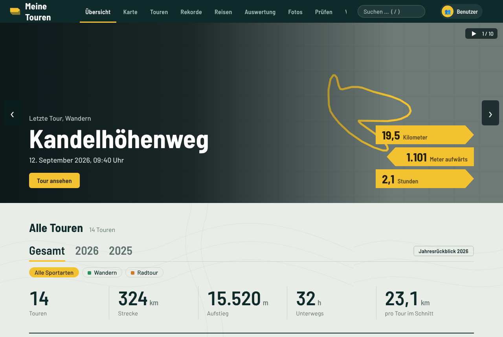
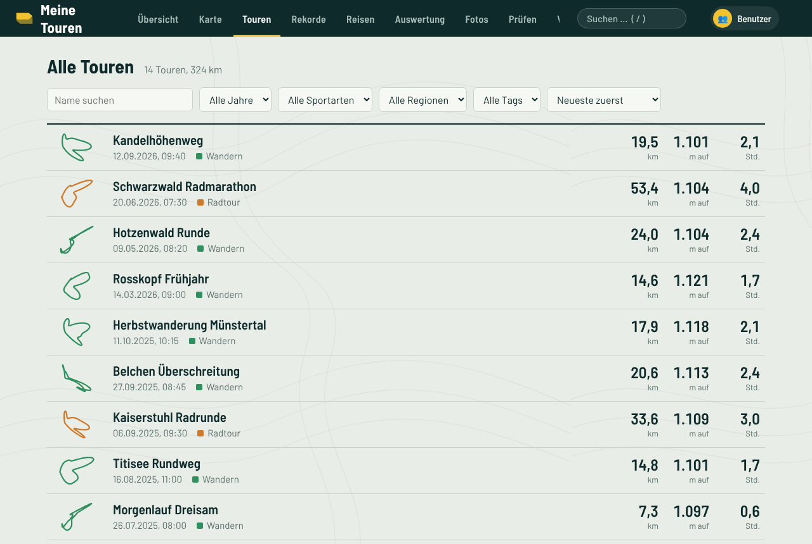
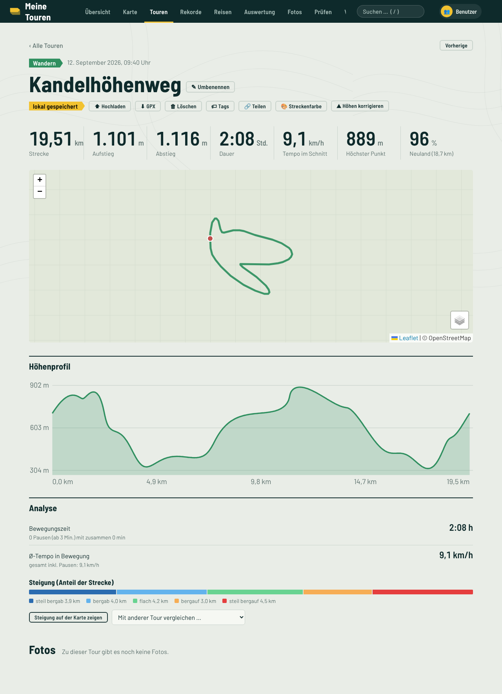
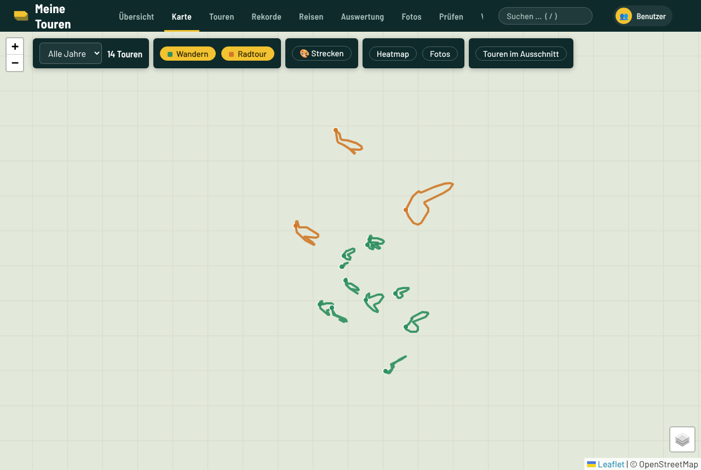
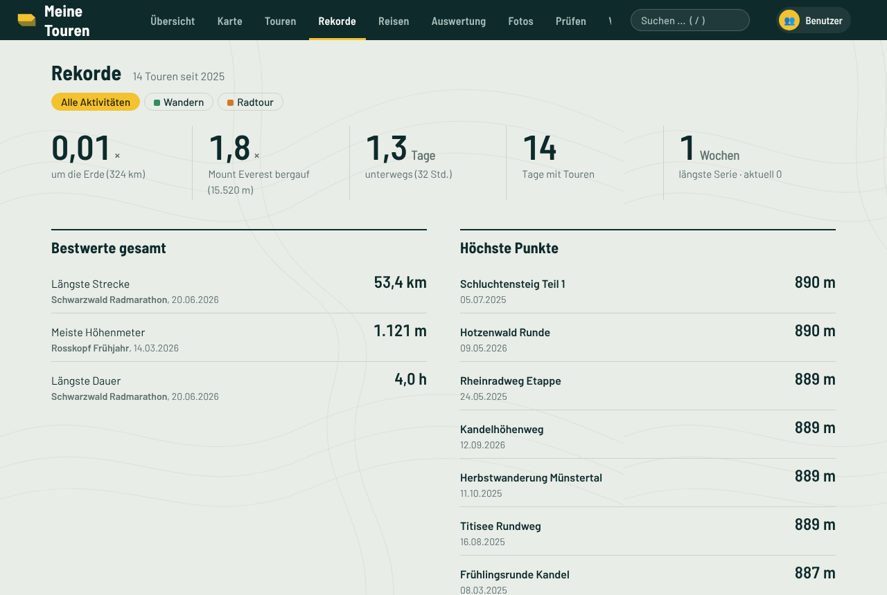
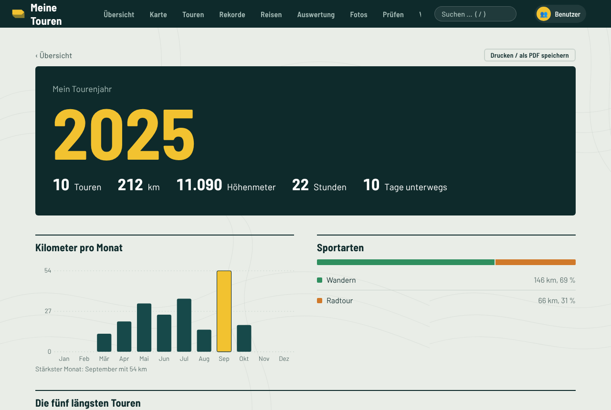
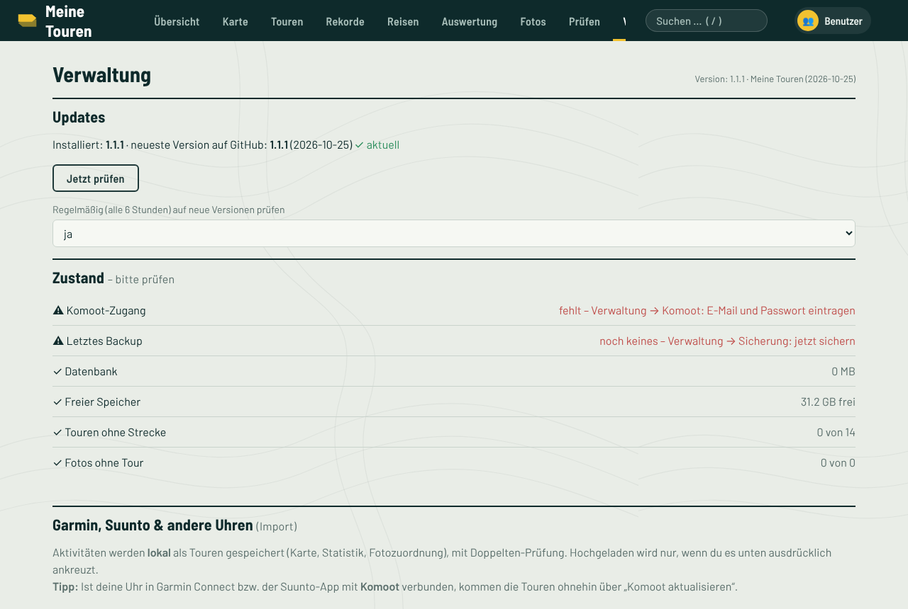
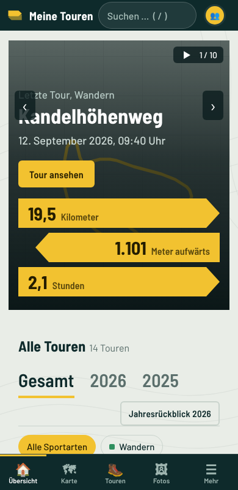

# Meine Touren – Kurzanleitung mit Bildern

Meine Touren sammelt deine Wander-, Rad- und Laufaktivitäten auf deinem eigenen Server oder PC: Karte, Höhenprofil, Statistik, Rekorde, Jahresrückblick und Fotos – ohne Cloud-Zwang. Die Bilder unten zeigen Beispieldaten; die Kartenkacheln fehlen in den Aufnahmen (in der echten App siehst du OpenStreetMap bzw. OpenTopoMap).

## 1. Übersicht

Oben die letzte Tour mit Strecke, Aufstieg und Dauer, darunter deine Gesamtstatistik. Mit den Reitern wechselst du zwischen Gesamt und einzelnen Jahren, mit den Schaltflächen filterst du nach Sportart. „Jahresrückblick“ öffnet die Zusammenfassung des Jahres.

## 2. Alle Touren

Die Liste aller Aktivitäten – sortier- und filterbar. Ein Klick öffnet die Tour. Über die Suche oben (Taste `/`) findest du Touren nach Name, Ort oder Tag.

## 3. Eine Tour

Kopfzeile mit den wichtigsten Werten, darunter Karte, **Höhenprofil** und **Analyse** (Bewegungszeit, Tempo, Steigungsanteile). Über die Schaltflächen oben kannst du die Tour umbenennen, mit Tags versehen, teilen, als GPX laden, die Streckenfarbe ändern oder die Höhen korrigieren. Zugeordnete Fotos erscheinen unten und als Marker auf der Karte.

**Fotos auf der Strecke ausrichten:** Ziehe auf der Karte ein Foto an die Stelle, an der es sicher entstanden ist – alle übrigen Fotos wandern im Zeitabstand wie auf einer Perlenkette mit. Speichern übernimmt die Verschiebung für die Tour oder den ganzen Tag.

## 4. Karte

Alle Touren auf einer Karte, filterbar nach Sportart und Jahr.

## 5. Rekorde

Längste Tour, größter Aufstieg, schnellstes Tempo und mehr – je Sportart.

## 6. Jahresrückblick

Das Jahr auf einen Blick: Kilometer, Höhenmeter, Zeit, Lieblingsmonate und Highlights.

## 7. Verwaltung

Hier findest du **Updates** (die App prüft regelmäßig auf GitHub und bietet die Installation an), den **Zustand** der Installation, den **Import von Garmin, Suunto und anderen Uhren** (FIT/GPX/TCX-Dateien oder Konto-Anbindung), Komoot-Zugang, Sicherungen und Benutzer.

## 8. Auch am Handy

Die Oberfläche passt sich kleinen Bildschirmen an und lässt sich im Browser zum Home-Bildschirm hinzufügen.

---

Installation: siehe [README](../README.md) (Proxmox, Debian/Ubuntu, Mac, Windows).
