# Meine Touren – Kurzanleitung mit Bildern

> Ausführlicher: das [Handbuch](HANDBUCH.md) (auch als [PDF](Handbuch-Meine-Touren.pdf)).

Meine Touren sammelt deine Wander-, Rad- und Laufaktivitäten auf deinem eigenen Server oder PC: Karte, Höhenprofil, Statistik, Rekorde, Jahresrückblick und Fotos – ohne Cloud-Zwang. Die Bilder unten zeigen Beispieldaten; die Kartenkacheln fehlen in den Aufnahmen (in der echten App siehst du OpenStreetMap bzw. OpenTopoMap).

## 1. Übersicht

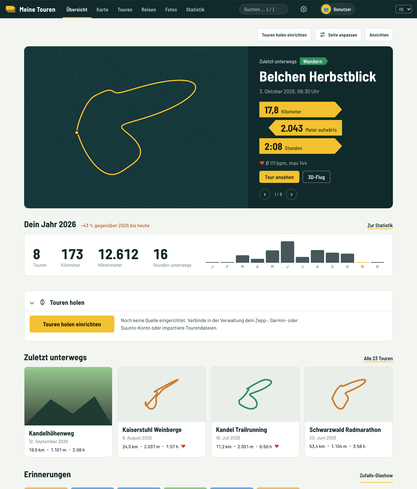

Oben die letzte Tour mit Strecke, Aufstieg und Dauer (zum Durchblättern), darunter „Dein Jahr“ mit Vergleich zum Vorjahr, die zuletzt gemachten Touren und Erinnerungen. Über „Seite anpassen“ stellst du die Übersicht selbst zusammen (siehe Abschnitt 9), die Statistik mit Reitern für Gesamt und einzelne Jahre und Filtern nach Sportart liegt unter „Statistik“.

## 2. Alle Touren

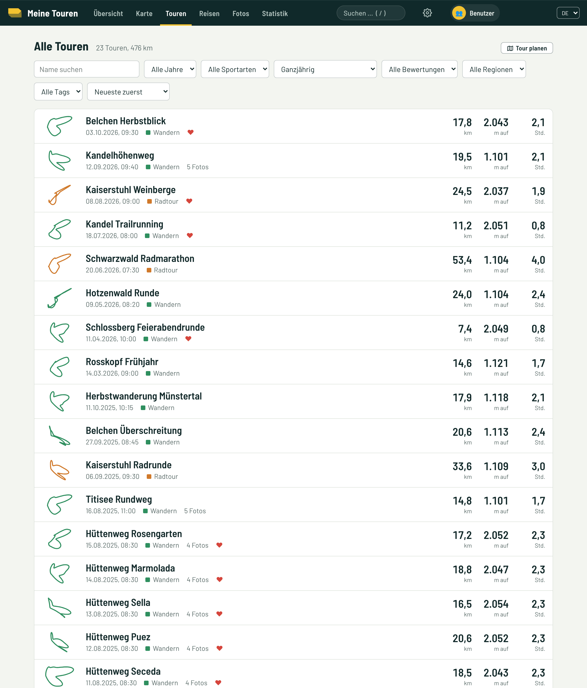

Die Liste aller Aktivitäten – sortier- und filterbar. Ein Klick öffnet die Tour. Über die Suche oben (Taste `/`) findest du Touren nach Name, Ort oder Tag.

## 3. Eine Tour

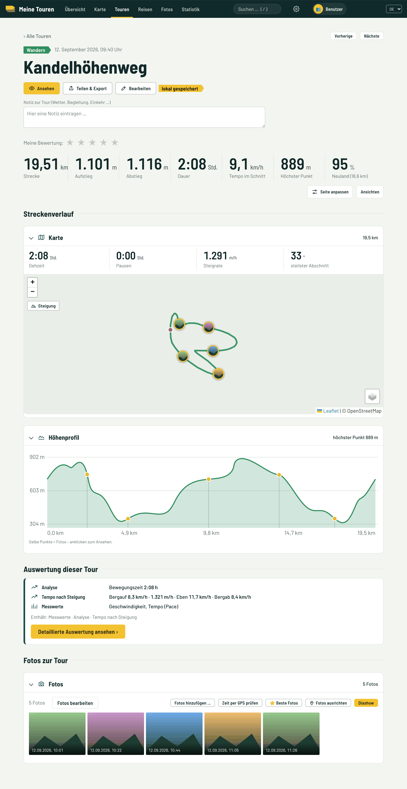

Kopfzeile mit den wichtigsten Werten, darunter Karte, **Höhenprofil** und **Analyse** (Bewegungszeit, Tempo, Steigungsanteile). Über die Schaltflächen oben kannst du die Tour umbenennen, mit Tags versehen, teilen, als GPX laden, die Streckenfarbe ändern oder die Höhen korrigieren. Zugeordnete Fotos erscheinen unten und als Marker auf der Karte.

**Fotos auf der Strecke ausrichten:** Ziehe auf der Karte ein Foto an die Stelle, an der es sicher entstanden ist – alle übrigen Fotos wandern im Zeitabstand wie auf einer Perlenkette mit. Speichern übernimmt die Verschiebung für die Tour oder den ganzen Tag.

## 4. Karte

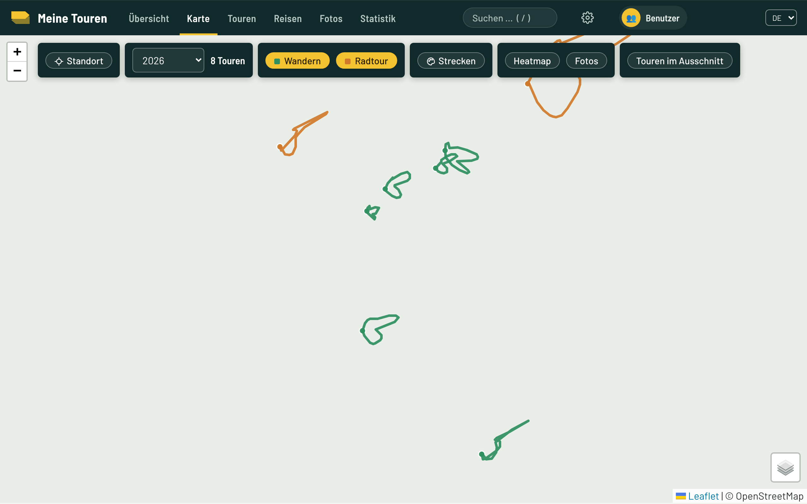

Alle Touren auf einer Karte, filterbar nach Sportart und Jahr.

## 5. Statistik und Rekorde

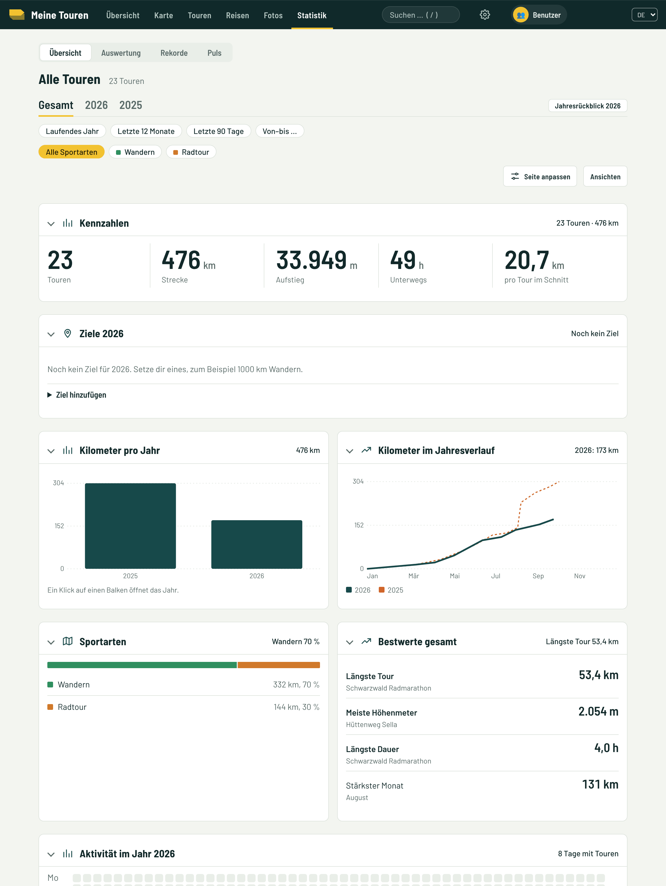

Die Statistik besteht aus Bausteinen (Kennzahlen, Ziele, Kilometer pro Jahr, Sportarten, Aktivität …) mit einem globalen Filter für Aktivität und Zeitraum. Reiter: Übersicht, Auswertung, Rekorde und Puls.

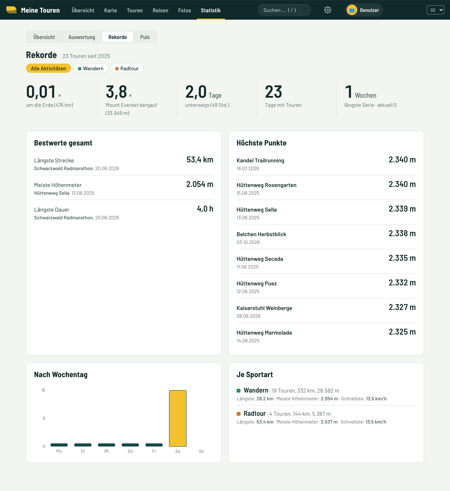

Rekorde: längste Tour, größter Aufstieg, schnellstes Tempo und mehr – je Sportart.

## 6. Jahresrückblick

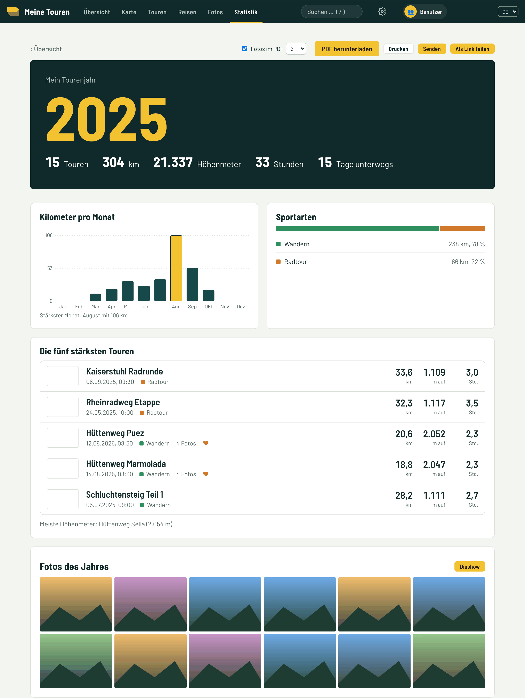

Das Jahr auf einen Blick: Kilometer, Höhenmeter, Zeit, Lieblingsmonate und Highlights. Der Rückblick lässt sich als PDF laden, drucken oder als Link ohne Konto teilen.

## 7. Verwaltung

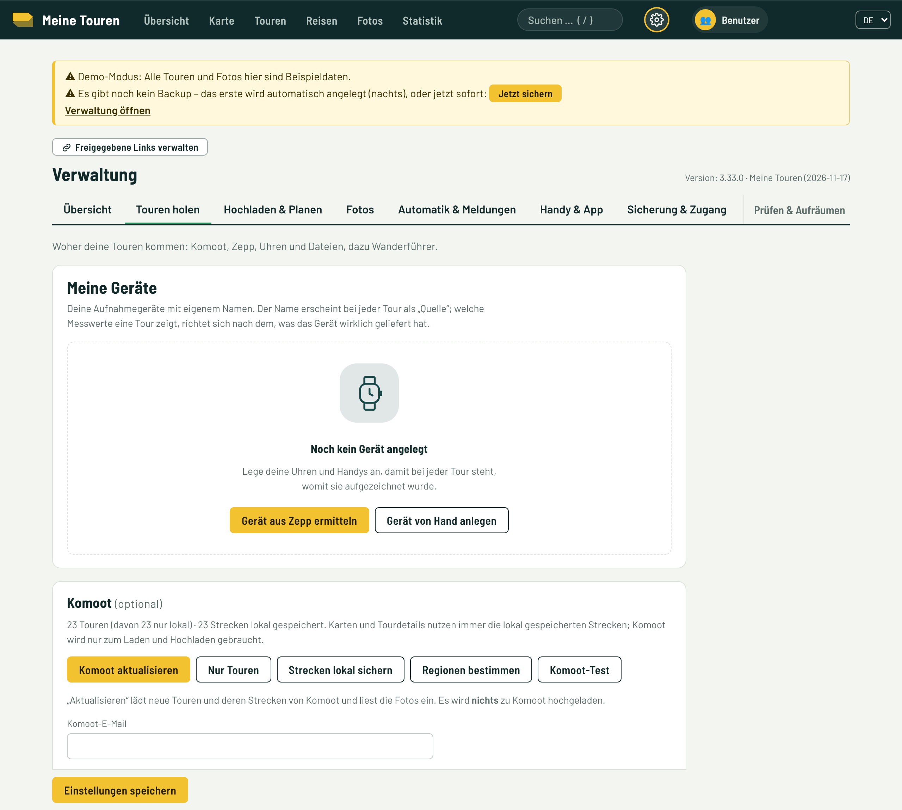

Hier findest du **Updates** (die App prüft regelmäßig auf GitHub und bietet die Installation an), den **Zustand** der Installation, den **Import von Garmin, Suunto und anderen Uhren** (FIT/GPX/TCX-Dateien oder Konto-Anbindung), Komoot-Zugang, Sicherungen und Benutzer.

## 8. Auch am Handy

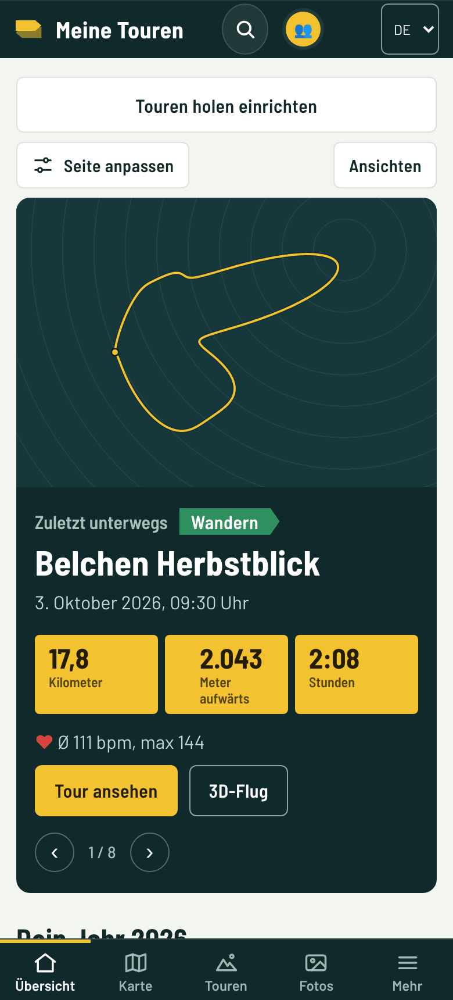

Die Oberfläche passt sich kleinen Bildschirmen an und lässt sich im Browser zum Home-Bildschirm hinzufügen.

## 9. Seite anpassen

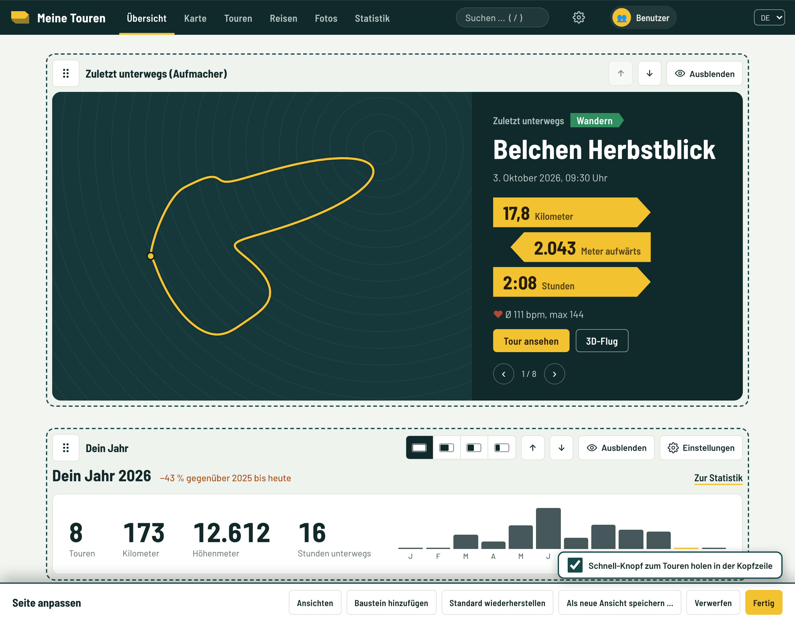

„Seite anpassen“ (auf Übersicht, Tourseite, Statistik, Reise-Seite und Reisen-Übersicht) schaltet den Bearbeitungsmodus ein: Bausteine verschieben, ausblenden, ein- oder ausklappen und in der Breite ändern, neue Bausteine aus dem Katalog hinzufügen (auch eigene Kennzahlen). „Ansichten“ speichert mehrere Anordnungen (z. B. „Wandern“, „Rad“) und bietet fertige Vorlagen sowie Export und Import als Datei. „Fertig“ übernimmt, „Verwerfen“ lässt alles wie vorher.

## 10. Reisen

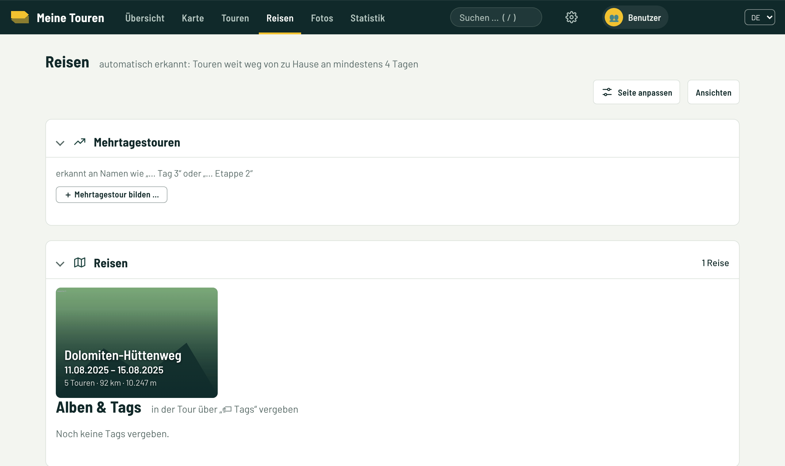

Touren weit weg von zu Hause an mindestens vier Tagen am Stück werden als Reise erkannt, Tourenreihen wie „… Tag 3“ als Mehrtagestour.

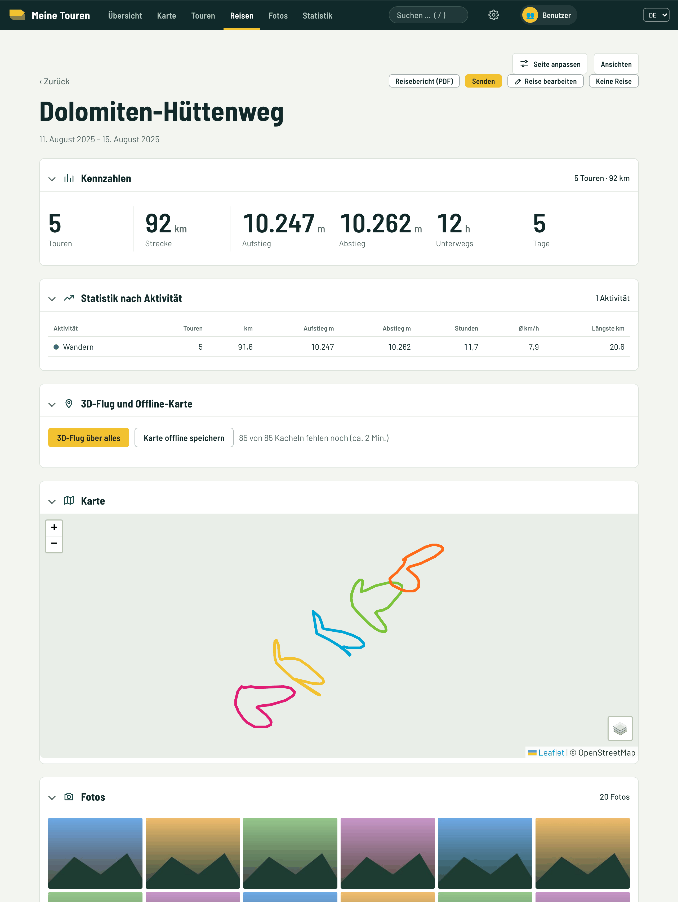

Die Reise-Seite zeigt Kennzahlen, Statistik nach Aktivität, Karte mit den Tagen in Farben, Fotos und Touren; auch sie ist anpassbar. Der Reisebericht lässt sich als PDF laden.

---

Installation: siehe [README](../README.md) (Proxmox, Debian/Ubuntu, Mac, Windows).
