# Meine Touren – Handbuch

**Für Anwenderinnen und Anwender · Stand: Version 3.37.0**

Dieses Handbuch erklärt Schritt für Schritt, wie du mit **Meine Touren** arbeitest: Touren holen und importieren, ansehen, auswerten, mit Fotos verbinden, die Seiten nach deinem Geschmack gestalten und Links sicher teilen. Es richtet sich an Menschen, die die App benutzen – nicht an Entwickler.

* Eine kürzere Fassung mit Bildern findest du in der [Kurzanleitung](ANLEITUNG.md), die Installation steht ausführlich in der [README](../README.md).
* Dieses Handbuch gibt es auch als **PDF**: [Handbuch-Meine-Touren.pdf](Handbuch-Meine-Touren.pdf).
* Alle Bilder zeigen **Beispieldaten** (Demo-Modus, erfundene Touren). Die Texte auf den Knöpfen sind so geschrieben, wie du sie in der App siehst.

> **Hinweis zu den Bildern:** In den Aufnahmen fehlen die Kartenkacheln (OpenStreetMap), deshalb ist der Kartenhintergrund grau. In der echten App siehst du dort die Karte. Die Fotos der Beispieltouren sind einfache Farbverläufe mit Bergsilhouette. Für einige Bilder der neueren Bausteine (Jahreszeiten und Wetter, Belastung und Erholung, Ausrüstung, Eigene Kennzahlen) wurden zusätzlich erfundene Wetterwerte, Uhr-Belastungen, Ausrüstung und ein paar weitere Beispieltouren ergänzt; darum weichen dort Zahlen wie die Tourenzahl von den übrigen Bildern ab.

## Inhaltsverzeichnis

1. [Einführung und Überblick](#k1)
2. [Installation und Start](#k2)
3. [Erste Schritte: Konto, Rollen, Sprache, Hell und Dunkel](#k3)
4. [Touren importieren und holen](#k4)
5. [Die Übersicht](#k5)
6. [Touren-Liste, Filter und Suche](#k6)
7. [Das Tourdetail](#k7)
8. [Die Karte](#k8)
9. [Reisen und Mehrtagestouren](#k9)
10. [Fotos und Diashow](#k10)
11. [Statistik, Rekorde, Puls und Auswertung](#k11)
12. [Der Jahresrückblick](#k12)
13. [Seiten anpassen: Bausteine, Ansichten, Vorlagen, eigene Kennzahlen](#k13)
14. [Freigabe und Teilen](#k14)
15. [Die Verwaltung](#k15)
16. [Die Android-App](#k16)
17. [Mein Tourentagebuch (Begleit-App)](#k17)
18. [Tipps, Tastenkürzel, Fehlersuche und häufige Fragen](#k18)
19. [Datenschutz und Sicherheit](#k19)
20. [Glossar](#glossar)

---

## 1. Einführung und Überblick

**Zweck:** Meine Touren ist dein **privates Tourenarchiv zum Selbsthosten**. Wanderungen, Radtouren, Läufe und andere Aktivitäten liegen bei dir – auf deinem Rechner, Server oder NAS – mit Karte, Höhenprofil, Statistik und Fotos. Es gibt keine Cloud, in der deine Daten liegen müssen.

**Was die App kann (Auswahl):**

* Touren aus Dateien (GPX, FIT, TCX, ZIP) und aus Zepp, Garmin, Suunto und anderen Uhren übernehmen, dazu Komoot-Touren. Strava und Komoot kannst du auch zum Hochladen nutzen – aber nur, wenn du das ausdrücklich willst.
* Jede Tour mit Karte, Höhenprofil, Fotos entlang der Strecke, Pulsverlauf, Geschwindigkeit, Tourblatt (PDF) und 3D-Flug.
* Fotos automatisch über die Aufnahmezeit den Touren zuordnen, Diashow, Erinnerungen.
* Statistik, Rekorde, Pulszonen, Jahresziele, Jahresrückblick.
* Reisen und Mehrtagestouren werden erkannt und bekommen eine eigene Seite samt Reisebericht.
* **Alle Seiten sind anpassbar** („Seite anpassen“): Bausteine verschieben, ausblenden, in der Breite ändern, hinzufügen; mehrere Ansichten und Vorlagen; eigene Kennzahlen.
* Teilen per Link ohne Konto – du bestimmst, was gezeigt wird, und kannst jeden Link widerrufen.
* Mehrere Benutzer mit getrennten Daten, Oberfläche auf Deutsch, Englisch, Französisch und Spanisch, Hell- und Dunkeldarstellung, Handy-Ansicht, Android-App.

**Aufbau der Oberfläche:** Oben steht die Menüleiste mit **Übersicht · Karte · Touren · Reisen · Fotos · Statistik**, dazu das Suchfeld („Suchen … ( / )“), das Zahnrad für die **Verwaltung**, das Benutzermenü und die Sprachauswahl.

*Abbildung 1: Die Übersicht. Oben die Menüleiste, darunter (hier über **Seite anpassen** eingeblendet) die Leiste „Zeitraum der Seite“, „Zuletzt unterwegs“, „Dein Jahr 2026“, der Bereich „Touren holen“, die letzten Touren und „Erinnerungen“.*

**Tipp:** Wenn du erst einmal nur schauen willst, was die App kann: Der **Demo-Modus** (siehe [Kapitel 2](#k2)) legt Beispieltouren an, ohne deine echten Daten anzufassen.

[↑ Inhaltsverzeichnis](#inhalt)

---

## 2. Installation und Start

**Zweck:** Meine Touren läuft als kleiner Webserver. Du öffnest ihn im Browser. Wie du ihn installierst, hängt davon ab, wo er laufen soll. Die vollständigen Befehle stehen in der [README](../README.md) – hier der Überblick.

| Wo soll es laufen? | Kurz gesagt | Wo steht die Anleitung? |
|---|---|---|
| **Proxmox VE** (empfohlen) | Ein Befehl auf dem Proxmox-Host legt einen Debian-Container an und installiert alles. Danach `http://<Container-IP>/` öffnen. | README: „Installation auf Proxmox VE“ |
| **Debian/Ubuntu-Server** | Repository holen, `bash deploy/install.sh` ausführen. Erreichbar unter `http://<IP>/` bzw. `http://<IP>:8080/`. | README: „Manuelle Installation“ |
| **Docker** (auch Raspberry Pi, Synology, QNAP) | `docker-compose.yml` kopieren, `docker compose up -d`, dann `http://<Server>:8080` öffnen. Die Daten liegen im Ordner `./daten`. | README: „Docker“ |
| **NAS (TrueNAS SCALE)** | Als „Custom App“ mit der Compose-Datei; ausführliche Schritte inklusive Tailscale und Zwei-Faktor-Anmeldung. | [docs/truenas-scale.md](truenas-scale.md) |
| **Windows-PC** | Python installieren, im Ordner `windows` die Datei `Meine-Touren-lokal.bat` doppelklicken. Der Browser öffnet `http://localhost:8080`. | README: „Lokal auf Windows“ |
| **Mac** | Im Ordner `mac` die Datei `Meine-Touren-lokal.command` doppelklicken (beim ersten Mal Rechtsklick → Öffnen). | README: „Lokal auf dem Mac“ |

**Der erste Start:**

1. Öffne die Adresse deiner Installation im Browser.
2. Beim ersten Besuch legst du den **Administrator** an (Name, E-Mail-Adresse, Passwort mit mindestens 8 Zeichen) – siehe [Kapitel 3](#k3).
3. Lade deine ersten Touren: [Kapitel 4](#k4).

**Ausprobieren ohne eigene Daten (Demo-Modus):** Unter Windows startet `windows\Meine-Touren-Demo.bat`, auf dem Mac `mac/Meine-Touren-Demo.command` die App mit Beispieltouren und -fotos; auf anderen Systemen geht es mit `MT_DEMO=1 python3 -m app.demo`. Die Beispieldaten liegen in einem temporären Ordner; echte Daten werden nie angefasst. In der Verwaltung erscheint dann der Hinweis „Demo-Modus: Alle Touren und Fotos hier sind Beispieldaten.“

**Aktualisieren:**

* Proxmox: im Container `meine-touren-update github` oder auf dem Host das Skript erneut starten und „Update“ wählen.
* Docker: `docker compose pull && docker compose up -d`.
* Windows und Mac: Updates lassen sich in der Oberfläche installieren; die App startet danach selbst neu (Windows) bzw. es gibt `Meine-Touren-aktualisieren.command` (Mac).
* Vor jedem Update legt die App automatisch eine Sicherung an. Mehr dazu in [Kapitel 15](#k15).

**Von außen erreichbar machen:** Für den Zugriff von unterwegs empfiehlt die README **Tailscale** (privates Netz, kein offener Router-Port). Mehr dazu in [Kapitel 19](#k19).

**Hinweis:** Fehlt das Internet, funktionieren die Seiten weiter, es fehlen aber Kartenkacheln, Höhen- und Wetterdaten sowie Ortsnamen (siehe [Kapitel 19](#k19)).

[↑ Inhaltsverzeichnis](#inhalt)

---

## 3. Erste Schritte: Konto, Rollen, Sprache, Hell und Dunkel

### 3.1 Benutzer einrichten

Solange noch keine Benutzerverwaltung eingerichtet ist, zeigt das Benutzermenü oben rechts „Noch keine Benutzerverwaltung“. Dann ist die Oberfläche für jeden im Netzwerk offen. Für den Alltag solltest du die Benutzerverwaltung einschalten.

1. Klicke oben rechts auf **Benutzer**.
2. Wähle **Benutzer einrichten …**.
3. Trage Name, E-Mail-Adresse und Passwort ein (mindestens 8 Zeichen, zweimal). Die E-Mail-Adresse dient zum Zurücksetzen des Passworts.
4. Klicke auf **Einrichten**. Mit **Später** schließt du den Dialog, ohne etwas zu ändern.

*Abbildung 2: Das Benutzermenü, solange noch kein Konto eingerichtet ist.*

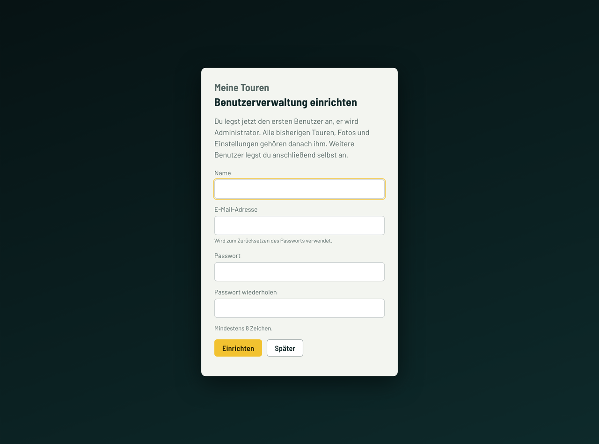

*Abbildung 3: „Benutzerverwaltung einrichten“. Du legst jetzt den ersten Benutzer an; er wird Administrator. Alle bisherigen Touren, Fotos und Einstellungen gehören danach ihm.*

Wenn du dich später anmeldest, ersetzt das Benutzermenü diese Einträge durch „Konto & Freigaben“, „Geteilte Fotos“, „Info“ und „Abmelden“.

### 3.2 Rollen

Es gibt drei Rollen:

| Rolle | Darf … |
|---|---|
| **Administrator** | alles, auch Benutzer anlegen und verwalten, Updates installieren. |
| **Benutzer** | seine eigenen Touren, Fotos, Notizen, Ziele und Einstellungen verwalten. Jeder Benutzer hat eigene Daten und sein eigenes Komoot-Konto. |
| **Betrachter** („nur ansehen“) | die Touren, Fotos, Reisen, Auswertungen und die Karte eines gewählten Benutzers ansehen, aber nichts ändern, nichts hochladen und keine Links erzeugen. |

Administratoren legen Benutzer unter **Konto & Freigaben → Benutzer verwalten → Neuer Benutzer** an (Name, E-Mail, Passwort, Rolle). Dort können sie auch Passwörter setzen, E-Mail-Adressen ändern und die Zwei-Faktor-Anmeldung zurücksetzen.

### 3.3 Konto & Freigaben

Im Benutzermenü findest du **Konto & Freigaben**. Dort:

* **Passwort ändern.**
* **Zwei-Faktor-Anmeldung** ein- oder ausschalten (QR-Code mit einer Authenticator-App scannen, danach werden einmalig acht Wiederherstellungscodes angezeigt – gut aufbewahren).
* **Ansicht:** Automatisch, Smartphone-Ansicht oder Computer-Ansicht (gilt nur auf diesem Gerät).
* **Fotos freigeben:** Andere Benutzer dürfen deine ganze Fotobibliothek oder nur die Fotos einer Tour sehen und in ihre Bibliothek übernehmen. Deine Originale bleiben bei dir.

Auf der Anmeldeseite gibt es **Passwort vergessen?**. Das funktioniert, wenn der Administrator unter *Verwaltung → Automatik & Meldungen* den E-Mail-Versand eingerichtet hat.

### 3.4 Sprache

Oben rechts wählst du die Sprache: **DE**, **EN**, **FR** oder **ES**. Die Wahl gilt sofort.

### 3.5 Hell und Dunkel

Die App folgt der **Einstellung deines Geräts** (hell oder dunkel). Einen eigenen Schalter dafür gibt es nicht – stelle am Rechner oder Handy die Darstellung um, und die App zieht nach.

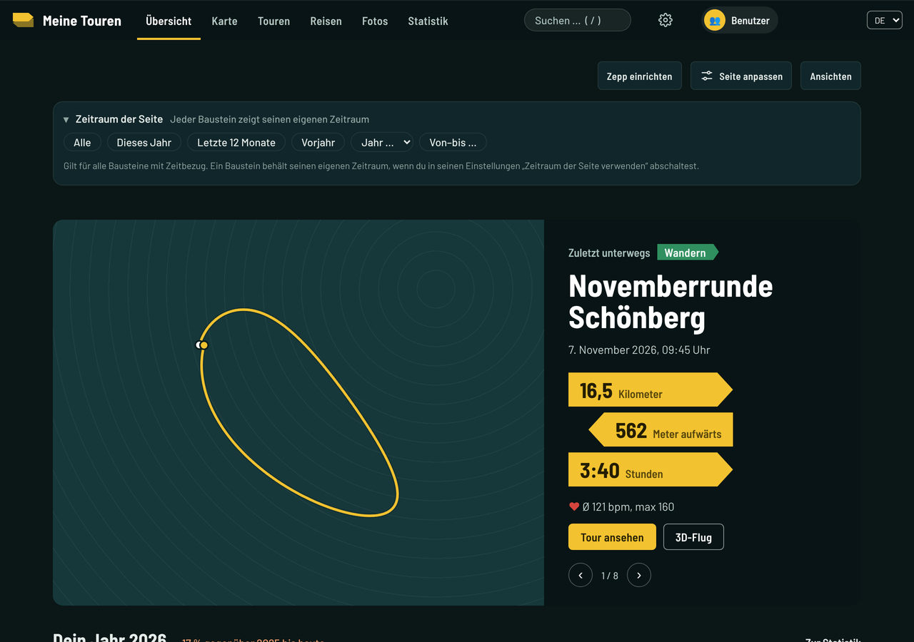

*Abbildung 4: Dieselbe Übersicht in der dunklen Darstellung.*

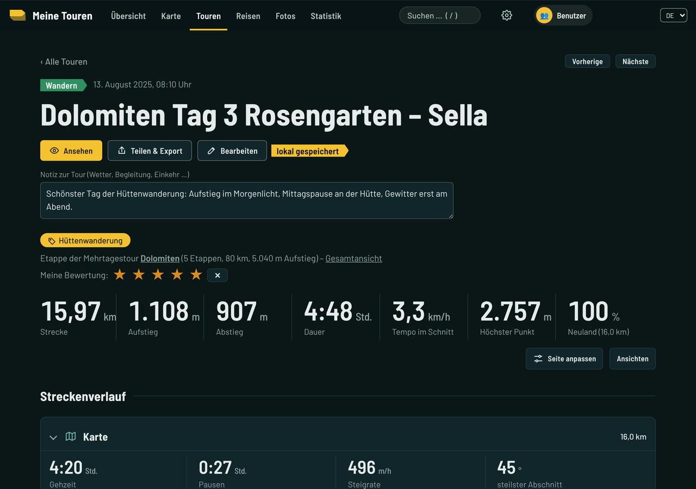

*Abbildung 5: Das Tourdetail im Dunkelmodus.*

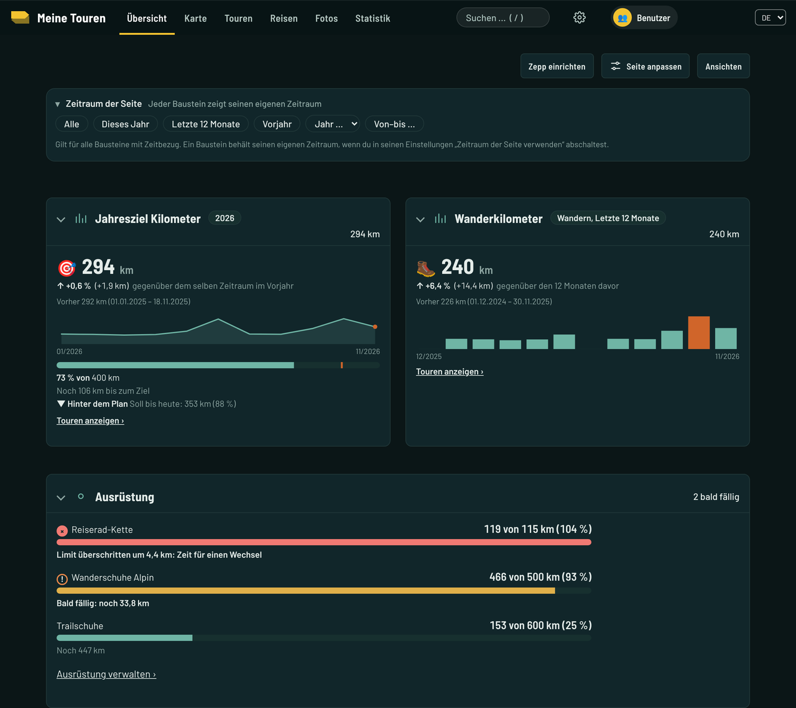

*Abbildung 6: Auch die neueren Bausteine folgen der dunklen Darstellung: Eigene Kennzahlen, Ausrüstung mit Warnzeichen und „Jahreszeiten und Wetter“ (Ausschnitt).*

### 3.6 Smartphone- oder Computer-Ansicht

Bis zu einer Breite von etwa 760 Pixeln schaltet die App automatisch in die Handy-Ansicht (Menü unten am Rand). Du kannst das unter „Konto & Freigaben → Ansicht“ oder im Menü **Mehr** (Handy) festlegen. Mehr dazu in [Kapitel 18](#k18).

[↑ Inhaltsverzeichnis](#inhalt)

---

## 4. Touren importieren und holen

**Zweck:** Deine Touren kommen aus vielen Quellen. Alles, was du holst, wird **lokal** als Tour gespeichert (Karte, Statistik, Fotozuordnung), mit Prüfung auf Doppelte. Hochgeladen wird nie von allein.

Alle Wege findest du unter **Verwaltung → Touren holen** („Woher deine Touren kommen: Komoot, Zepp, Uhren und Dateien, dazu Wanderführer.“).

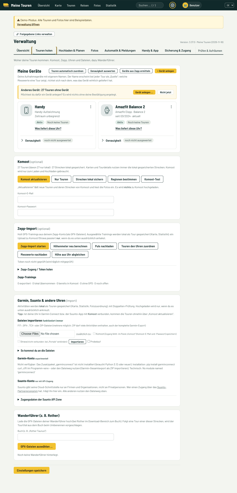

*Abbildung 7: Der Reiter „Touren holen“ mit „Meine Geräte“, Komoot, Zepp-Import, „Garmin, Suunto & andere Uhren“ und „Wanderführer“.*

### 4.1 Dateien importieren (funktioniert für jeden Hersteller)

1. *Verwaltung → Touren holen* und nach unten zu **Garmin, Suunto & andere Uhren (Import)** gehen, Bereich **Dateien importieren**.
2. **Choose Files** (bzw. „Dateien auswählen“, je nach Browsersprache) anklicken und eine oder mehrere **FIT-, GPX-, TCX- oder ZIP-Dateien** wählen. Eine ZIP-Datei darf viele Aktivitäten enthalten, auch den kompletten Garmin-Export.
3. Optional: **Probelauf** ankreuzen – dann wird nur geprüft und berichtet, nichts gespeichert.
4. **Importieren** anklicken.

Dateien ohne GPS (Schlaf, Alltag, Indoor) werden übersprungen und gezählt. Doppelte werden erkannt.

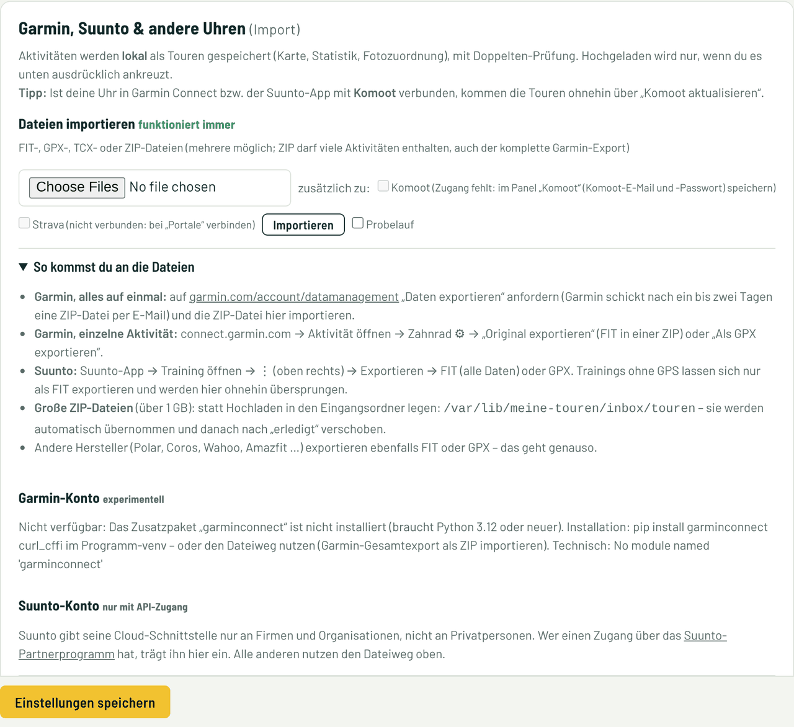

*Abbildung 8: Der Datei-Import samt aufgeklapptem Abschnitt „So kommst du an die Dateien“. Rechts neben der Dateiauswahl stehen die Haken „Komoot“ und „Strava“ (zusätzlich dorthin hochladen) – sie sind nur auswählbar, wenn das jeweilige Konto verbunden ist.*

**So kommst du an die Dateien** (laut Hinweis in der App):

* **Garmin, alles auf einmal:** auf garmin.com/account/datamanagement „Daten exportieren“ anfordern; Garmin schickt nach ein bis zwei Tagen eine ZIP-Datei per E-Mail. Diese ZIP importierst du.
* **Garmin, einzelne Aktivität:** connect.garmin.com → Aktivität öffnen → Zahnrad → „Original exportieren“ (FIT in einer ZIP) oder „Als GPX exportieren“.
* **Suunto:** Suunto-App → Training öffnen → ⋮ → Exportieren → FIT (alle Daten) oder GPX. Trainings ohne GPS lassen sich nur als FIT exportieren und werden hier übersprungen.
* **Andere Hersteller** (Polar, Coros, Wahoo, Amazfit …) exportieren ebenfalls FIT oder GPX – das geht genauso. Für Polar gibt es keine Konto-Anbindung, nur den Dateiweg.
* **Sehr große ZIP-Dateien** (über 1 GB): statt Hochladen in den Eingangsordner `inbox/touren` legen. Sie werden automatisch übernommen und danach nach „erledigt“ verschoben.
* **Handy-Aufzeichnung:** Die Android-App sendet Aufzeichnungen selbst; GPX/FIT/TCX/ZIP aus anderen Apps schickst du über das Teilen-Menü (siehe [Kapitel 16](#k16)).

### 4.2 Zepp (Amazfit)

Unter **Zepp-Import (optional)** holst du GPS-Trainings aus deinem Zepp-Konto (als GPX). Ausgewählte Trainings werden lokal als Tour gespeichert.

1. Klappe **Zepp-Zugang / Token holen** auf.
2. Trage E-Mail und Passwort ein (nur wenn dein Konto ein Zepp-Passwort hat) oder ein **Token** (für Mi-, Google- und Apple-Konten). Für das Token gibt es dort eine Anleitung mit einem Lesezeichen, das du in die Lesezeichenleiste ziehst.
3. Speichere die Einstellungen und klicke auf **Zepp-Import starten**.

Weitere Knöpfe im selben Bereich: **Aufstieg neu berechnen**, **Puls nachladen**, **Touren den Uhren zuordnen**, **Messwerte nachladen**, **Höhe aus Uhr abgleichen**. Der Zepp-Token wird täglich mitgeprüft.

### 4.3 Garmin- und Suunto-Konto (experimentell)

* **Garmin-Konto:** Anmeldung wie im Browser über ein optionales Zusatzpaket (`garminconnect`, braucht Python 3.12 oder neuer). Ist es nicht installiert, steht dort „Nicht verfügbar“ – dann bleibt der Dateiweg.
* **Suunto-Konto:** Suunto vergibt seinen Cloud-Zugang nur an Firmen und Organisationen. Wer keinen hat, nutzt den Dateiweg.
* Ist deine Uhr in Garmin Connect oder der Suunto-App mit **Komoot** verbunden, kommen die Touren ohnehin über „Komoot aktualisieren“.

> Garmin und Suunto sind bisher nur mit nachgebauten Testdaten geprüft, nicht mit echten Geräten. Rückmeldungen sind willkommen (siehe README, „Hilfe gesucht“).

### 4.4 Komoot

Im Bereich **Komoot (optional)** trägst du E-Mail und Passwort ein.

* **Komoot aktualisieren** lädt neue Touren und deren Strecken und liest die Fotos ein.
* **Nur Touren**, **Strecken lokal sichern**, **Regionen bestimmen** und **Komoot-Test** sind Teilschritte.
* Es wird nichts zu Komoot hochgeladen und nie etwas dort gelöscht.

Komoot und Zepp bieten Privatpersonen keine offizielle Schnittstelle; die Anbindungen nutzen inoffizielle Aufrufe und können sich jederzeit ändern.

### 4.5 Der Knopf „Touren holen“ auf der Übersicht

Auf der Übersicht gibt es den Bereich **Touren holen** und oben in der Kopfzeile einen Schnell-Knopf. Beschriftung und Funktion richten sich nach den Konten, die du verbunden hast:

* Ist **Zepp**, **Garmin** oder **Suunto** verbunden, heißt der Knopf z. B. „Zepp-Import starten“, „Garmin-Import starten“ oder „Suunto-Import starten“. Bei mehreren Konten gibt es je Konto eine Zeile und **Alle holen** (nacheinander, nie gleichzeitig). Fortschritt („Tour 3 von 12“) und Ergebnis des letzten Laufs werden angezeigt.
* Ist ein Gerät angelegt, aber das Konto noch nicht verbunden, heißt der Knopf z. B. **Zepp einrichten** und führt in die Verwaltung (so wie in Abbildung 1).
* Für **Polar**, Handy-Aufzeichnung und andere Geräte ohne Konto-Anbindung steht nur ein Link „Touren per Datei importieren“.
* Den Schnell-Knopf in der Kopfzeile kannst du unter „Seite anpassen“ (nur Übersicht) mit dem Schalter „Schnell-Knopf zum Touren holen in der Kopfzeile“ abschalten. Es gibt außerdem den Baustein „Touren holen (nur Knopf)“ für das Raster.

### 4.6 Meine Geräte

Ganz oben in „Touren holen“ stehen **Meine Geräte**: deine Uhren und Handys mit eigenem Namen. Der Name erscheint bei jeder Tour als „Quelle“; welche Messwerte eine Tour zeigt, richtet sich danach, was das Gerät wirklich geliefert hat. Mit **+ Gerät anlegen**, **Geräte aus Zepp ermitteln** und **Touren automatisch zuordnen** richtest du das ein; **Genauigkeit auswerten** meldet auffällige Touren.

Die **Android-App** legt ihr Gerät selbst an: Beim ersten Hochladen einer Aufzeichnung erscheint das Handy hier mit dem Kennzeichen „Aufzeichnungs-App“, Modell, Android- und App-Version und dem Datum der letzten Aufzeichnung. Seine Touren werden ihm fest zugeordnet; ältere Handy-Aufzeichnungen bleiben unberührt und lassen sich über das Menü des Geräts („Bisherige Handy-Aufzeichnungen zuordnen …“) nachträglich zuordnen.

### 4.7 Wanderführer

Unter **Wanderführer (z. B. Rother)** lädst du die GPX-Dateien deiner Wanderführer hoch. Folgt eine Tour einer dieser Strecken, wird der Tourtitel aus dem Buch beim Umbenennen vorgeschlagen.

**Wanderführer-Fortschritt (ab 3.53.0):** Unter Statistik → **Orte & Ausrüstung** steht jedes Buch als eingeklappte Karte: Titelbild (oder ein Buch-Symbol), Buchname, „x von y gewandert“ und ein Ring mit dem Anteil in Prozent. Ein Tipp klappt die Tourenliste auf (✓ gewandert mit Datum, ○ offen mit Länge und Aufstieg); lange Listen kommen in Blöcken zu 60 („Mehr anzeigen“). Welche Bücher offen sind, merkt sich das Gerät. Oben filterst du **Alle / Offen / Gewandert**, suchst über Buchnamen und Tourtitel (ein Treffer in einer Tour klappt das Buch auf) und wählst die Reihenfolge: **Buchreihenfolge**, **Nach Länge** oder **Zuletzt gewandert**; Filter, Suche und Reihenfolge stehen in der Adresse. **Offene Touren auf der Karte** zeigt die Startpunkte der offenen Touren eines Buchs (die Karte entsteht erst auf diesen Knopf). **Titelbild wählen** nimmt ein Bild von deinem Gerät – etwa das Titelbild, das du dir selbst beim Verlag heruntergeladen hast; die App lädt nie selbst Bilder aus dem Netz. Es wird auf etwa 400 Pixel verkleinert, gehört zur Datensicherung und verschwindet mit dem Buch; **Titelbild entfernen** nimmt es wieder weg.

### 4.8 Hochladen (nur auf deinen Wunsch)

Der Reiter **Hochladen & Planen** nimmt die Zugänge zu **Strava** (eigene App anlegen, Client-ID und -Secret eintragen, „Mit Strava verbinden“) und Komoot auf. Hochgeladen wird einzeln (Tour → **Bearbeiten → Hochladen**) oder gesammelt, immer nur ausdrücklich. Dort stellst du auch die **Tourplanung** ein (Routing über einen BRouter-Dienst; öffentlich, auf dem eigenen Server oder im Netz).

### 4.9 Fotos importieren

Fotos kommen separat – siehe [Kapitel 10](#k10).

[↑ Inhaltsverzeichnis](#inhalt)

---

## 5. Die Übersicht

**Zweck:** Die Startseite zeigt auf einen Blick, wo du zuletzt warst und wie dein Jahr läuft.

Von oben nach unten (in der Standardeinstellung):

1. **Zuletzt unterwegs:** die letzte Tour mit Strecke, Aufstieg, Dauer und – wenn vorhanden – dem Puls. Mit den Pfeilen blätterst du durch die jüngsten Touren. **Tour ansehen** öffnet das Tourdetail, **3D-Flug** fliegt die Strecke im Gelände ab.
2. **Dein Jahr 2026:** Touren, Kilometer, Höhenmeter und Stunden mit Monatssäulen und Vergleich zum Vorjahr bis zum selben Tag („–17 % gegenüber 2025 bis heute“). Darunter stehen deine Jahresziele mit Fortschritt (z. B. „243 / 400 km“). **Zur Statistik** führt weiter.
3. **Touren holen:** der Import-Bereich ([Abschnitt 4.5](#k4)).
4. **Zuletzt unterwegs:** Kacheln der letzten Touren; **Alle 27 Touren** öffnet die Liste.
5. **Erinnerungen:** eine Auswahl deiner Fotos mit Link **Zufalls-Diashow**.

Über **Seite anpassen** und **Ansichten** gestaltest du die Übersicht selbst ([Kapitel 13](#k13)).

**Ab 3.54.0** behält der Browser die Bilder der Übersicht (Kopfbereich, „Zuletzt unterwegs“, „An diesem Tag“, Erinnerungen, „Zuletzt aufgenommene Fotos“, „Wiederentdecken“): Beim nächsten Öffnen oder Neuladen erscheinen sie sofort, ohne erneut beim Server nachzufragen. Die **zufälligen** Erinnerungen und die Tour bei **Wiederentdecken** bleiben deshalb in diesem Browser-Tab bis zum nächsten Tag dieselben; neue Fotos holst du mit **Neu mischen** (falls in den Einstellungen der Kachel eingeschaltet) bzw. **Andere Tour**.

### Zeitraum der Seite

Die Leiste **Zeitraum der Seite** ist **standardmäßig ausgeblendet**: Ohne Anpassung zeigt jeder Baustein seinen eigenen Zeitraum, die Übersicht sieht aus wie gewohnt. Du blendest sie über **Seite anpassen** mit dem Schalter **Zeitraum der Seite anzeigen** ein (gespeichert je Seite und Ansicht, wieder ausschaltbar). Ein gewählter Seitenzeitraum ist nie unsichtbar: Gilt einer (aus einer Adresse mit `?z=…`, deiner letzten Wahl oder einer gespeicherten Ansicht), steht die Leiste immer da, und der Schalter ist dann gesperrt, bis du auf „Je Baustein“ zurückgesetzt hast.

Eingeblendet steht ganz oben auf der Übersicht die einklappbare Leiste **Zeitraum der Seite** („Jeder Baustein zeigt seinen eigenen Zeitraum“). Mit **Alle**, **Dieses Jahr**, **Letzte 12 Monate**, **Vorjahr**, einer Jahresauswahl (**Jahr …**) und **Von–bis …** legst du einen gemeinsamen Zeitraum fest, der für alle Bausteine mit Zeitbezug gilt, zum Beispiel „Dein Jahr“, Eigene Kennzahlen oder „Jahreszeiten und Wetter“. Im Kopf der Leiste steht der gewählte Zeitraum („Das Jahr 2025“), **Zurücksetzen** hebt die Wahl auf. Ein Baustein behält seinen eigenen Zeitraum, wenn du in seinen Einstellungen **Zeitraum der Seite verwenden** abschaltest. Der gewählte Zeitraum steht in der Adresse der Seite; nach einer Änderung zeigt die Übersicht „geändert“ und **Ansicht speichern**, damit du die Wahl in der Ansicht behalten kannst. Mit einem Klick auf den Titel der Leiste klappst du sie ein. Auf dem Handy steht statt der Leiste der Chip **Zeitraum: …** in der Werkzeugzeile. Die Statistik hat dafür ihre eigene Filterleiste, die zusätzlich den Knopf **Vorjahr** bietet ([Abschnitt 11.1](#k11)).

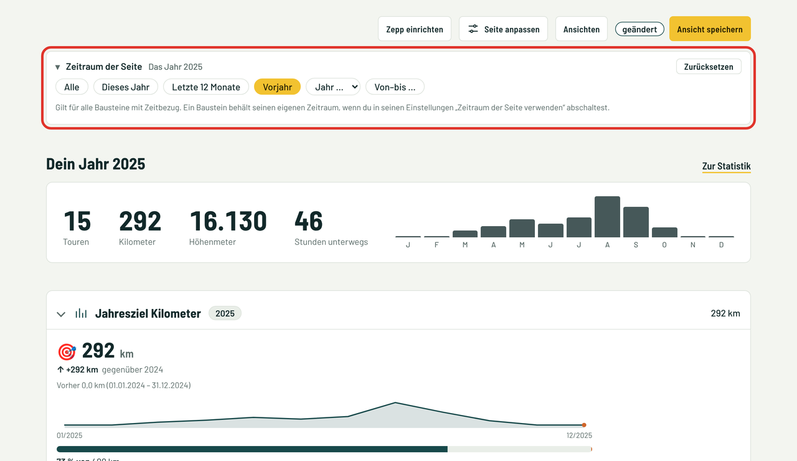

*Abbildung 9: Die Leiste „Zeitraum der Seite“ (rot umrandet), eingeblendet über Seite anpassen. Gewählt ist „Vorjahr“: „Dein Jahr“ zeigt jetzt 2025.*

**Was ist das? Die Erklärung in der App.** Beim Schalter in „Seite anpassen“ (**Was ist das?**) und in der Leiste selbst (**ⓘ Hilfe**, mit `aria-expanded`) klappt dieselbe kurze Erklärung auf:

* **Fitness-Einordnung** (nur im Katalog, Kategorie „Zahlen“): ordnet deine letzten 12 Wochen in Relation zu deinem Alter ein (Umfang gegen die WHO-Empfehlung, Regelmäßigkeit, Intensität mit Puls oder Aufstieg je Stunde). Du gibst nur dein Geburtsjahr an; es bleibt privat in deinem Konto und erscheint nie in Freigaben, Exporten oder bei Betrachtern. Formeln und Quellen stehen im Baustein unter „So wird gerechnet“. Orientierung, keine medizinische Aussage.
* Ein Zeitraum für alle Bausteine der Seite, die mit Zeit zu tun haben, statt für jeden Baustein einzeln.
* Ein Baustein behält seinen eigenen Zeitraum, wenn du in seinen Einstellungen „Zeitraum der Seite verwenden“ abschaltest.
* Bausteine ohne Zeitbezug, zum Beispiel „Heute vor X Jahren“ und die Erinnerungen, sind nicht betroffen.
* Deine Auswahl merkt sich die App; „Ansicht speichern“ legt sie in der Ansicht ab. Die Adresse mit `?z=…` lässt sich teilen und blendet die Leiste ein.

In den Einstellungen eines Bausteins steht unter **Zeitraum der Seite verwenden**, was gerade gilt („Gerade gilt: 2025 von der Seite“ oder „Dieser Baustein nutzt seinen eigenen Zeitraum“).

*Abbildung 10: Die Übersicht (siehe auch Abbildung 1).*

**Hinweis-Bausteine:** Im Katalog gibt es Bausteine, die sich nur zeigen, wenn es einen Anlass gibt – etwa „Meilenstein erreicht“, „Lange Pause“, „Rekord-Tour“, „Erholungshinweis“ oder „Datensicherung“. Ist nichts los, sind sie unsichtbar und brauchen keinen Platz. Ab 3.45.0 ist die Warnung „Ziel in Gefahr“ eine Darstellung des Bausteins **Ziele** („Nur Warnung“); der Baustein zeigt deine Ziele sonst als Balken oder Ring. Rekorde und Top-Touren sind der Baustein **Bestwerte** (Anzahl 1, 3, 5 oder 10).

[↑ Inhaltsverzeichnis](#inhalt)

---

## 6. Touren-Liste, Filter und Suche

**Zweck:** Alle Aktivitäten in einer sortier- und filterbaren Liste.

**Schritt für Schritt:**

1. Klicke in der Menüleiste auf **Touren**.
2. Jede Zeile zeigt Streckenform, Name, Datum, Sportart, Fotos, Bewertung sowie Kilometer, Höhenmeter („m auf“) und Dauer („Std.“). Ein Klick öffnet die Tour.
   **Ab 3.52.0** steht vorn ein **Foto der Tour** (Touren ohne Fotos zeigen weiter die Streckenform in der Farbe der Sportart). Gewählt wird ein Foto mit deinen Sternen, sonst eines aus der Mitte der Tour, das nicht als unscharf oder abgelehnt bekannt ist; dieselbe Tour zeigt immer dasselbe Foto, bis sich ihre Fotos ändern. Die Bilder bleiben im Browser: beim nächsten Öffnen der Liste wird nichts nachgeladen. Abschalten lässt sich das je Gerät unter **Konto & Freigaben → Darstellung** oder am Handy unter **Mehr → Darstellung** („Fotos in der Tourenliste“).
3. Oben filterst du:
   * **Name suchen** – Textfeld,
   * **Alle Jahre**, **Alle Sportarten**,
   * Zeitraum im Jahr: **Ganzjährig**, **Sommerhalbjahr (Mai–Okt)** oder Winterhalbjahr,
   * **Alle Bewertungen** (ab ★★★★★, ★★★★ …),
   * **Alle Regionen**, **Alle Tags**,
   * Sortierung: **Neueste zuerst**, Älteste zuerst, Längste Strecke und weitere.
4. **Tour planen** öffnet die Tourplanung (Voraussetzung: die Funktion ist unter *Verwaltung → Hochladen & Planen* eingeschaltet).

**Planen (ab 3.38.0):**

* **Machbarkeit:** Unter dem Höhenprofil vergleicht eine einklappbare Karte die geplante Strecke mit deinen Touren der letzten 12 Monate (gleiche Sportart): „✓ Im gewohnten Rahmen“, „▲ Etwas mehr als gewohnt“ oder „⚠ Deutlich mehr als bisher“, immer mit Zahlen (z. B. „Deine längste Tour der letzten 12 Monate: 19,2 km mit 1.100 m; diese: 22,0 km mit 1.400 m“). Bei weniger als 6 passenden Touren steht ehrlich „Zu wenig eigene Touren für eine persönliche Einschätzung“. Die Karte nennt die **Gesamtzeit inkl. Pausen** (dieselbe Zahl wie oben) und, für Wandern und Laufen, die **reine Gehzeit ohne Pausen** nach deinem Steigungstempo.
* **Notizen & Quellen (ab 3.47.0):** Ein einklappbarer Abschnitt auf der Planseite: eine mehrzeilige **Notiz** (bis 4.000 Zeichen), die **Herkunft** des Plans (eigene Planung, Komoot, Outdooractive, Wanderführer, Sonstiges, dazu ein Freitext wie Buchtitel und Seite) und eine Liste von **Links** (Titel, Adresse, Art: Wanderführer, Karte/Route, Wetter/Lawinenbericht, Hütte/Unterkunft, Sonstiges; bis zu 20). Erlaubt sind nur Adressen mit http:// oder https://; sie öffnen in einem neuen Tab und werden **nie automatisch abgerufen** oder als Vorschau geladen. Alles wird mit „Plan speichern“ gesichert; die Planliste zeigt „Notiz“ und „n Links“ als kleine Marken.
* **Passt die Tour zu mir? (ab 3.47.0):** Ein weiterer einklappbarer Abschnitt für gespeicherte Pläne. **Form:** Strecke, Aufstieg und geschätzte Gesamtzeit gegen deine Touren derselben Sportart der letzten 12 Monate („kürzer/ähnlich/länger als deine üblichen“ im Verhältnis zum Median, dazu „länger als x % deiner Touren“ und der Vergleich mit deiner längsten bzw. höchsten Tour; über 120 % davon steht ein Hinweis). Bei weniger als 5 Vergleichstouren steht „Zu wenig Vergleichstouren“, nie ein Platzhalter. Die Trainingsbelastung der letzten 4 Wochen steht nur dabei, wenn genug Uhr-Werte vorliegen. **Tageslicht:** Mit Datum (leer = heute), Startzeit (leer = 09:00) und Pausenpuffer (leer = 20 %) rechnet die App Sonnenaufgang und -untergang am Startpunkt und die geschätzte Rückkehr (Start + Dauer + Puffer): „Rückkehr vor Sonnenuntergang mit 1:20 Std. Reserve“ (ab 60 Minuten), „Knapp“ (unter 60 Minuten) oder „nach Sonnenuntergang“. Darunter stehen deine gespeicherten Links der Art Wetter/Lawinenbericht. **Das ist Orientierung, keine Sicherheitsgarantie:** Wetter, Lawinenlage und Gelände musst du selbst prüfen; Dämmerung ist keine Sicherheitsaussage.
* **Status und gelaufene Tour:** Jeder gespeicherte Plan hat einen Status (geplant, gegangen, verworfen). Deckt eine gelaufene Tour den Plan zu mindestens 80 % ab, schlägt die Liste „Gelaufen am … vorschlagen“ vor; erst **Bestätigen** verknüpft (nie automatisch). Verknüpfte Pläne zeigen „geplant 2:00 Std. · gelaufen 1:42 Std. (−0:18)“ sowie Strecke und Aufstieg mit Differenz; **Verknüpfung lösen** nimmt sie zurück.
* **Baustein „Geplante Touren“ (Übersicht):** Zeigt nur offene Pläne (Status „geplant“) mit Länge, Höhenmetern und geschätzter Dauer; gegangene und verworfene Pläne sind ausgeblendet. In den Einstellungen des Bausteins lässt sich **„Gegangene Pläne auch zeigen“** einschalten (Standard: aus): Dann stehen gegangene Pläne mit „✓ gegangen am …“ und dem Vergleich „geplant … · gelaufen … (±…)“ darunter, nach den offenen. Verworfene Pläne erscheinen nie. Gibt es keinen offenen Plan, steht dort „Keine offenen Pläne.“

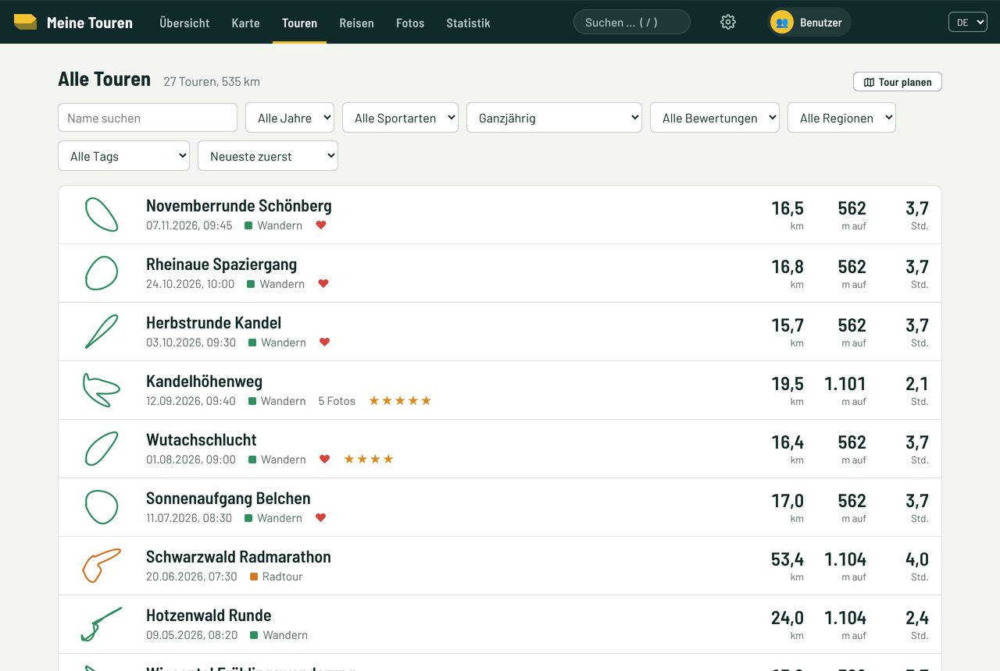

*Abbildung 11: Die Liste aller Touren.*

*Abbildung 12: Die Filter (rot umrandet) – hier ist „Wandern“ gewählt, daher steht oben „24 Touren, 416 km“.*

### Die Suche

Das Suchfeld ganz oben („Suchen … ( / )“) durchsucht Tournamen, Notizen, Sportart, Datum, Monat, Jahr, Orte, Landkreis, Bundesland, Land und Tags. Drücke die Taste **/**, um es sofort anzuspringen.

Die Suche ist **akzent- und apostroph-unabhängig**: „reunion“ findet „Réunion“, „strasse“ findet „Straße“, „munstertal“ findet „Münstertal“. Das gilt für das Suchfeld der Kopfzeile, den Namensfilter der Liste, die Auswertung nach Regionen und die Bausteine-Suche in „Seite anpassen“.

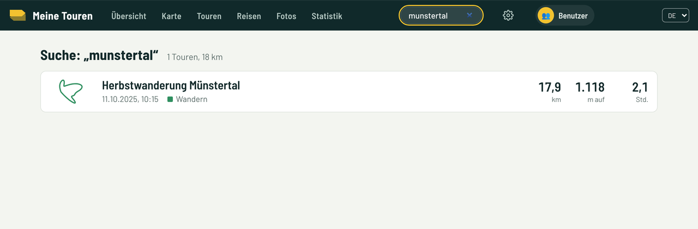

*Abbildung 13: „munstertal“ ohne Umlaut findet „Herbstwanderung Münstertal“.*

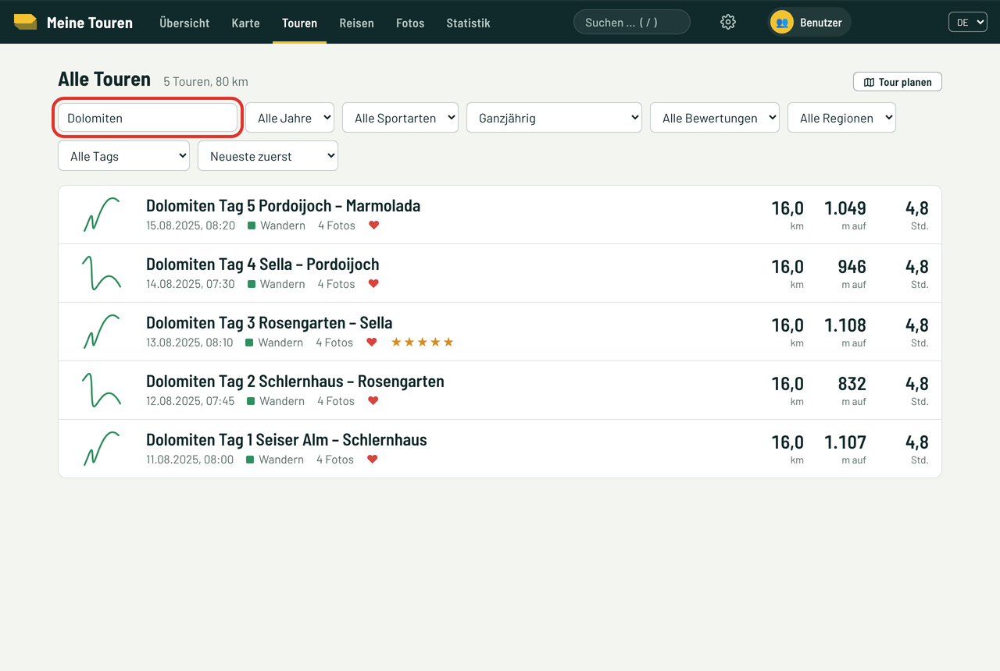

*Abbildung 14: Der Namensfilter der Liste („Dolomiten“) zeigt die fünf Etappen der Hüttenwanderung.*

[↑ Inhaltsverzeichnis](#inhalt)

---

## 7. Das Tourdetail

**Zweck:** Alles zu einer Tour an einem Ort. Das Beispiel hier ist „Dolomiten Tag 3 Rosengarten – Sella“.

### 7.1 Kopf, Kennzahlen, Notiz, Bewertung

Oben stehen Sportart, Datum und Name. Rechts oben gehst du mit **Vorherige** und **Nächste** durch die Touren. Darunter:

* drei Knöpfe: **Ansehen**, **Teilen & Export**, **Bearbeiten** (Abschnitt 7.7),
* eine Marke wie „lokal gespeichert“,
* ein Feld **Notiz zur Tour** (Wetter, Begleitung, Einkehr …) – du tippst, es wird gespeichert,
* **Tags** und – bei Mehrtagestouren – ein Hinweis mit Link zur Gesamtansicht,
* **Meine Bewertung** mit fünf Sternen (das ✕ löscht sie),
* die **Kennzahlen**: Strecke, Aufstieg, Abstieg, Dauer, Tempo im Schnitt, Höchster Punkt, Neuland.

*Abbildung 15: Der obere Teil des Tourdetails.*

### 7.2 Karte

Der Abschnitt **Karte** zeigt die Strecke mit Start (grün) und Ziel (rot) und Fotos als Marker. Darüber stehen Gehzeit, Pausen, Steigrate und steilster Abschnitt. Mit **+/−** zoomst du, mit dem Schichten-Symbol wechselst du die Kartenart, und **Steigung** färbt die Strecke nach Steilheit.

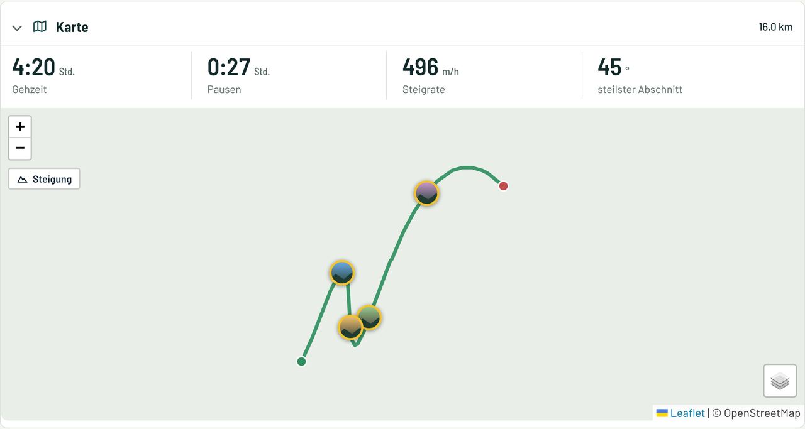

*Abbildung 16: Der Abschnitt „Karte“ (die Kartenkacheln fehlen in dieser Aufnahme).*

### 7.3 Höhenprofil

Das **Höhenprofil** zeigt die Höhe über der Strecke. Die **gelben Punkte** sind Fotos – anklicken öffnet sie. Hat die Tour Pulsdaten, liegt der Puls als rote Linie darüber.

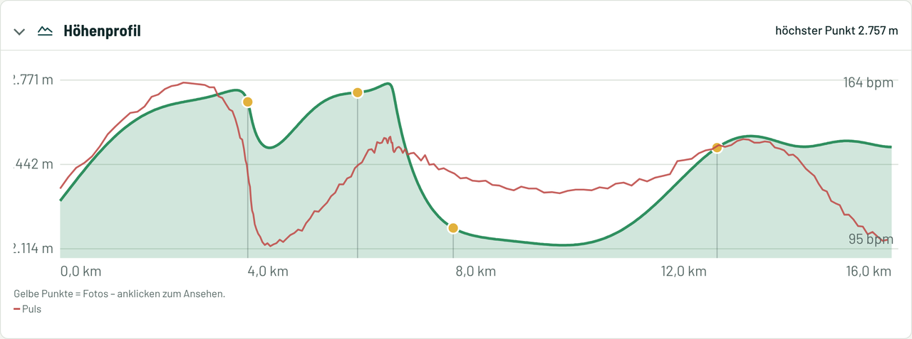

*Abbildung 17: Höhenprofil mit Foto-Punkten (gelb) und Puls (rot).*

### 7.4 Puls

Der Abschnitt **Herzfrequenz** erscheint, wenn das Gerät den Puls geliefert hat: Durchschnitt, Maximum, Minimum, Verlauf und die **Pulszonen** Z1 bis Z5 (Sehr leicht, Leicht, Moderat, Hart, Maximal) mit den Zeiten je Zone. Die Zonen richten sich nach deinem Maximalpuls (Standard 185 bpm; einstellbar unter *Verwaltung → Übersicht → Heimatort und Puls*).

*Abbildung 18: Herzfrequenz und Pulszonen.*

### 7.5 Geschwindigkeit und Auswertung dieser Tour

Unter **Auswertung dieser Tour** findest du **Analyse** (Bewegungszeit, Pausen), **Tempo nach Steigung** (bergauf, eben, bergab) und **Messwerte**. **Detaillierte Auswertung ansehen ›** öffnet die Seite mit allen Messwerten, z. B. dem **Geschwindigkeitsverlauf** (Ø, Ø in Bewegung, Maximum) und dem Tempo (Pace). Ein Stern (*) hinter einem Wert bedeutet: aus GPS-Strecke und Zeit berechnet, kein Messwert des Geräts. Welche Messwerte da sind, hängt vom Gerät ab.

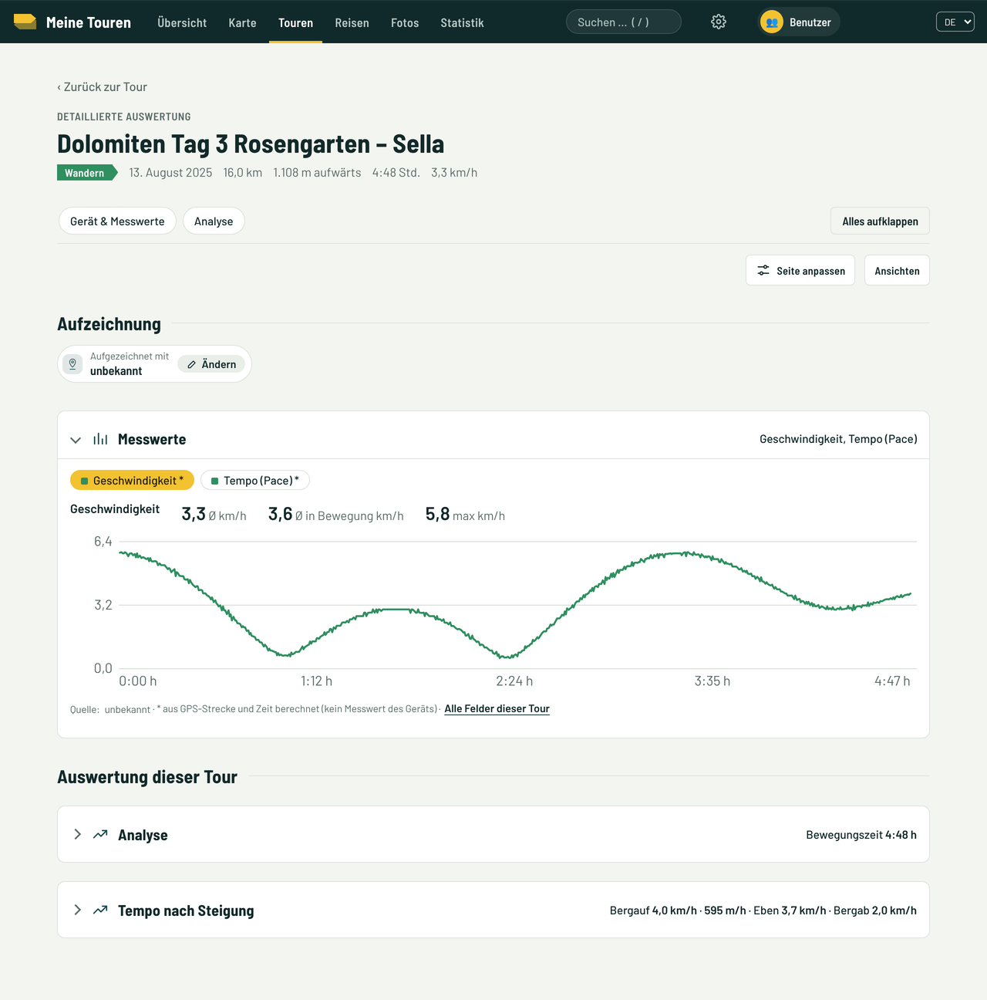

*Abbildung 19: Die detaillierte Auswertung mit dem Geschwindigkeitsverlauf. Mit „Ändern“ legst du fest, womit die Tour aufgezeichnet wurde.*

### 7.6 Fotos der Tour

Der Abschnitt **Fotos** zeigt zuerst einen **Foto-Streifen** mit den besten (höchstens 12) Fotos der Tour in Aufnahmereihenfolge – nach Sternen und Schärfe gewählt, sonst gleichmäßig über die Tour verteilt; am Handy wischst du ihn zur Seite. Ein Tipp auf ein Foto öffnet das Vollbild, dort blätterst du durch alle Fotos. **Alle … Fotos** öffnet das volle Raster mit Uhrzeit (es lädt beim Herunterscrollen in Blöcken nach), **Weniger zeigen** schließt es wieder. Einmal gesehene Fotos lädt die App nicht erneut. Die Knöpfe:

* **Fotos bearbeiten**,
* **Fotos hinzufügen …**,
* **Zeit per GPS prüfen** (korrigiert falsche Kamerauhren),
* **⭐ Beste Fotos**,
* **Fotos ausrichten** (Perlenkette, siehe [Kapitel 10](#k10)),
* **Diashow**.

*Abbildung 20: Fotos der Tour mit ihren Knöpfen.*

### 7.7 Die drei Menüs: Ansehen, Teilen & Export, Bearbeiten

**Ansehen** bietet:

* **Erzählung** – Zeitleiste mit Wegpunkten, Fotos und Kommentaren (mit **Teilen (mit Kommentaren)** und **Drucken**),
* **3D-Flug** – die Strecke im 3D-Gelände abfliegen,
* **Tourblatt** – druckbare Seite mit Karte, Profil und Fotos (**PDF herunterladen**, **Drucken**, Haken „Fotos im PDF“).

*Abbildung 21: Das Menü „Tour ansehen“.*

*Abbildung 22: „Erzählung“: Start, Fotos mit Uhrzeit und Puls, Ziel.*

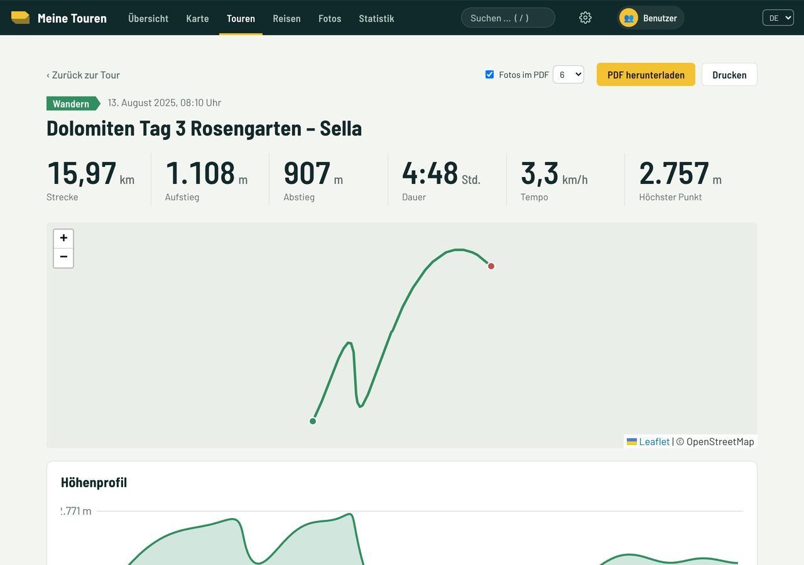

*Abbildung 23: Das Tourblatt – oben die Knöpfe „PDF herunterladen“ und „Drucken“.*

**3D-Flug: Steuerung in der freien Kamera (ab 3.40.0)** – im Modus „Kamera folgt“ bleibt alles wie bisher; jede eigene Bewegung wechselt in die freie Kamera.

Rechts auf der Flugkarte steht immer eine **Bedienleiste**: Kompass (Nadel zeigt nach Norden und wird mit der Neigung flacher; ein Tipp stellt **Norden / Draufsicht** ein), **nach links / rechts drehen**, **flacher / steiler neigen** und die Voreinstellungen **Von oben**, **Schräg** und **Hinter der Tour**. Gedreht wird um den aktuellen Punkt der Tour, nicht um die Bildmitte. Das **?** zeigt die Hilfe mit allen Belegungen; beim ersten Wechsel in die freie Kamera erscheint einmal ein kurzer Hinweis.

| Aktion | Maus | Touchpad | Touchscreen | Tastatur |
| --- | --- | --- | --- | --- |
| Verschieben | Ziehen | Ziehen (Klicken und Ziehen) | Ein Finger | – |
| Zoomen | Mausrad | Zwei Finger spreizen (Pinch) | Zwei Finger spreizen | – |
| Drehen | rechte Taste oder Strg/Cmd + Ziehen, Umschalt + Ziehen | Zwei Finger seitwärts wischen; Safari: Drehgeste | Zwei Finger verdrehen | Pfeil links/rechts (Umschalt: doppelter Schritt) |
| Neigen | wie Drehen (senkrecht ziehen), Alt + Mausrad | Zwei Finger senkrecht wischen | Zwei Finger gemeinsam nach oben/unten | Pfeil hoch/runter |

Ob eine Maus oder ein Touchpad benutzt wird, erkennt die App an der Art der Bewegung (je Geste neu). Passt das nicht – etwa bei einer Maus mit stufenlosem Rad –, stelle im Bedienfeld unten **Bedienung: Maus** (das Rad zoomt immer) oder **Bedienung: Touchpad** (Wischen dreht und neigt immer) ein; die Wahl merkt sich dieser Browser. Den früheren Knopf „↻ Drehen“ gibt es nicht mehr. Mit der Systemeinstellung „Bewegung reduzieren“ springen die Voreinstellungen ohne Kamerafahrt ans Ziel.

> **3D-Flug:** Er braucht WebGL im Browser sowie Gelände- und Kartendaten aus dem Internet. In der Umgebung, in der die Bilder dieses Handbuchs entstanden sind, gab es diese Daten nicht; deshalb ist hier kein Bild des 3D-Flugs abgebildet.

**Teilen & Export** bietet **Link senden**, **Diashow senden**, **Diashow-Link**, **Links verwalten** und **GPX-Datei laden** (Strecke als GPX herunterladen). Mehr in [Kapitel 14](#k14).

*Abbildung 24: Das Menü „Teilen & Export“.*

**Bearbeiten** bietet:

* **Umbenennen**, **Tags & Alben** (Schlagworte),
* **Streckenfarbe** (Farbe und Breite auf der Karte),
* **Höhen korrigieren** (mit Geländemodell neu berechnen), **Höhe aus Uhr abgleichen (Zepp)**,
* **Track korrigieren** (Fehlpunkte und Pausen bereinigen; das Original bleibt erhalten),
* **Hochladen** (zu Strava, Komoot … – nur auf deinen Wunsch),
* **Tour löschen** (rot, abgesetzt; entfernt die Tour nur aus Meine Touren).

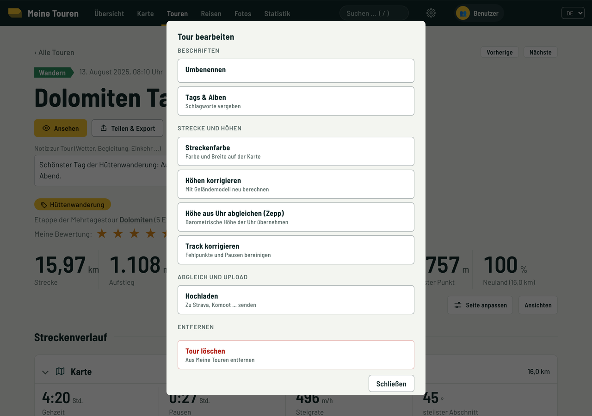

*Abbildung 25: Das Menü „Tour bearbeiten“.*

### Plan und Ergebnis (Soll/Ist)

Ist eine Tour mit einer Planung verknüpft (in der Planliste, z. B. über den Vorschlag „Gelaufen am … vorschlagen“ mit **Bestätigen**), erscheint auf der Tourseite unter dem Streckenverlauf die einklappbare Karte **Plan und Ergebnis**: **Strecke**, **Aufstieg** und **Zeit gesamt** (einschließlich Pausen) als Plan und Ergebnis, dazu der Unterschied mit Vorzeichen, Pfeil und Wort (↑ länger/mehr als geplant, ↓ kürzer/weniger, = wie geplant – nie nur durch Farbe). Darunter liegt die geplante Linie (gestrichelt) über der gelaufenen (durchgezogen). **Zum Plan** öffnet die Planung, **Verknüpfung lösen** hebt die Verknüpfung auf (der Plan bleibt erhalten). Ohne Verknüpfung erscheint die Karte nicht; im Katalog (**Seite anpassen** → **Baustein hinzufügen**, Kategorie **Planung**) ist sie als „Plan und Ergebnis“ für alle Touren vorhanden. Betrachter sehen die Karte ohne Knöpfe; in geteilten Links erscheint sie nie.

### 7.8 Tourseite selbst gestalten

Auch das Tourdetail besteht aus Bausteinen. Unter den Kennzahlen stehen **Seite anpassen** und **Ansichten** – siehe [Kapitel 13](#k13).

[↑ Inhaltsverzeichnis](#inhalt)

---

## 8. Die Karte

**Zweck:** Alle Touren auf einer Karte – zum Beispiel, um zu sehen, wo du überall warst.

Oben schwebt eine Leiste mit Bedienelementen:

* **Standort** – zeigt deine Position (Browser fragt nach Erlaubnis),
* **Alle Jahre** – Jahr wählen, daneben die Zahl der Touren,
* **Wandern / Radtour …** – Sportarten ein- und ausschalten (jede hat ihre Farbe),
* **Strecken**, **Heatmap**, **Fotos** – Darstellungsarten: Strecken einzeln, Heatmap (Häufigkeit), Fotos als Marker (bei Fotos ohne eigenen Aufnahmeort wird die Position aus der Aufnahmezeit berechnet und blasser gezeigt),
* **Touren im Ausschnitt** – listet die Touren des gerade sichtbaren Kartenausschnitts in einem Fenster über allen Bedienfeldern. Es gibt immer nur ein Fenster; **Esc** oder **Schließen** schließt es und bringt den Fokus zurück auf den Knopf.

Der Hinweistext am Knopf **Heatmap** erklärt den Unterschied: Die Heatmap zeichnet alle Touren in einer Farbe übereinander (häufig begangene Wege leuchten stärker) und ersetzt die farbigen Tracklinien; der Knopf **Strecken** ändert deren Farbe und Breite.

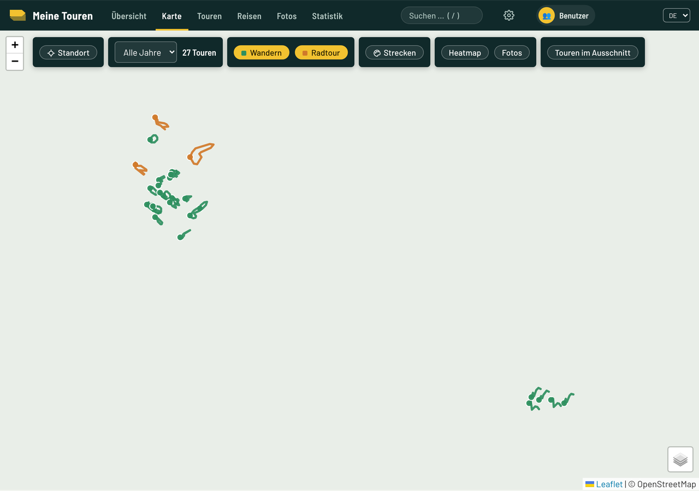

*Abbildung 26: Alle Touren, nach Sportart gefärbt (Wandern grün, Radtour orange).*

*Abbildung 27: Die Bedienelemente (rot umrandet); hier ist „Heatmap“ eingeschaltet.*

### Die Karten-Seite anpassen

Auch die Karte ist eine anpassbare Seite (**Seite anpassen**, [Kapitel 13](#k13)). Die **Karte** selbst bleibt immer sichtbar; du kannst nur ihre Breite wählen und sie verschieben. Die Bedienelemente sind einzelne **Bedienfelder**: **Mein Standort**, **Jahr und Anzahl**, **Aktivitäten**, Strecken-Stil, Heatmap und Fotos sowie **Touren im Ausschnitt**. Sie lassen sich verschieben, einklappen und ausblenden; ein ausgeblendetes Bedienfeld behält seine Einstellung. Nach jeder Änderung passt sich die Karte an, ohne dass ein selbst gewählter Kartenausschnitt verloren geht. Im Katalog (Kategorie **Karte**) gibt es zusätzlich die Bausteine **Karten-Kennzahlen**, **Touren im Kartenausschnitt** und **Legende der Aktivitäten**; Vorlagen sind „Karte mit Kennzahlen“, „Karte mit Liste“ und „Nur die Karte“. Gruppen gibt es auf der Karte nicht.

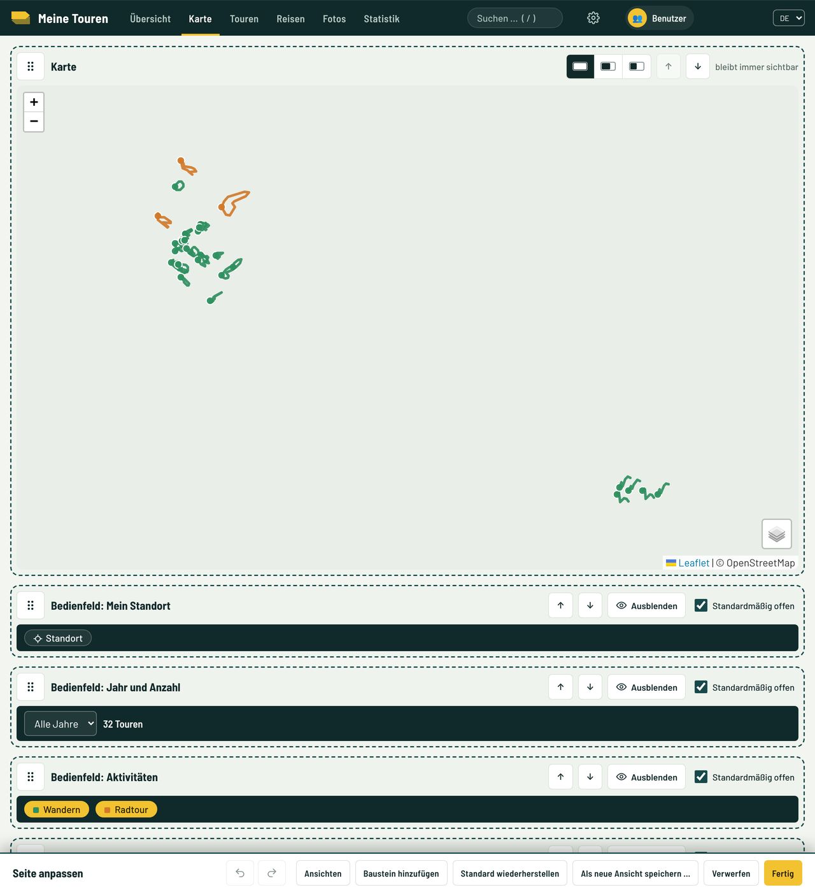

*Abbildung 28: Die Karte im Bearbeitungsmodus: Die Karte bleibt immer sichtbar, darunter stehen die Bedienfelder als eigene Bausteine (Kartenkacheln fehlen in der Aufnahme).*

**Hinweis:** Karten und Tourdetails arbeiten mit den **lokal gespeicherten Strecken**; nur die Kartenkacheln kommen aus dem Internet. Für unterwegs ohne Netz kannst du Touren und Kacheln **offline vorbereiten** ([Kapitel 15](#k15)).

[↑ Inhaltsverzeichnis](#inhalt)

---

## 9. Reisen und Mehrtagestouren

**Zweck:** Mehrtägige Unternehmungen weit weg von zu Hause werden automatisch erkannt und als Einheit dargestellt.

### 9.1 Wann ist etwas eine Reise?

* **Reise:** Touren **weit weg von zu Hause** (mehr als etwa 60 km) an **mindestens vier Tagen** am Stück. Wochenend- und Kurzausflüge erscheinen hier nicht; sie bleiben normale Touren.
* **Heimatort:** Die App erkennt ihn selbst aus deinen Touren. Du kannst ihn unter *Verwaltung → Übersicht → Heimatort und Puls* festlegen (Ort oder Adresse suchen, „Suchen“, Treffer anklicken, „Einstellungen speichern“). Touren in der Nähe zählen dann nie als Reise.
* **Mehrtagestour:** Tourenreihen mit Namen wie „… Tag 3“ oder „… Etappe 2“ werden zusammengefasst. Mit **＋ Mehrtagestour bilden …** legst du eine selbst an.

### 9.2 Die Reisen-Übersicht

Menü **Reisen**. Die Seite besteht aus den Abschnitten **Mehrtagestouren**, **Reisen**, **Alben und Tags** und (zugeklappt) **Entfernte Reisen**. Jede Reise ist eine Kachel mit Zeitraum, Zahl der Touren, Kilometern und Höhenmetern.

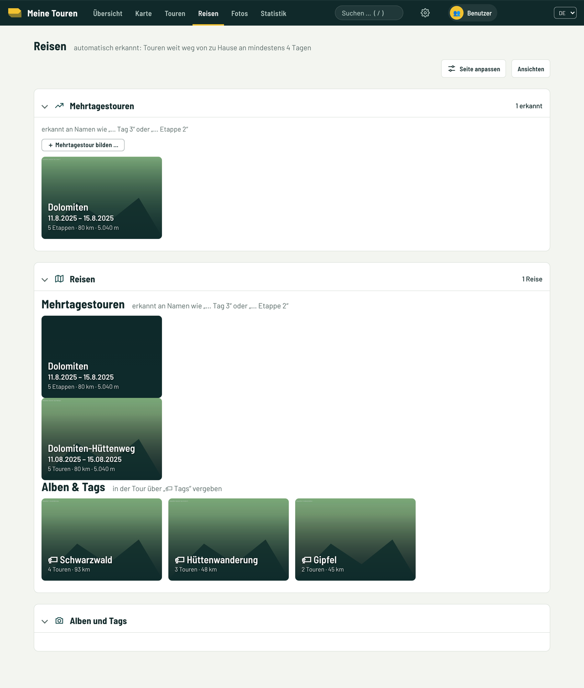

*Abbildung 29: Die Reisen-Übersicht mit der Mehrtagestour „Dolomiten“, der Reise „Dolomiten-Hüttenweg“ und den Tags in der eigenen Karte „Alben und Tags“.*

### 9.3 Die Reise-Seite

Ein Klick auf die Reise öffnet die Seite mit:

* **Kennzahlen** (Touren, Strecke, Aufstieg, Abstieg, Unterwegs, Tage),
* **Statistik nach Aktivität**,
* **3D-Flug und Offline-Karte** (**3D-Flug über alles**, **Karte offline speichern**),
* **Karte** mit den Tagen in verschiedenen Farben,
* **Fotos** der Reise,
* **Touren** (Liste der Etappen).

Oben stehen **Reisebericht (PDF)**, **Senden**, **Reise bearbeiten** (Name und Zeitraum ändern) und **Keine Reise** (aus der Liste entfernen; die Touren bleiben). Die automatisch erkannte Region heißt zunächst „Reise“ oder wie das Bundesland; mit „Reise bearbeiten“ gibst du ihr einen eigenen Namen wie hier „Dolomiten-Hüttenweg“.

*Abbildung 30: Die Reise-Seite „Dolomiten-Hüttenweg“ (fünf Tage, 80 km).*

### 9.4 Das Reiseblatt

**Reisebericht (PDF)** öffnet das Reiseblatt mit Karte, Statistik und Fotos. Dort stellst du ein, ob Fotos im PDF erscheinen und wie viele, und klickst **PDF herunterladen** oder **Drucken**.

*Abbildung 31: Das Reiseblatt (Reisebericht).*

### 9.5 Reisen anpassen

Reise-Seite und Reisen-Übersicht sind wie alle Seiten anpassbar ([Kapitel 13](#k13)): Jeder Abschnitt ist ein Baustein, den du verschieben, ausblenden, einklappen und in der Breite ändern kannst. Der Kopf mit Titel, Zeitraum und Aktionen lässt sich verschieben, aber nicht ausblenden. In der Übersicht sind Mehrtagestouren, Reisen, Alben und Tags sowie „Entfernte Reisen“ (standardmäßig zugeklappt) Bausteine. Zusätzliche Bausteine: Reise-Kennzahlen, Kilometer je Tag, Reise-Diashow, Reisen-Kennzahlen und Reisen je Jahr; dazu gibt es fünf Vorlagen. Das Layout gilt für alle Reisen.

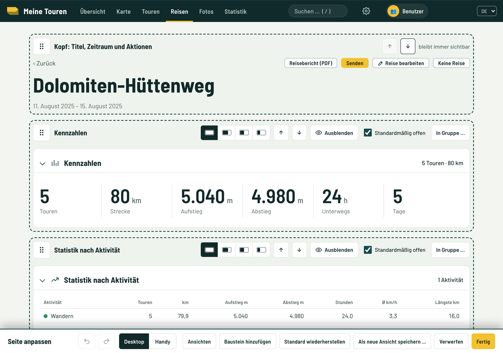

*Abbildung 32: Die Reise-Seite im Bearbeitungsmodus: Kopf, Kennzahlen und „Statistik nach Aktivität“ als Bausteine mit Breitenwahl, Pfeilen und „Ausblenden“.*

[↑ Inhaltsverzeichnis](#inhalt)

---

## 10. Fotos und Diashow

### 10.1 Fotos importieren

**Zweck:** Fotos werden über die **Aufnahmezeit** (und den Aufnahmeort, wenn vorhanden) automatisch der passenden Tour zugeordnet.

**Schritt für Schritt:**

1. Menü **Fotos → Fotos importieren …** (auch in der Verwaltung unter *Fotos* und im Tourdetail unter **Fotos hinzufügen …**).
2. Einen Ordner oder einzelne Fotos auswählen – oder einfach ins Fenster ziehen.
3. Die App zeigt **je Aufnahmetag**, welcher Tour die Fotos zugeordnet werden. Pro Tag kannst du ändern: „nach Uhrzeit“, andere Tour, „ohne Tour“ oder „nicht importieren“.
4. Starten; danach steht da, wie viele Fotos Touren zugeordnet wurden.

Die Bilder werden **im Browser verkleinert**, nur die kleinen Dateien gehen über das Netz; Originale werden nie verändert.

**Weitere Wege** (Verwaltung → Fotos): der **Foto-Eingang** – Fotos einfach in den Eingangsordner kopieren (scp, rsync oder SMB-Freigabe); sie werden automatisch verkleinert, mit Aufnahmezeit übernommen und Touren zugeordnet (Prüfung alle 5 Minuten). Dazu **Bibliothek neu einlesen** und SMB-Ordner bzw. ein Mac-Skript.

*Abbildung 33: Der Reiter „Fotos“ in der Verwaltung.*

**Falsche Kamerauhr?** Beim Import erkennt die App Zeitverschiebungen an Fotos mit Aufnahmeort und bietet eine minutengenaue Korrektur an. Bei bereits importierten Fotos prüft **Zeit per GPS prüfen** im Tourdetail die Uhrzeiten und korrigiert sie nach Rückfrage. **Fotos zuordnen** auf der Fotos-Seite ordnet nachträglich zu.

### 10.2 Die Fotos-Seite

Menü **Fotos**: oben **Fotos zuordnen**, **Fotos importieren …**, **Diashow 2025** (für das gewählte Jahr) und **Zufall**. Darunter Reiter je Jahr. Die Fotos sind nach Tour gruppiert; jede Gruppe hat einen eigenen Knopf **Diashow**. Ein Klick auf ein Foto öffnet die Großansicht.

Auch die Fotos-Seite lässt sich anpassen ([Kapitel 13](#k13)): Der **Kopf** (Titel, Zahlen, Aktionen) bleibt immer sichtbar, die **Jahresleiste** und die **Fotos des Jahres** sind Bausteine, die du verschieben, ausblenden oder in der Breite ändern kannst. Neue Bausteine sind **Foto-Kennzahlen** (Fotos, einer Tour zugeordnet, Touren mit Fotos, Jahre, Länder – Länder nur, wenn sie bekannt sind) und **Fotos je Jahr** (Säulen je Jahr). Vorlagen: „Mit Kennzahlen“, „Nur Fotos“ und „Jahresverlauf“.

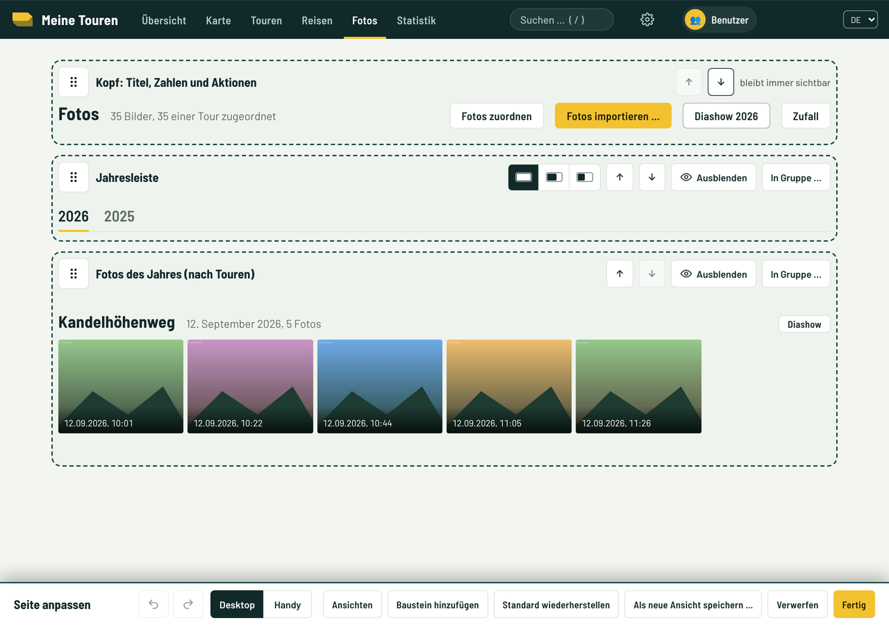

*Abbildung 34: Die Fotos-Seite im Bearbeitungsmodus mit den Bausteinen Kopf, Jahresleiste und Fotos des Jahres.*

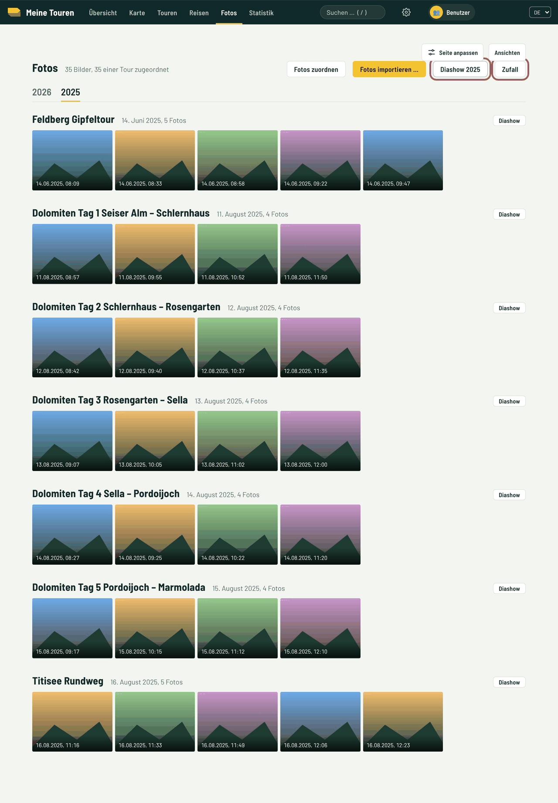

*Abbildung 35: Fotos nach Touren, Reiter für 2026 und 2025. Die Knöpfe „Diashow 2025“ und „Zufall“ sind hervorgehoben.*

*Abbildung 36: Die Großansicht. Mit ← und → blätterst du, Esc schließt.*

### 10.3 Fotos auf der Strecke ausrichten („Perlenkette“)

Stimmt die Position eines Fotos nicht: Im Tourdetail auf **Fotos ausrichten** klicken, auf der Karte **ein** Foto an die Stelle ziehen, an der es sicher entstand – alle anderen Fotos wandern im gleichen zeitlichen Abstand wie auf einer Perlenkette mit. **Speichern** verschiebt die Aufnahmezeiten dauerhaft (wahlweise auch die anderen Fotos desselben Tages); **Original-Zeiten** nimmt jede Verschiebung zurück. Voraussetzung: Die Strecke enthält Zeitstempel.

### 10.4 Diashow

Die Diashow läuft im Vollbild: automatischer Wechsel (3, 5 oder 8 Sekunden), unten Tourname, Datum und Uhrzeit, Position („1/30“).

* **Leertaste:** Pause · **← →:** blättern · **F:** Vollbild.
* Auf Touchgeräten erscheinen oben rechts Knöpfe für Teilen (📤), Pause, Vollbild und Schließen; sie blenden sich aus und kommen per Tippen zurück. Wischen blättert.

*Abbildung 37: Die Diashow des Jahres 2025 (30 Fotos).*

**Diashow teilen:** In einer Tour über **Teilen & Export → Diashow senden** bzw. **Diashow-Link**; für ein ganzes Jahr oder alle Fotos über den Teilen-Knopf in der Diashow. Der Link braucht beim Empfänger **kein Konto**. Beim Tour-Link wählst du vorher, welche Fotos (alle oder nur die besten) und die Gültigkeit (7 Tage, 30 Tage, unbegrenzt). Der **Diashow-Link für ein Jahr oder alle Fotos gilt 24 Stunden** und enthält bis zu 300 der besten Fotos; abgelehnte und ausgeblendete Fotos fehlen. Der Link zeigt nur Fotos, ihre Aufnahmezeit und den Tournamen – keine Karte, keine Orte, keine Notizen, keine Strecken, keine Kommentare.

### 10.5 Erinnerungen

Die Kachel **Erinnerungen** (Übersicht und Statistik) zeigt Fotos aus deinem Archiv. Über **Seite anpassen → Erinnerungen → Einstellungen** (Zahnrad) legst du fest:

* **Welche Fotos:** zufällig, beste Fotos, „an diesem Tag in früheren Jahren“ oder neueste; optional nach Aktivität und Zeitraum gefiltert; 3, 6, 9 oder 12 Stück.
* **Darstellung:** Raster, Streifen (seitlich wischen) oder Einzelbild-Show (blättert selbst).
* **Anzeige:** Titel, Bildunterschrift, „Neu mischen“, Link „Diashow starten“.

Die Kachel lässt sich mehrfach mit unterschiedlichen Einstellungen hinzufügen.

[↑ Inhaltsverzeichnis](#inhalt)

---

## 11. Statistik, Rekorde, Puls und Auswertung

**Zweck:** Zahlen und Diagramme über alle deine Touren. Menü **Statistik**, vier Reiter: **Übersicht**, **Auswertung**, **Rekorde**, **Puls**.

### 11.1 Übersicht

Oben steht der **globale Filter**, der für alle Bausteine der Seite gilt:

* **Gesamt** oder ein einzelnes Jahr (2026, 2025 …),
* Zeitraum: **Laufendes Jahr**, **Letzte 12 Monate**, **Letzte 90 Tage**, **Vorjahr**, **Von–bis …**,
* Aktivität: **Alle Sportarten**, **Wandern**, **Radtour** …

Daneben **Jahresrückblick 2026** ([Kapitel 12](#k12)). Die Bausteine:

* **Kennzahlen** (Touren, Strecke, Aufstieg, Unterwegs, pro Tour im Schnitt),
* **Ziele** – ein Ziel anlegen: **Ziel hinzufügen**, Zeitraum (Ziel für das Jahr oder für jede Woche, ab 3.45.0), Messgröße (Kilometer, Höhenmeter, Touren, Stunden), Sportart, **Zielwert**, **Speichern**. Nur hier werden Ziele gepflegt; der Baustein „Ziele“ zeigt sie auf anderen Seiten. Die App zeigt Fortschritt, Prognose zum Jahresende und ob du im Plan liegst,
* **Kilometer pro Jahr** (ein Klick auf einen Balken öffnet das Jahr) und **Kilometer im Jahresverlauf** (mit Vorjahreslinie),
* **Sportarten**, **Bestwerte** (Baustein, Anzahl einstellbar), **Aktivität im Jahr** (Kalender-Heatmap),
* **Dein typisches Tempo** (bergauf, eben, bergab; mit **Schätzen** für eine Tour, die du planst),
* **Erinnerungen**.

*Abbildung 38: Statistik → Übersicht. Der globale Filter (rot) wirkt auf alle Bausteine.*

### 11.2 Auswertung

Die Auswertung zeigt Orte, Gipfel, Leistung, Wetter und Neuland: **Häufigste Startorte** (braucht „Regionen bestimmen“ in der Verwaltung), **Gipfel & Pässe** („Gipfel bestimmen“), **Wanderführer-Fortschritt**, **Leistung über die Jahre** (Tempo, Höhenmeter pro Stunde), **Wetter** („Wetter für alle Touren laden“) und **Neuland** (Anteil der Strecke, der auf keiner früheren Tour lag; „Größte Entdeckungen“). Einige Abschnitte sind leer, bis du die genannten Auswertungen gestartet hast – sie brauchen Internet (Ortsnamen, Gipfel, Wetter).

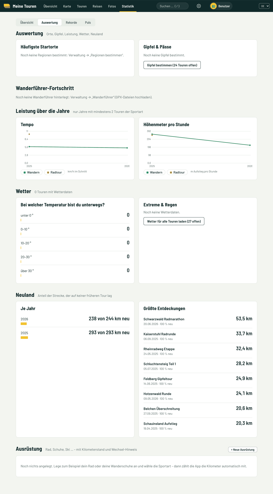

*Abbildung 39: Auswertung. In dieser Demo wurden Regionen, Gipfel und Wetter noch nicht bestimmt; die Abschnitte bieten deshalb die entsprechenden Knöpfe an.*

### 11.3 Rekorde

Rekorde mit Vergleichen („um die Erde“, „Mount Everest bergauf“), **Bestwerte gesamt** (längste Strecke, meiste Höhenmeter, längste Dauer), **Höchste Punkte**, **Nach Wochentag** und **Je Sportart**. Oben wählst du die Aktivität.

*Abbildung 40: Rekorde.*

### 11.4 Puls

Wenn deine Touren Pulsdaten haben: **Zeit in den Pulszonen** je Jahr, **Durchschnittspuls je Tour** (ein Punkt je Tour, Antippen öffnet sie) und **Die anstrengendsten Touren** (Anteil der Zeit in Zone 4 und 5). Der Maximalpuls für die Zonen steht in der Verwaltung ([Abschnitt 15.1](#k15)).

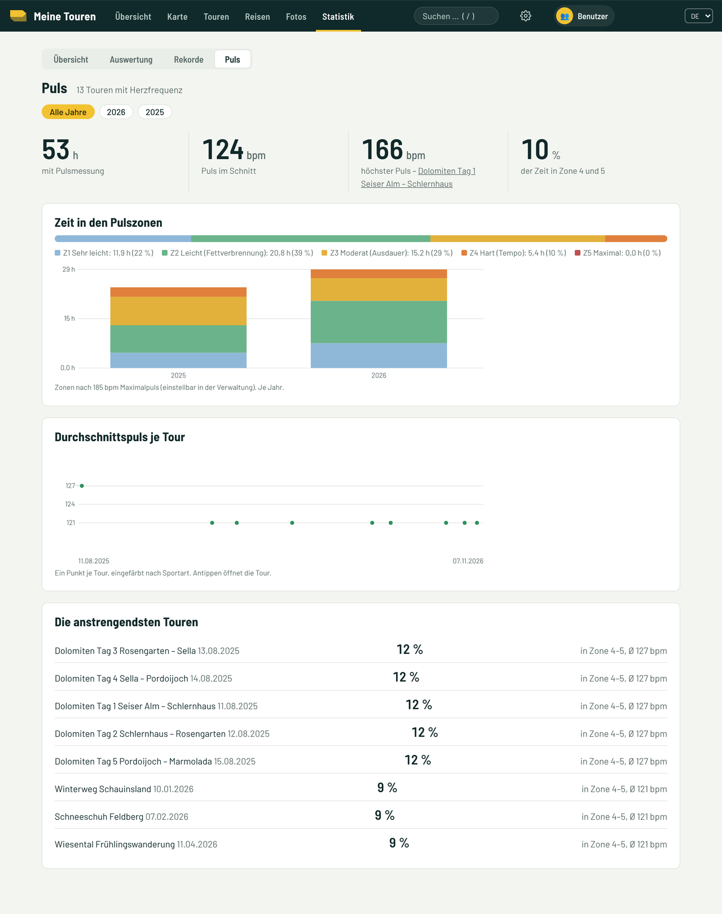

*Abbildung 41: Puls mit Pulszonen und den anstrengendsten Touren.*

### 11.5 Statistik anpassen

Die Statistik besteht aus Bausteinen wie die anderen Seiten: **Seite anpassen** und **Ansichten** ([Kapitel 13](#k13)). Neuere Bausteine wie „Jahreszeiten und Wetter“, die Wochenansicht von „Belastung und Erholung“ und „Ausrüstung“ stehen in [Abschnitt 13.12](#k13).

[↑ Inhaltsverzeichnis](#inhalt)

---

## 12. Der Jahresrückblick

**Zweck:** Dein Tourenjahr als Seite zum Anschauen, Drucken und Teilen.

**Öffnen:** Statistik → Knopf **Jahresrückblick 2026** (Jahr passt sich an). Die Seite zeigt:

* das Jahr groß, darunter Touren, Kilometer, Höhenmeter, Stunden, Tage unterwegs und den Vergleich zum Vorjahr,
* **Kilometer pro Monat** (stärkster Monat hervorgehoben) und **Sportarten**,
* **Die fünf stärksten Touren**,
* **Fotos des Jahres** mit Knopf **Diashow**.

Oben: **‹ Übersicht**, „Fotos im PDF“ (mit Anzahl), **PDF herunterladen**, **Drucken**, **Senden**, **Als Link teilen**.

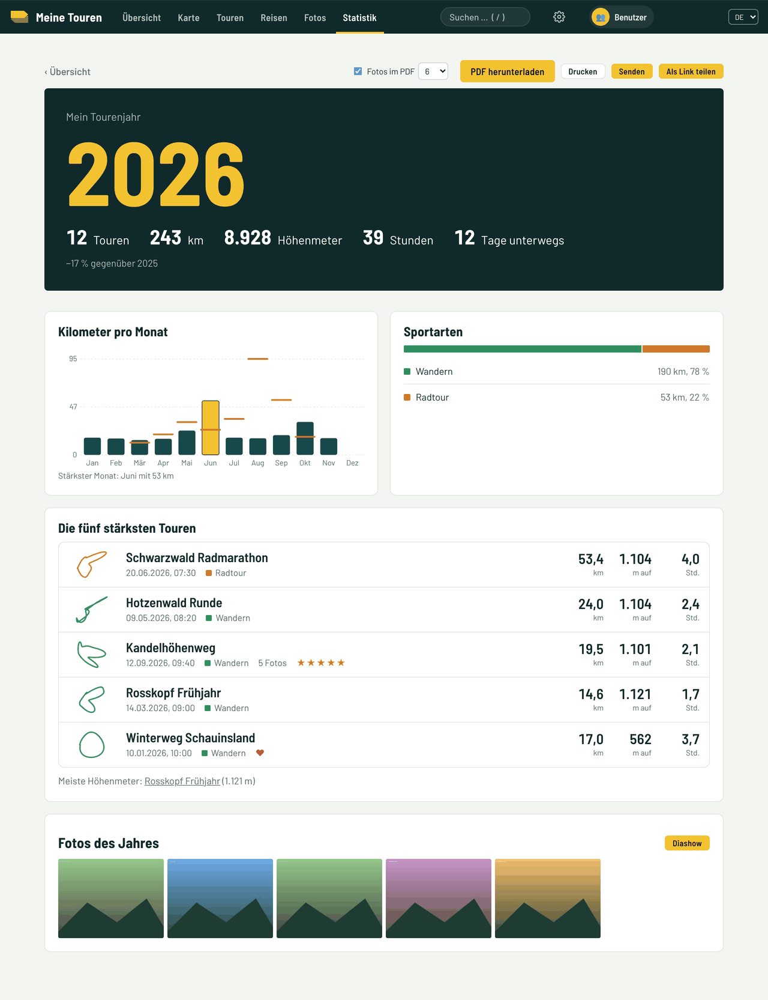

*Abbildung 42: Der Jahresrückblick 2026.*

### Als Link teilen

1. **Als Link teilen** anklicken.
2. **Jahr** und **Aktivität** (alle oder nur eine, z. B. Wandern) wählen.
3. Unter **Was wird gezeigt?** auswählen: **Kennzahlen**, **Rekorde**, **Heatmap** (Kalender, kein Kartenbild), **Beste Fotos**. Die Zeile „Dieser Link zeigt: …“ fasst es zusammen.
4. **Link gültig** wählen (z. B. 30 Tage).
5. **Link erstellen.** Der Link lässt sich ohne Konto öffnen und sauber als PDF speichern oder drucken („Drucken / Als PDF speichern“ auf der Seite).

*Abbildung 43: „Jahresrückblick teilen“. Was du nicht wählst, schickt der Server gar nicht erst mit.*

**Was nie geteilt wird:** Strecken und Koordinaten (auch keine Start- oder Heimatorte, keine Ortsnamen), Notizen, Wegpunkte, Puls, Wetter, Uhr-Rohdaten, Gerät und Ausrüstung. Rekorde nennen nur Tourname und Datum – darauf weist der Dialog hin.

[↑ Inhaltsverzeichnis](#inhalt)

---

## 13. Seiten anpassen: Bausteine, Ansichten, Vorlagen, eigene Kennzahlen

**Zweck:** Tourseite, Übersicht, Statistik, Reise-Seite, Reisen-Übersicht, Fotos-Seite und Karte bestehen aus **Bausteinen**. Du bestimmst, welche es gibt, wo sie stehen und wie breit sie sind. Ohne Anpassung sieht alles aus wie gewohnt. Die Einstellung wird je Benutzer gespeichert; Betrachter sehen den Standard.

### 13.1 Den Bearbeitungsmodus einschalten

1. Auf der Seite **Seite anpassen** anklicken (rechts über den Bausteinen).
2. Jeder Baustein bekommt einen gestrichelten Rahmen und eine Kopfzeile mit Steuerelementen. Unten erscheint eine Leiste mit **Rückgängig** und **Wiederholen**, dem Umschalter **Anordnung für: Desktop | Handy** sowie **Ansichten**, **Baustein hinzufügen**, **Standard wiederherstellen**, **Als neue Ansicht speichern …**, **Verwerfen** und **Fertig**.
3. **Fertig** übernimmt alles. **Verwerfen** lässt alles wie vorher.

In der Kopfzeile jedes Bausteins:

* der **Griff** (⋮⋮) zum Ziehen – auch mit Tastatur: Pfeiltasten verschieben, Home und End springen an den Anfang bzw. das Ende,
* vier **Breiten**: ganze Breite, zwei Drittel, halbe Breite, ein Drittel (auf breiten Bildschirmen stehen kleine Bausteine nebeneinander),
* **↑ ↓** zum Verschieben, **Ausblenden** (der Baustein ist weg, aber nicht gelöscht – im Bearbeitungsmodus holst du ihn zurück),
* **Einstellungen** (Zahnrad), falls der Baustein einstellbar ist,
* **Standardmäßig offen:** ob der Baustein beim Öffnen der Seite aufgeklappt ist,
* **Duplizieren** (bei Bausteinen, die mehrfach vorkommen dürfen) und **In Gruppe …** (bei schmalen Bausteinen im Menü „⋯“).

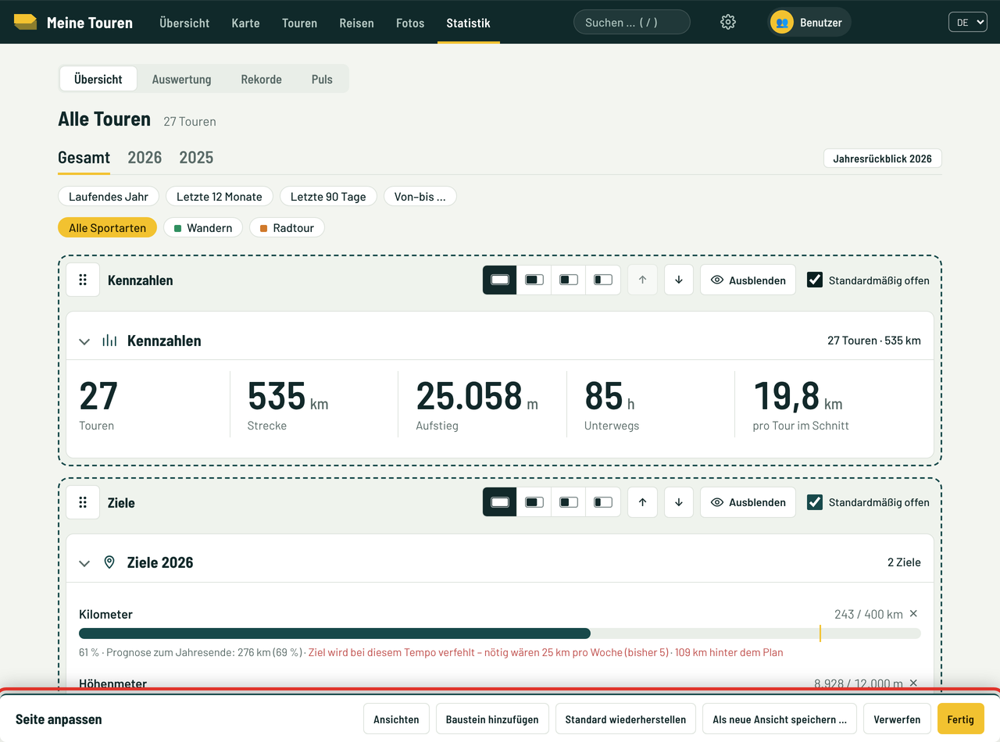

*Abbildung 44: Statistik im Bearbeitungsmodus. Die untere Leiste (rot) enthält Rückgängig und Wiederholen, den Umschalter „Desktop | Handy“ und die Hauptfunktionen.*

**Schalter über der Leiste (nur Übersicht):** Zwei Schalter schweben über der Leiste: **Schnell-Knopf zum Touren holen in der Kopfzeile** und **Zeitraum der Seite anzeigen** (blendet die Leiste „Zeitraum der Seite“ ein oder aus). Hinter **Was ist das?** steht eine kurze Erklärung ([Zeitraum der Seite](#k5)): ein gemeinsamer Zeitraum für alle Bausteine mit Zeitbezug; Bausteine, die „Zeitraum der Seite verwenden“ abgeschaltet haben, behalten ihren eigenen; Bausteine ohne Zeitbezug (zum Beispiel „Heute vor X Jahren“, Erinnerungen) sind nicht betroffen; die Adresse mit `?z=…` ist teilbar, „Ansicht speichern“ legt die Wahl in der Ansicht ab. Der Schalter gehört zur Ansicht (er steht im Layout, auch in Export, Layoutcode und Vorlagen) und ist Teil von Rückgängig und Wiederholen.

### 13.2 Bausteine hinzufügen

1. **Baustein hinzufügen** anklicken.
2. Im Katalog nach Kategorie filtern – **Alle**, **Statistik**, **Zahlen**, **Grafiken**, **Rückblick**, **Planung**, **Touren holen**, **Hinweise**, **Eigene Kennzahlen** (je nach Seite gibt es unterschiedliche, etwa Reisen, Fotos und Karte nur auf der jeweiligen Seite) – oder mit **Bausteine suchen …** nach einem Wort.
3. Bei **Hinzufügen** bekommst du den Baustein ans Seitenende; verschiebe ihn dann an die richtige Stelle. Jeder Baustein hat im Katalog eine kleine, nicht bedienbare **Vorschau mit deinen echten Zahlen**. Sie wird erst geladen, wenn die Karte sichtbar wird; solange steht dort ein Ladezustand. Hast du noch keine passenden Daten, zeigt die Vorschau Beispielwerte und kennzeichnet sie als „Beispielwerte“.

Bausteine gelten nicht nur für eine Seite: „Dein Jahr“ kannst du z. B. auch auf der Tourseite einsetzen, und mehrere Exemplare mit verschiedenen Filtern (Aktivität, Zeitraum, Kennzahlen, Titel) sind möglich.

*Abbildung 45: Der Katalog (hier für die Statistik): Kategorien, Suche und Vorschau.*

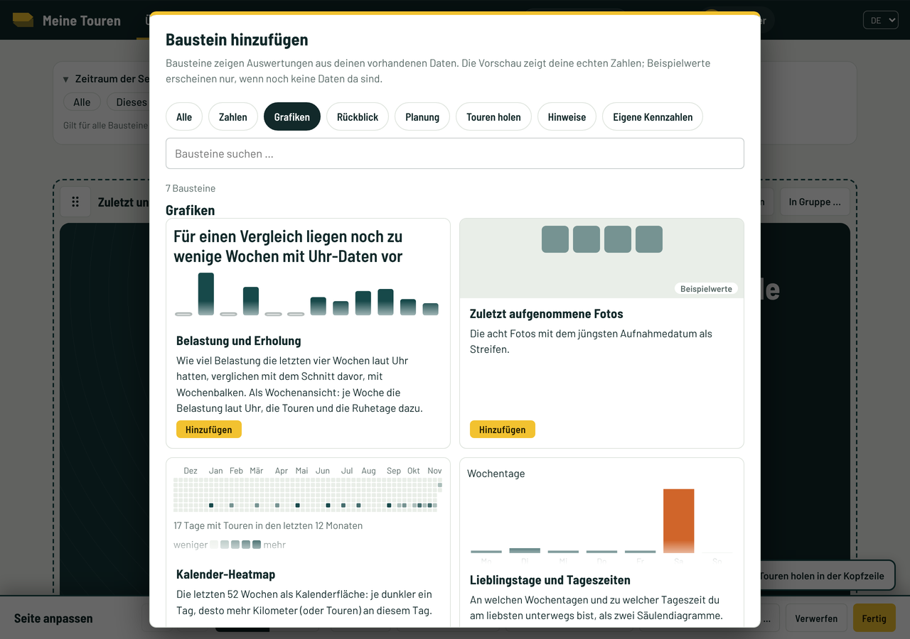

*Abbildung 46: Der Katalog der Übersicht in der Kategorie „Grafiken“ mit Vorschau aus deinen Daten (Beispielwerte, wo noch Daten fehlen).*

### 13.3 Eigene Kennzahlen

Mit einer eigenen Kennzahl rechnest du selbst aus, was du wissen willst – ohne Programmieren.

1. **Seite anpassen → Baustein hinzufügen → Eigene Kennzahlen → Erstellen** (Übersicht und Statistik).
2. Optional: **Mit einer Vorlage starten**, z. B. „Höhenmeter je km“, „Touren pro Monat“, „Längste Wanderung“, „Ziel: 1000 km im Jahr“, „Durchschnittstempo“, „Größter Aufstieg“.
3. **Name und Symbol** vergeben (Emoji, optional).
4. **Was wird gerechnet?** – **Messgröße** (Anzahl Touren, Strecke, Aufstieg, Abstieg, Dauer, Gehzeit, Durchschnittspuls, Höchstpuls, Geschwindigkeit, Steigung, Höhenmeter je Kilometer) und **Rechenart** (Summe, Durchschnitt, Maximum, Minimum, Anzahl, Rekord mit Tourname, Durchschnitt pro Monat). Optional **Formel: durch eine zweite Kennzahl teilen**, z. B. Aufstieg geteilt durch Strecke.
5. **Filter:** Aktivität, Zeitraum (Laufendes Jahr, Letzte 12 Monate, Letzte 90 Tage, Gesamte Zeit, Bestimmtes Jahr, Eigener Bereich), Schlagwort, Mindeststrecke.
6. **Anzeige** – vier einklappbare Gruppen:
   * **Ziel:** ein Zielwert (z. B. 1000 km im Jahr) erzeugt einen Fortschrittsbalken mit Prozent und dem Rest bis zum Ziel. Mit **„Im Plan?“** vergleicht die Kachel deinen Stand mit einem gleichmäßigen Soll (Tag des Jahres bzw. Anteil deines Bereichs) und sagt in Worten **Vor dem Plan**, **Im Plan** oder **Hinter dem Plan**; eine dünne Marke im Balken zeigt das Soll. Es gibt keine Warnfarbe, jede Aussage steht als Text. Das Soll gibt es für Summe und Anzahl ohne Formel bei laufendem Jahr, bestimmtem Jahr und eigenem Bereich.
   * **Vergleich:** zeigt einen Pfeil (**↑ ↓ →**) mit Prozent und Differenz, zum Beispiel „↑ +23,1 % (+15 km)“. Du wählst, womit verglichen wird: **Zeitraum davor**, **Vorjahr** (gleicher Zeitraum bis zum selben Tag) oder **Vormonat** (einen Monat früher). Der Pfeil bewertet nichts: Ob mehr gut ist, hängt von der Kennzahl ab. Für „Gesamte Zeit“ gibt es keinen Vergleich.
   * **Verlauf:** eine kleine Grafik der Wochen- (bis 98 Tage), Monats- oder Jahreswerte als **Linie (Sparkline)**, als **Säulen** oder **Aus**.
   * **Antippen:** Tippst du auf die Kachel oder auf „Touren anzeigen ›“, öffnet sich die Tourenliste mit den Filtern der Kennzahl (Aktivität, Zeitraum, Schlagwort, Mindeststrecke); bei einem Rekord öffnet sich die Rekordtour. Oben in der Liste steht, was gefiltert ist, mit „Filter aufheben“. Lässt sich etwas nicht genau abbilden (z. B. nur Touren mit Pulsdaten), steht ein Hinweis dabei.
7. Die **Vorschau** oben zeigt Wert, Trend, Verlauf und Ziel sofort. **Hinzufügen** übernimmt die Kennzahl als Baustein.

Es zählen nur Touren, die die jeweilige Angabe haben (z. B. Puls); fehlende Angaben werden nie als 0 gerechnet.

*Abbildung 47: „Eigene Kennzahl erstellen“ mit den Startvorlagen.*

*Abbildung 48: Die Vorlage „Höhenmeter je km“: Vorschau (36,7 m/km, Vergleich zum Vorjahr), Name, Messgröße, Formel.*

*Abbildung 49: Der untere Teil des Dialogs: Filter, Zeitraum, Anzeige, Ziel, „Hinzufügen“.*

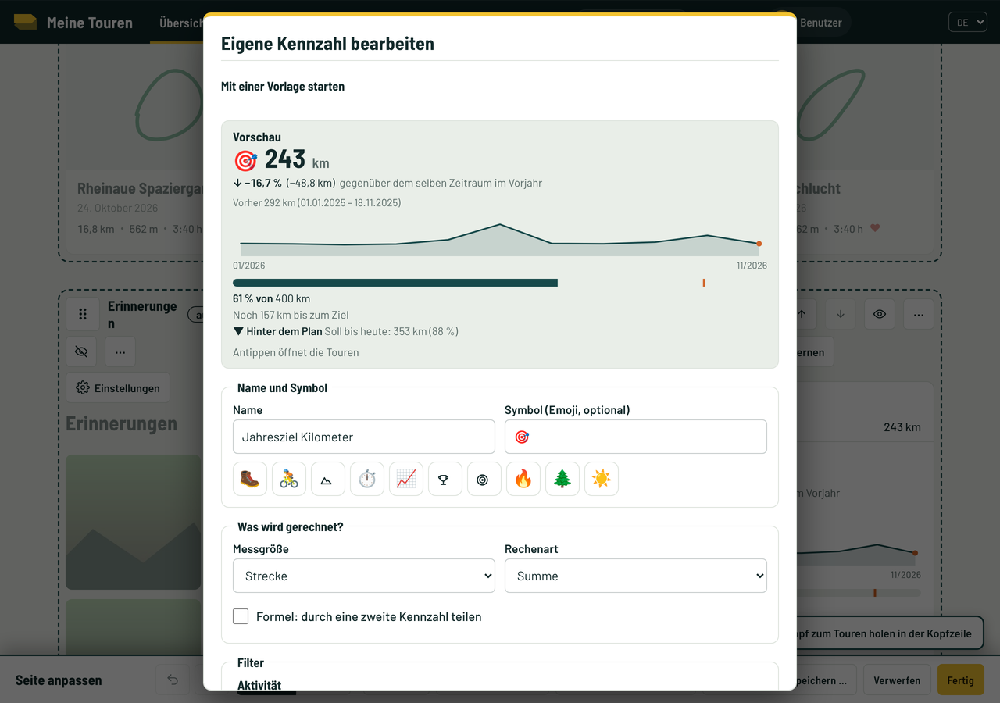

*Abbildung 50: Eine bestehende Kennzahl bearbeiten („Jahresziel Kilometer“): Die Vorschau oben zeigt Wert, Trendpfeil, Sparkline, Zielbalken und „Im Plan?“ sofort.*

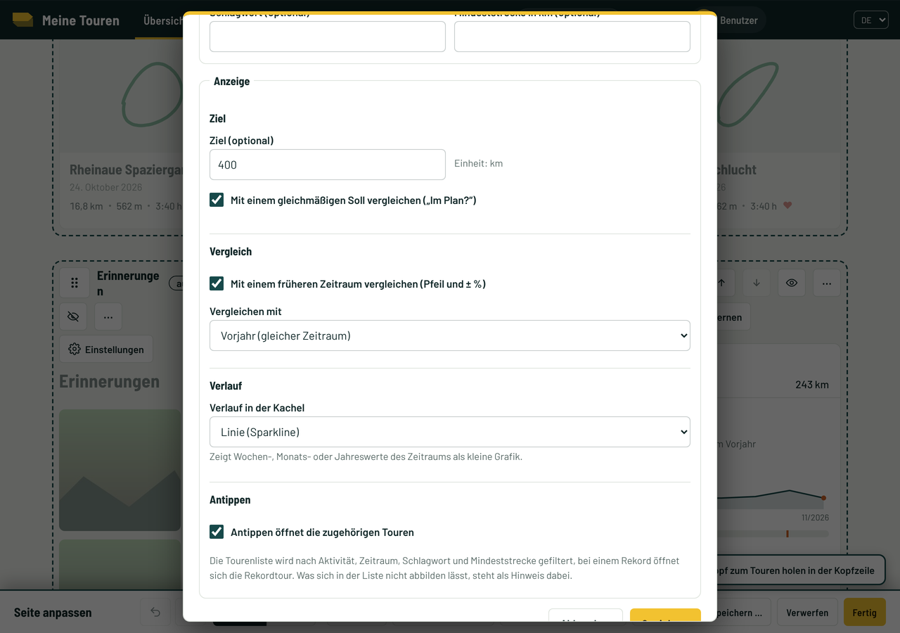

*Abbildung 51: Der Bereich „Anzeige“ mit den vier Gruppen Ziel (mit „Im Plan?“), Vergleich, Verlauf und Antippen.*

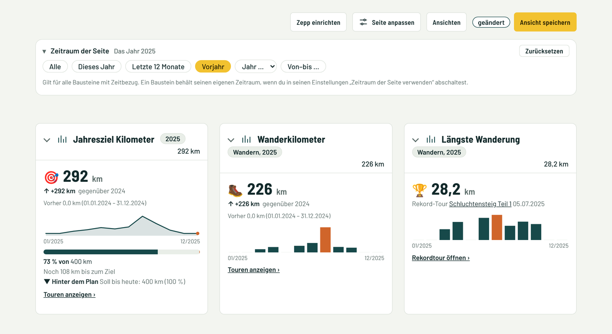

*Abbildung 52: So sehen eigene Kennzahlen auf der Übersicht aus: Jahresziel mit Trend, Sparkline, Fortschrittsbalken und „Hinter dem Plan“, Wanderkilometer mit Säulen und die Rekord-Kennzahl „Längste Wanderung“.*

### 13.4 Ansichten

Eine **Ansicht** ist eine gespeicherte Anordnung der Seite, z. B. „Wandern“, „Rad“ oder „Kompakt“. Es gibt immer die **Standardansicht**.

* **Ansichten** (Knopf oben auf der Seite oder in der Leiste) öffnet die Liste. Die gerade **angezeigte** Ansicht ist markiert.
* Je Ansicht: **Umbenennen**, **Duplizieren**, **Exportieren**, **Teilen …** (Layoutcode und Link, siehe 13.11).
* Neu: **Neue Ansicht**, **Aus Vorlage …**, **Importieren …**.
* Im Bearbeitungsmodus speichert **Als neue Ansicht speichern …** den aktuellen Stand unter einem Namen.

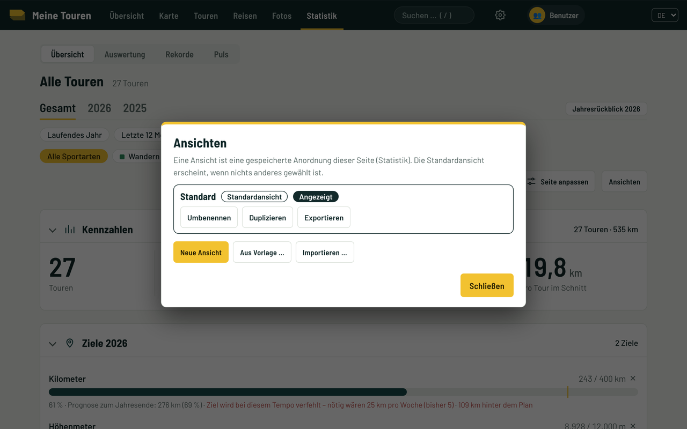

*Abbildung 53: Der Dialog „Ansichten“ der Statistik.*

### 13.5 Vorlagen

**Aus Vorlage …** zeigt fertige Anordnungen, die du als **neue Ansicht übernehmen** kannst – deine bisherigen Ansichten bleiben unberührt. Für die Statistik sind das z. B. **Jahresrückblick**, **Training** (Belastung, typisches Tempo, Streckenlängen) und **Kompakt**. Für die Übersicht gibt es u. a. eine Vorlage mit Hinweisen; für Reisen fünf eigene Vorlagen.

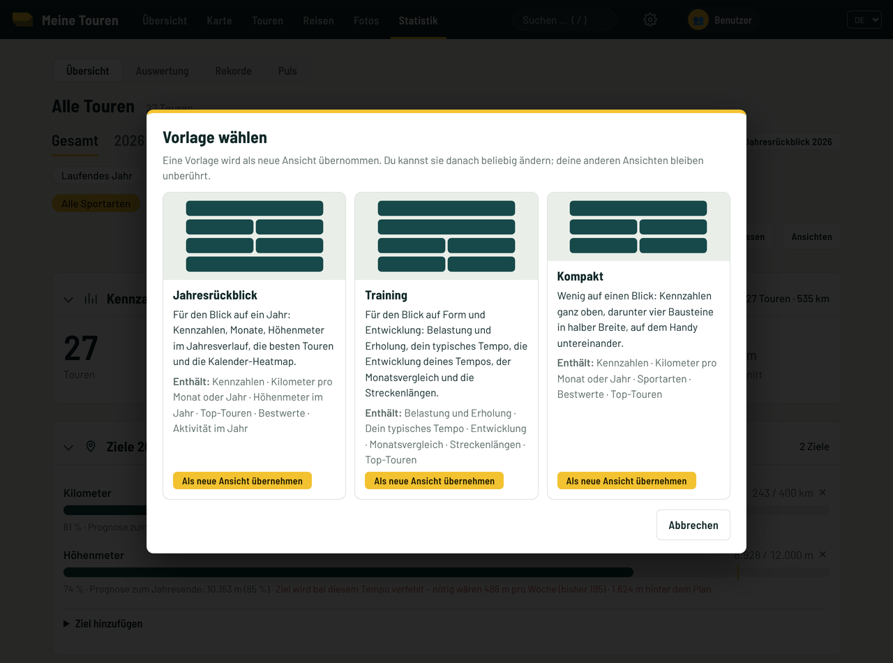

*Abbildung 54: „Vorlage wählen“ für die Statistik.*

### 13.6 Export und Import des Layouts

* **Exportieren** speichert eine Ansicht als Datei – zum Sichern oder für ein anderes Gerät oder Konto.
* **Importieren …** liest eine solche Datei wieder ein (oder einen Layoutcode, siehe 13.11). Ungültige Dateien werden mit einer Fehlermeldung abgelehnt.

### 13.7 Standard wiederherstellen

**Standard wiederherstellen** (untere Leiste im Bearbeitungsmodus) setzt die Seite auf die ursprüngliche Anordnung zurück. Deine gespeicherten Ansichten bleiben dabei bestehen. Mit **Rückgängig** (13.8) holst du den Stand zurück, wenn es zu schnell ging.

### 13.8 Bausteine duplizieren, Rückgängig und Wiederholen

**Duplizieren:** In der Kopfzeile eines Bausteins (bei schmalen Bausteinen im Menü „⋯“) legt **Duplizieren** eine Kopie mit denselben Einstellungen direkt dahinter an. Sie heißt „… (Kopie)“, bekommt den Fokus und steht in derselben Gruppe wie das Original. Das gibt es nur bei Bausteinen, die mehrfach vorkommen dürfen (im Katalog erkennst du sie daran, dass „Noch einmal hinzufügen“ möglich ist) und nicht für feste Abschnitte der Seite. Je Seite sind höchstens 40 Bausteine möglich; ist das Limit erreicht, sagt dir ein Hinweis, warum nichts passiert.

**Rückgängig und Wiederholen:** Die Knöpfe **Rückgängig** und **Wiederholen** in der Leiste (auf dem Handy mit Text, Pfeilsymbol) nehmen die letzten Änderungen zurück bzw. stellen sie wieder her: verschieben, Breite, ausblenden, hinzufügen, entfernen, duplizieren, Einstellungen, Gruppen, Handy-Anordnung und „Standard wiederherstellen“. Mit der Tastatur: **Strg+Z** (Mac: **Cmd+Z**) und **Strg+Umschalt+Z** (auch Strg+Y). Die Kürzel gelten nur im Bearbeitungsmodus und nicht in Eingabefeldern oder Dialogen. Es werden die letzten 50 Schritte gemerkt; **Fertig**, **Verwerfen**, das Verlassen der Seite und der Wechsel der Ansicht beginnen einen neuen Verlauf. Vorlesehilfen hören jeden Schritt („Rückgängig: …“). Ein ausgegrauter Knopf bedeutet: nichts mehr da.

### 13.9 Gruppen

Eine **Gruppe** bündelt mehrere Bausteine zu einem einklappbaren Abschnitt mit eigenem Titel, z. B. „Rückblick“ oder „Training“.

1. Im Bearbeitungsmodus im Menü eines Bausteins **In Gruppe …** wählen, dann **In eine neue Gruppe** oder eine bestehende Gruppe. Oder den Baustein am Griff **über eine Gruppe ziehen** (die Gruppe zeigt, dass er hineinkommt); aus der Gruppe heraus ziehst du ihn auf dieselbe Weise.
2. In der Kopfzeile der Gruppe: **Umbenennen** (Titel bis 60 Zeichen; ohne Titel heißt sie „Gruppe 1“ usw.), **Standardmäßig offen**, **↑ ↓** (die Gruppe wandert als ein Block) und **Gruppe lösen** (die Bausteine bleiben auf der Seite).
3. **Aus Gruppe lösen** im Menü eines Bausteins nimmt ihn heraus. Mit den Pfeiltasten am Griff verlässt ein Baustein am Rand die Gruppe.

Außerhalb des Bearbeitungsmodus klappst du eine Gruppe mit einem Klick auf ihre Überschrift auf oder zu; der Zustand wird je Benutzer gemerkt, „Standardmäßig offen“ legt fest, wie die Gruppe beim ersten Öffnen aussieht. Im Bearbeitungsmodus sind alle Gruppen offen. Grenzen: höchstens 10 Gruppen je Seite und 30 Bausteine je Gruppe, keine Gruppen in Gruppen, und der Einstieg in die Auswertung sowie die Köpfe der Reise- und Fotos-Seite lassen sich nicht gruppieren. Die Karte hat keine Gruppen. Gruppen gehören zur Ansicht und werden mit Ansichten, Vorlagen (z. B. „Mit Gruppe“), Export und Import weitergegeben.

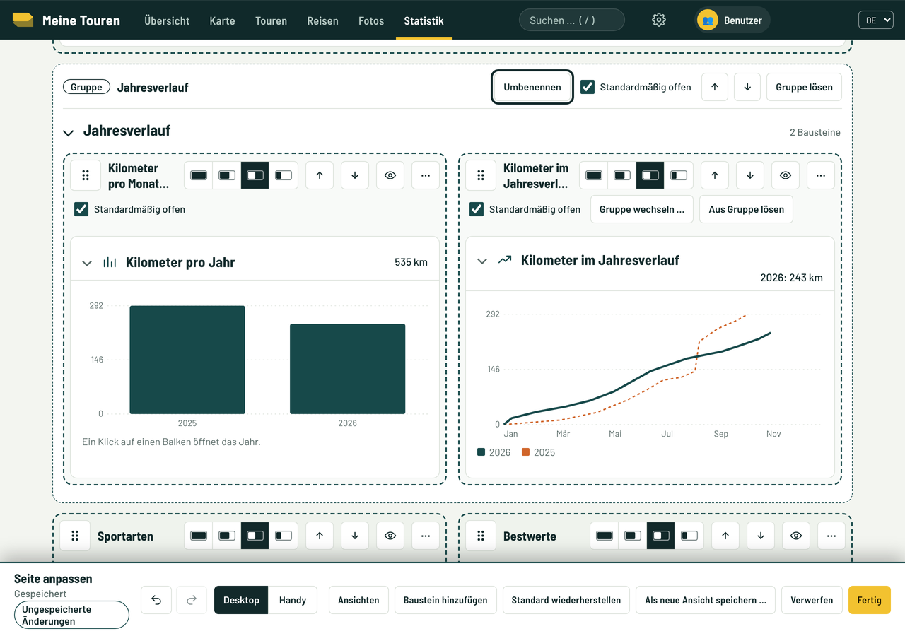

*Abbildung 55: Eine Gruppe „Jahresverlauf“ mit zwei Bausteinen. Oben in der Gruppe: Umbenennen, „Standardmäßig offen“, Pfeile und „Gruppe lösen“.*

### 13.10 Eigene Handy-Anordnung

Auf schmalen Bildschirmen (Ansicht „Handy“, bis 760 Pixel Breite) willst du vielleicht eine andere Reihenfolge oder weniger Bausteine als am Computer.

1. Im Bearbeitungsmodus in der Leiste **Anordnung für: Handy** wählen. Die Seite erscheint in einem schmalen Rahmen, einspaltig, so wie sie auf dem Handy aussieht.
2. Jetzt verschiebst und blendest du aus wie gewohnt – das gilt nur für das Handy. Die erste Änderung legt die Handy-Anordnung an; der Hinweis in der Leiste sagt, ob es schon eine gibt.
3. **Desktop** schaltet zurück; **Handy-Anordnung zurücksetzen** entfernt sie, dann gilt wieder die Desktop-Reihenfolge.

Ohne eigene Handy-Anordnung gilt überall die Desktop-Reihenfolge, wie bisher. Auf einem Handy startet der Umschalter bei „Handy“. Breite, Einstellungen und Gruppen sind für beide gleich; die Karte hat keine eigene Handy-Anordnung.

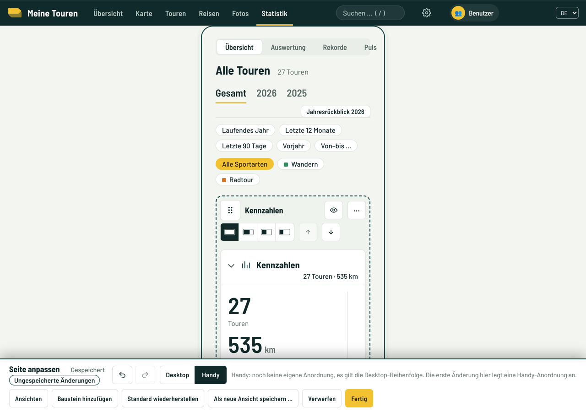

*Abbildung 56: „Anordnung für: Handy“: Die Seite steht einspaltig in einem schmalen Rahmen; der Hinweis rechts in der Leiste sagt, dass noch keine eigene Handy-Anordnung besteht.*

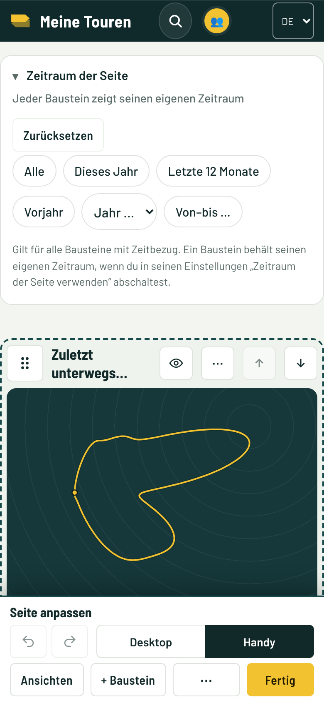

*Abbildung 57: Der Bearbeitungsmodus auf dem Handy (390 px): Die Leiste unten bietet Rückgängig, Wiederholen, den Umschalter „Desktop | Handy“, „Ansichten“, „+ Baustein“ und „Fertig“.*

### 13.11 Ansichten teilen: Layoutcode und Link

Eine Ansicht lässt sich auch als kurzer Text weitergeben, zum Beispiel in einer Nachricht.

* **Ansichten → bei der Ansicht Teilen …** zeigt den **Layoutcode** (beginnt mit `MTA1.`). **Code kopieren** und **Link kopieren** legen ihn in die Zwischenablage; ist das nicht möglich, ist der Code markiert und du kopierst ihn mit Strg+C.
* Wer den Code bekommt, fügt ihn bei **Ansichten → Importieren … → Layoutcode oder Link einfügen** ein und wählt **Code prüfen**. Ein geöffneter Link führt auf der anderen Installation (angemeldet) zur passenden Seite und öffnet den Import mit dem Code.
* Dann wie beim Import einer Datei: Name wählen, **Als neue Ansicht importieren** oder eine bestehende Ansicht ersetzen. Vorher wird nichts gespeichert.

**Was steckt im Code?** Nur die Anordnung und die Einstellungen der Bausteine, auch eigene Titel und Notizen, die du dort eingegeben hast. Keine Touren, Fotos, Orte oder Zugangsdaten, und der Code gibt keinen Zugriff auf deine Daten. Der Server prüft jeden Code streng wie eine Datei (nur erlaubte Felder, Größen und Bausteine); beschädigte oder zu große Codes werden abgelehnt. Betrachter können keine Ansichten importieren.

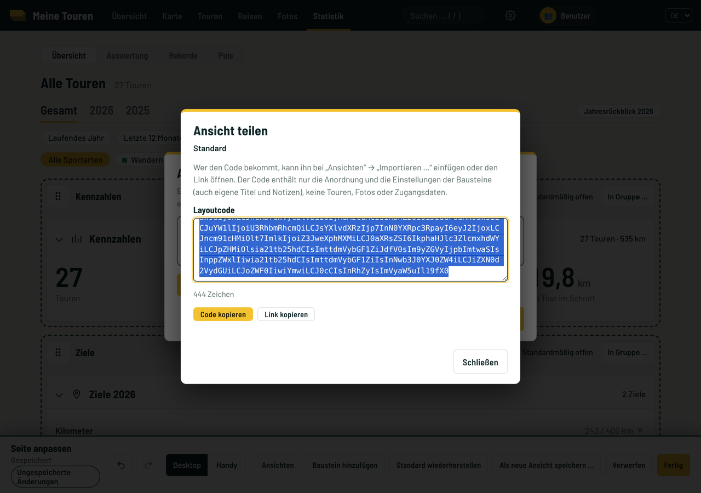

*Abbildung 58: Der Dialog „Ansicht teilen“ mit dem Layoutcode zum Kopieren sowie „Code kopieren“ und „Link kopieren“.*

### 13.12 Bausteine für Rhythmus, Jahreszeiten und Ausrüstung

Drei Bausteine der Übersicht (und der Statistik) helfen beim Blick auf Rhythmus und Verschleiß. Alle lesen nur Daten, die schon in deiner Installation liegen; beim Anzeigen wird nichts aus dem Internet geholt. Betrachter sehen sie wie die anderen Bausteine.

* **Belastung und Erholung – Wochenansicht:** Im Einstellungsdialog des Bausteins wählst du bei **Ansicht** die **Wochenansicht mit Ruhetagen** (8 oder 12 Wochen). Je Woche siehst du die Belastung laut Uhr als Balken, die Zahl der Touren und Kilometer und die **Ruhetage** (Tage ohne Tour) als sieben Punkte von Montag bis Sonntag: gefüllt = Tour, leer = Ruhetag, gestrichelt = Tag der laufenden Woche, der noch kommt. Hat eine Woche Touren, aber keinen Uhr-Wert, steht dort **„Belastung ohne Angabe“** und es gibt keinen Balken; „ohne Angabe“ zählt nie als 0. Eine Woche ohne Tour heißt **„Ruhewoche“**. Die Ansicht **Kompakt** ist wie bisher.
* **Jahreszeiten und Wetter:** Zeigt, wann du unterwegs bist: die vier Jahreszeiten (Frühling März bis Mai, Sommer Juni bis August, Herbst September bis November, Winter Dezember bis Februar, nach der nördlichen Halbkugel) mit Touren oder Kilometern, dazu zwölf Säulen für die Monate (alle Jahre des gewählten Zeitraums zusammen). Aktivität und Zeitraum stellst du wie bei den anderen Bausteinen ein. Liegen zu deinen Touren Wetterdaten vor (sie werden beim Öffnen einer Tour oder in der Verwaltung mit **Wetter laden** gespeichert), kommen die durchschnittliche Temperatur je Monat und Jahreszeit und die Verteilung der Touren nach Temperatur (unter 0 °C, 0 bis 10, 10 bis 20, ab 20 °C) dazu. Ohne Wetterdaten steht ein ehrlicher Hinweis statt der Temperaturen; Touren ohne Wetterdaten zählen bei den Temperaturen nie als 0 °C.
* **Ausrüstung:** Der Baustein zeigt jetzt zusätzlich den Anteil am Limit in Prozent (zum Beispiel „412 von 600 km (69 %)“). Ab 90 % des Limits steht **„Bald fällig“** mit einem Ausrufezeichen-Symbol, ab 100 % **„Limit erreicht“** beziehungsweise „Limit überschritten um …“ mit einem Kreuz-Symbol; Farbe allein trägt die Aussage nie. Ausrüstung mit Warnung steht ganz oben.

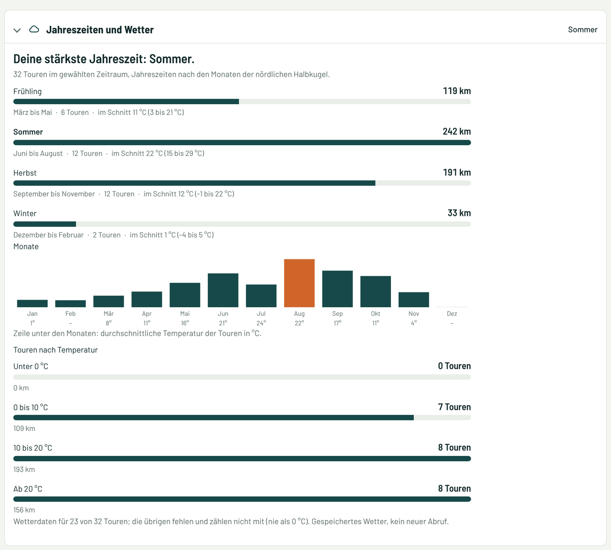

*Abbildung 59: „Jahreszeiten und Wetter“: vier Jahreszeiten, zwölf Monatssäulen mit Durchschnittstemperatur und Touren nach Temperatur. Die Wetterwerte der Beispieltouren sind erfunden.*

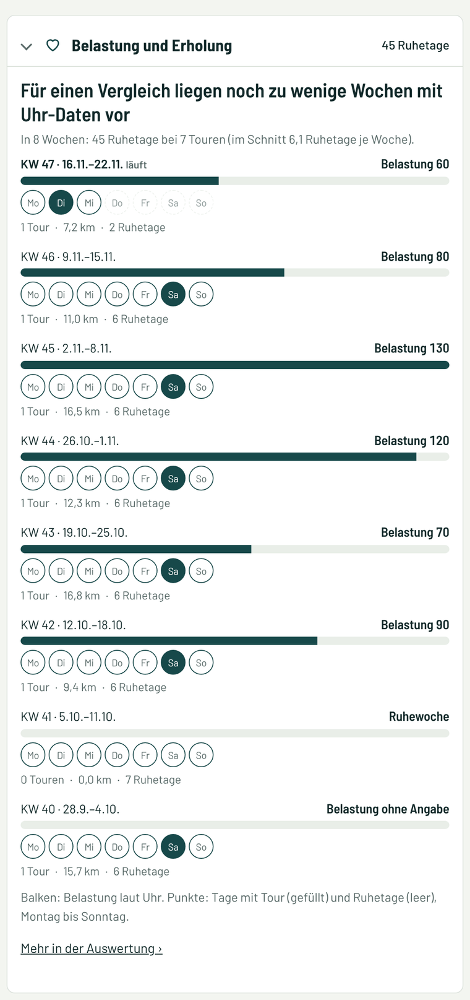

*Abbildung 60: „Belastung und Erholung“ in der Wochenansicht (8 Wochen, Ausschnitt): Belastungsbalken, Tage mit Tour (gefüllt) und Ruhetage (leer), „Ruhewoche“ und „Belastung ohne Angabe“.*

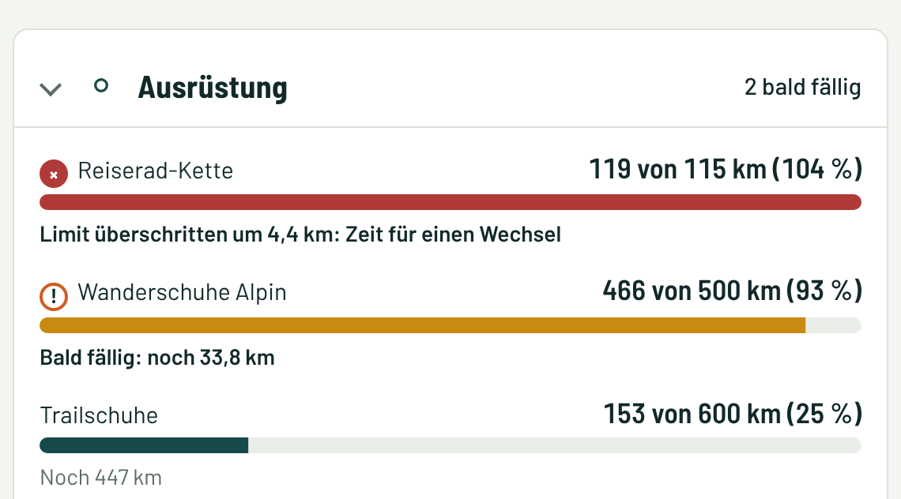

*Abbildung 61: „Ausrüstung“: „Limit überschritten“ (×) und „Bald fällig“ (!) stehen oben, dazu der Anteil am Limit in Prozent.*

„Heute vor X Jahren“ gibt es schon als eigenen Baustein (Kategorie Rückblick): die Touren dieses Kalendertags aus früheren Jahren mit Jahr, Name und Kilometern, ein Tipp öffnet die Tour. Er folgt bewusst nicht dem Zeitraum der Seite.

[↑ Inhaltsverzeichnis](#inhalt)

---

## 14. Freigabe und Teilen

**Zweck:** Du kannst Touren, Diashows und den Jahresrückblick **per Link ohne Konto** teilen. Du entscheidest, was gezeigt wird, und kannst jeden Link jederzeit widerrufen.

### 14.1 Eine Tour teilen

1. Tour öffnen → **Teilen & Export → Link senden**.
2. **Voreinstellung** wählen: **Komplett**, **Nur Karte und Fotos**, **Alles außer Notizen**, **Alles zeigen**.
3. Unter **Was wird gezeigt?** einzelne Bausteine ein- und ausschalten: **Karte**, **Höhenprofil**, **Kennzahlen**, **Fotos**, **Notiz und Beschreibung**, **Wegpunkte**, **Pulsverlauf**, **Wetter**. Die Zeile „Dieser Link zeigt: …“ fasst es zusammen.
4. **Anfang und Ende der Strecke ausblenden (300 m)** ist vorgewählt – sinnvoll, damit dein Zuhause nicht zu erkennen ist.
5. **Link gültig:** 7 Tage, 30 Tage oder unbegrenzt.
6. **Link erstellen.** Auf Handys öffnet sich das Teilen-Menü (WhatsApp, Signal, E-Mail …).

*Abbildung 62: „Tour teilen“. Hier: „Nur Karte und Fotos“, Anfang und Ende ausgeblendet, 30 Tage gültig.*

**Was Empfänger sehen:** Name und Datum der Tour stehen immer im Kopf; dazu genau die gewählten Bausteine.

*Abbildung 63: Die geteilte Seite, die ein Empfänger ohne Konto sieht: Karte und Fotos (die Kartenkacheln fehlen in dieser Aufnahme).*

### 14.2 Was wird nie geteilt?

* **Nie Teil eines Tour-Links:** Auswertung, Uhr-Daten, Vergleiche, Gerät, Ausrüstung, Sicherheit.
* **Nie Teil eines Rückblick-Links:** Strecken und Koordinaten, Orte, Notizen, Wegpunkte, Puls, Wetter, Uhr-Rohdaten, Gerät, Ausrüstung.
* **Nie Teil eines Diashow-Links:** Koordinaten, Orte, Notizen, Strecken, Uhr-Daten; es gibt keine Kommentare.
* **Nur Gewähltes verlässt den Server.** Was du abwählst, wird gar nicht erst geliefert – auch nicht versteckt.
* Wegpunkt-Texte erscheinen nur, wenn zusätzlich „Notiz und Beschreibung“ gewählt ist. Bevor du „Notiz“ wählst, prüfe, ob die Notiz öffentlich sein darf.
* Betrachter dürfen keine Links erzeugen.

### 14.3 Freigegebene Links verwalten

Im Benutzermenü **Freigegebene Links** (oder in der Verwaltung der Knopf **Freigegebene Links verwalten**) siehst du alle Links mit Typ, Inhalt („Zeigt: …“), Erstellungsdatum und Gültigkeit. Filter: **Alle**, **Diashows**, **Tourlinks**, **Rückblicke**, **Abgelaufen**. Pro Link:

* **Kopieren** und **Öffnen**,
* **PDF** (bei Rückblicken),
* **Laufzeit ändern …**,
* **Auswahl ändern** – die Änderung gilt sofort für den bestehenden Link,
* **Widerrufen** – der Link zeigt danach „nicht mehr gültig“.

*Abbildung 64: „Freigegebene Links“ mit Tourlink und Jahresrückblick. Die Adresse zeigt die Demo-Installation; bei dir steht dort die Adresse deiner Installation.*

### 14.4 Wichtig für Links nach draußen

Damit Empfänger ohne Konto einen Link öffnen können, muss deine Installation **von außen erreichbar** sein (z. B. Tailscale Funnel oder ein Reverse-Proxy mit HTTPS). Im Heimnetz oder nur im Tailnet kann niemand sonst den Link öffnen. Die Risiken dazu stehen im Abschnitt „Tailscale Funnel“ der [README](../README.md) und in [Kapitel 19](#k19).

[↑ Inhaltsverzeichnis](#inhalt)

---

## 15. Die Verwaltung

**Zweck:** Einrichtung, Wartung und Sicherung. Öffne sie mit dem **Zahnrad** oben (auf dem Handy: **Mehr → Verwaltung**). Die Verwaltung hat acht Reiter und oben die Knöpfe **Freigegebene Links verwalten** und – rechts oben – die Versionsangabe („Version: 3.37.0“).

| Reiter | Inhalt |
|---|---|
| **Übersicht** | Zustand, Updates, Protokoll, Heimatort und Puls, Entwicklermodus |
| **Touren holen** | Meine Geräte, Komoot, Zepp, Garmin/Suunto/andere Uhren, Wanderführer ([Kapitel 4](#k4)) |
| **Hochladen & Planen** | Strava und Komoot (Upload), Tourplanung |
| **Fotos** | Fotobibliothek, Import, Foto-Eingang, Bildeinstellungen |
| **Automatik & Meldungen** | tägliche Aktualisierung, Benachrichtigung (Webhook/ntfy), E-Mail-Versand |
| **Handy & App** | Standort teilen, App auf dem Startbildschirm, Android-App |
| **Sicherung & Zugang** | Sicherung, Umzugspaket, Zugriffsschutz, Offline-Nutzung |
| **Prüfen & Aufräumen** | auffällige Touren, Aufräumen (eigene Seite) |

Die Verwaltung wird **Administratoren** angezeigt. **Einstellungen speichern** am Ende jedes Reiters speichert die Eingaben.

### 15.1 Übersicht: Zustand, Updates, Heimatort

* **Zustand:** Haken oder Warnzeichen für Komoot-Zugang, letztes Backup, Datenbank, freien Speicher, Touren ohne Strecke und Fotos ohne Tour.
* **Updates:** zeigt die installierte und die neueste Version auf GitHub. **Jetzt prüfen** fragt sofort nach; „Regelmäßig (alle 6 Stunden) auf neue Versionen prüfen“ kannst du einschalten. Administratoren installieren neue Versionen auf den meisten Installationen per Knopfdruck; bei Docker nennt die App nur den Befehl. Vor jedem Update gibt es automatisch eine Sicherung.
* **Protokoll:** Meldungen der Hintergrundarbeiten.
* **Heimatort und Puls:** Heimatort suchen und festlegen; **Maximalpuls (bpm)** für die Pulszonen (leer = 185 bzw. der höchste gemessene Wert).
* **Entwicklermodus:** blendet Ansichten zur Fehlersuche ein (Selbsttest, vollständiges Protokoll …). Im Alltag nicht nötig.

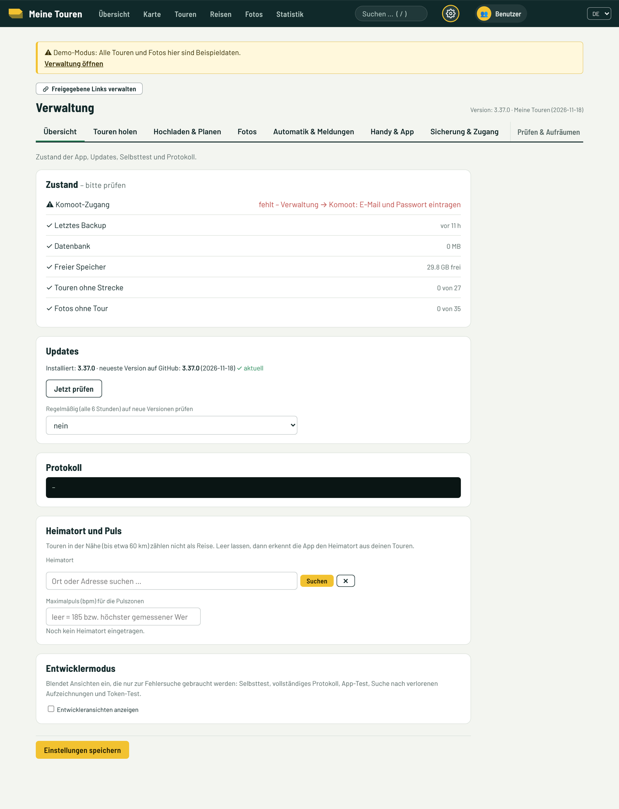

*Abbildung 65: „Übersicht“: Zustand, Updates, Protokoll, Heimatort und Puls. Der gelbe Hinweis oben erscheint nur im Demo-Modus.*

### 15.2 Hochladen & Planen

**Portale (Upload):** Strava (Client-ID und -Secret aus strava.com/settings/api, „Mit Strava verbinden“) und Komoot. **Tourplanung:** Funktion an/aus und wo der Routing-Dienst BRouter läuft (öffentlich über brouter.de – dann werden die Koordinaten der geplanten Punkte dorthin gesendet –, auf dem eigenen Server oder im Netz).

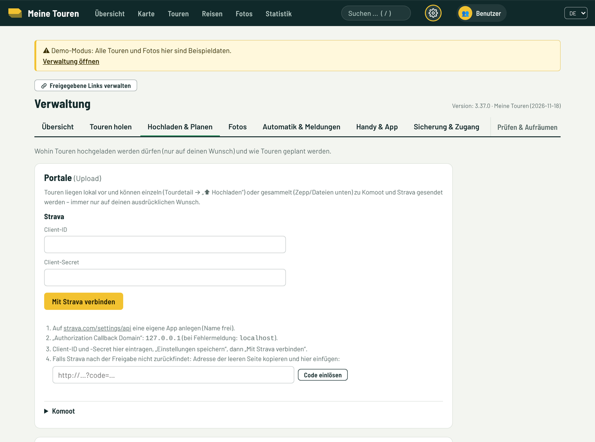

*Abbildung 66: Portale und Tourplanung.*

### 15.3 Fotos

Siehe [Abschnitt 10.1](#k10).

### 15.4 Automatik & Meldungen

* **Täglich aktualisieren** (Komoot, Routen, Fotos) an oder aus, dazu die Uhrzeit.
* **Benachrichtigung (optional):** Trage eine Webhook-Adresse ein (z. B. ntfy oder Gotify). Bei Warnungen (Zepp-Token, Backup, Job-Fehler, Speicher) wird dort eine Textnachricht abgeliefert; optional auch bei neuen Touren. **Testnachricht senden** prüft die Adresse.
* **E-Mail-Versand:** SMTP-Zugang für „Passwort vergessen“ und Zwei-Faktor-Hinweise.

### 15.5 Handy & App

**Standort teilen** (Aus / Nur während einer Aufzeichnung / Immer, wenn die Karte meinen Standort zeigt; **Letzten Standort löschen**) und **Auf dem Handy**: Meine Touren lässt sich wie eine App auf dem Startbildschirm installieren. Danach erscheint sie im Teilen-Menü von Android. Voraussetzung ist eine gesicherte Verbindung (HTTPS); ohne Installation hilft in Chrome ⋮ → „Zum Startbildschirm hinzufügen“.

*Abbildung 67: Der Reiter „Handy & App“.*

### 15.6 Sicherung & Zugang

* **Sicherung:** Täglich um 03:40 Uhr wird die Datenbank (Touren, Notizen, Ziele, Zuordnungen) gesichert, die letzten 14 bleiben erhalten. **Backup jetzt herunterladen** und **Jetzt sichern** (oben) legen sofort eine an. Passwörter und Tokens sind im Download nicht enthalten; **Fotos und Routen sind nicht enthalten** – sichere diese Ordner zusätzlich. Wiederherstellen: `meine-touren-restore <Datei>` auf dem Server.
* **Sicherung prüfen (ab 3.38.0):** Eine Sicherung wird erst nach dem Schreiben geprüft (freier Platz vorher, ZIP und Datenbank danach) und dann erst umbenannt; schlägt sie fehl, steht der Grund hier („Letzte Sicherung fehlgeschlagen: …“) und die bisherigen Sicherungen bleiben erhalten. **Letzte Sicherung prüfen** öffnet die neueste Sicherung in einem temporären Ordner, prüft die Datenbank und zeigt „Zuletzt geprüft: …, in Ordnung“ mit der Zahl der Touren, Tracks und Layouts. Deine Daten werden dabei nicht verändert; eine Wiederherstellung findet nicht statt. **Nicht in der Tagessicherung:** die Fotodateien und der Zwischenspeicher sowie der Schlüssel für gespeicherte Zugangsdaten (`secret.key`) – nach einer Wiederherstellung auf einem neuen Rechner müssen diese Zugangsdaten neu eingegeben werden. Das Umzugspaket enthält beides. Als überfällig gilt eine Sicherung nach 36 Stunden.
* **Sicherung zurückspielen (ab 3.40.0, nur Administratoren):** Klappe **Sicherung zurückspielen** auf. Wähle eine Sicherung aus der Liste (neueste zuerst) oder lade eine ZIP-Datei hoch und tippe auf **Sicherung prüfen …**. Die Prüfung ändert nichts: Sie zeigt, von wann die Sicherung ist, zu wem sie gehört und wie viele Touren, Strecken, Reisen, geplante Touren und Seitenlayouts sie enthält – daneben die Zahlen von heute. Ersetzt werden Touren, Notizen, Ziele, Pläne, Seitenlayouts und Einstellungen; alles, was seit der Sicherung dazukam, geht verloren. Nicht enthalten und unverändert bleiben Fotodateien, Zwischenspeicher, der Schlüssel `secret.key`, Benutzer und Passwörter. Setze das Häkchen „Ich habe verstanden, dass der heutige Stand ersetzt wird“ und tippe auf **Jetzt zurückspielen**. Vorher sichert die App den heutigen Stand von selbst; diese Sicherheitskopie steht danach mit dem Zusatz „Sicherheitskopie vor einer Wiederherstellung“ in derselben Liste – damit machst du den Schritt auf demselben Weg rückgängig. Geht beim Zurückspielen etwas schief, holt die App den vorherigen Stand selbst zurück. Ein Umzugspaket oder die Sicherung eines anderen Benutzers lässt sich hier nicht zurückspielen; dafür bleibt `meine-touren-restore <Datei>` auf dem Server.
* **Umzug auf einen neuen Server:** **Umzugspaket erstellen** enthält alles (alle Benutzer, Touren, Fotos, Strecken, Freigabelinks, gespeicherte Zugangsdaten samt Schlüssel). Das Paket enthält Passwörter und Schlüssel – gut aufbewahren; es kann groß werden.
* **Zugriffsschutz:** Ohne Benutzerverwaltung kannst du die Oberfläche mit einem Passwort schützen („Passwort setzen“, der Browser fragt danach; Benutzername beliebig). Besser ist die Benutzerverwaltung ([Kapitel 3](#k3)).
* **Offline-Nutzung:** **Für Offline vorbereiten** lädt die letzten 8 Touren mit Strecke, einigen Fotos und den Kartenkacheln auf dieses Gerät; **Alle Touren offline (Daten und Strecken)** lädt alle Strecken.

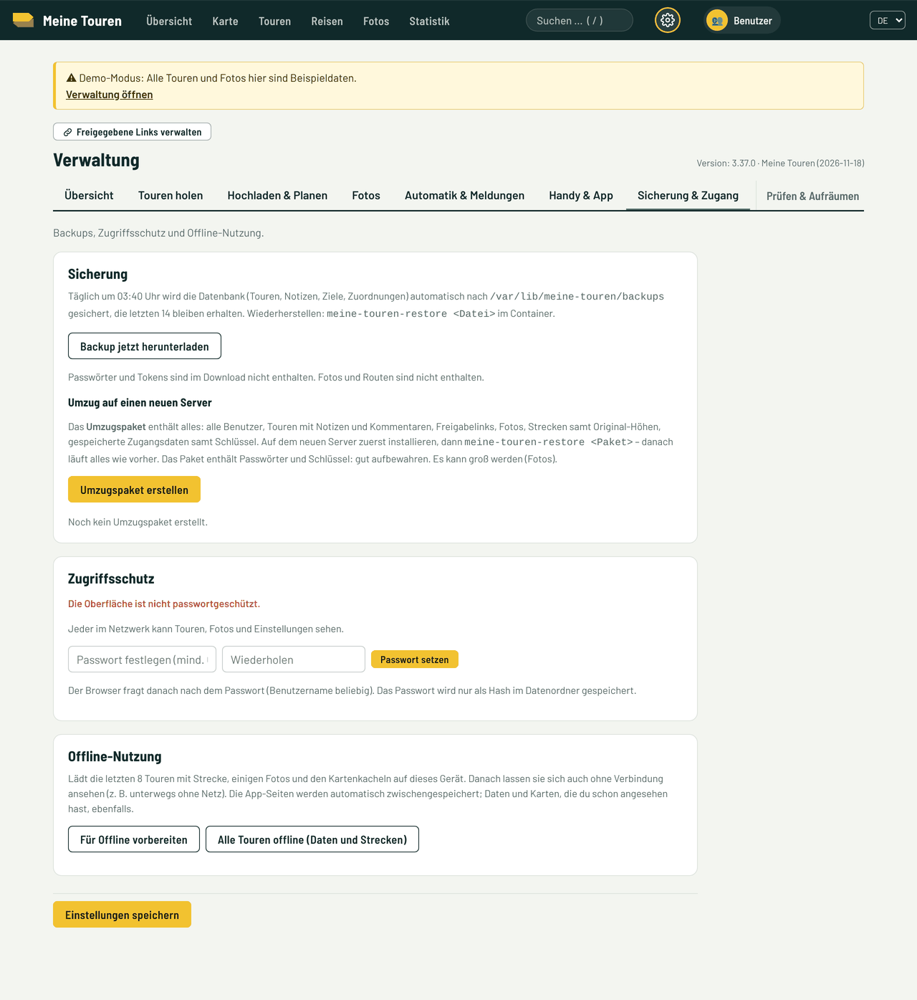

*Abbildung 68: Sicherung, Umzugspaket, Zugriffsschutz und Offline-Nutzung.*

### 15.7 Prüfen & Aufräumen

Hier findest du auffällige Touren (zum Beispiel unplausible Tempi) und Aufräum-Werkzeuge. Touren, die nur wegen Lücken oder Pausen auffallen, kannst du als **geprüft** markieren.

**Läufe von der Uhr (ab 3.50.0):** Läufe der Zepp-Uhr sind „Laufen“, nicht mehr „Wandern“. Was sicher zugeordnet werden konnte, hat die App beim Update selbst umgestellt. Touren, die von Komoot stammen oder nur über Startzeit und Länge zu einem Lauf der Uhr passen, stehen hier: **Auf Laufen umstellen** (einzeln) oder **Alle … auf Laufen umstellen** (mit Rückfrage). Der Abschnitt erscheint nur, wenn es solche Touren gibt.

**Schneeschuh (ab 3.50.0):** Schneeschuhtouren sind Wanderungen mit dem Schlagwort **„Schneeschuh“** – sie zählen in Statistik und Zielen als Wandern, wie im Tourentagebuch. Steilheit über 30° und die Sicherheitsnotiz gibt es weiterhin bei Touren mit diesem Schlagwort.

[↑ Inhaltsverzeichnis](#inhalt)

---

## 16. Die Android-App

**Zweck:** Eine kleine native Android-App als „Hülle“ um die Weboberfläche. Sie kann, was eine Webseite nicht kann.

**Was sie bietet:**

* **GPS-Aufzeichnung** im Hintergrund (auch bei ausgeschaltetem Bildschirm). Das Aufzeichnen steht in der App im Mittelpunkt: **Aufzeichnen** ist der runde Reiter in der Mitte der Tab-Leiste und die Startseite der App (umstellbar auf „Übersicht“ unter *Einstellungen der Aufzeichnung*). Der Reiter zeigt auf jeder Seite, ob eine Aufzeichnung läuft (rot, mit Zeit), pausiert ist oder auf das Hochladen wartet.
  * **Bereit:** Sportart antippen (die zuletzt genutzte steht vorn), GPS-Zustand ablesen („GPS bereit, ±5 m“), **Aufzeichnung starten**. Route mit Sprachansagen wählst du direkt darunter; Name, Fotomodus, Wetterwarnung und Live-Standort-Link liegen unter **Einstellungen der Aufzeichnung**.
  * **Unterwegs:** Zeit und Strecke groß, darunter Aufstieg, Höhe und Tempo, Karte mit Spur; **Foto** und **Wegpunkt** als kleinere Knöpfe, **Pausieren** und **Beenden** groß am unteren Rand. **Beenden** fragt nach („Weiter aufzeichnen“ / „Beenden“).
  * **Fertig:** Die Tour wird von selbst hochgeladen; danach **Tour ansehen**. Ohne Netz steht dort „Wartet auf Netz – wird später gesendet“: Die Aufzeichnung bleibt auf dem Handy und wird gesendet, sobald der Server erreichbar ist. Mit **Später senden, neue Aufzeichnung** kannst du sofort weiter aufzeichnen (die App behält die letzten 10 Aufzeichnungen als Sicherung).
* **Aufzeichnungsgerät:** Beim ersten Hochladen meldet sich das Handy von selbst unter **Meine Geräte** an („Meine Touren App · <Modell>“, mit Android- und App-Version); seine Touren gehören diesem Gerät. Du kannst es umbenennen. Übertragen werden nur Modell, Android-/App-Version und eine zufällige Kennung der Installation ([Kapitel 4.6](#k4)).
* **Fotos aufnehmen** während der Aufzeichnung (sofort hochladen oder gesammelt am Ende).
* **Sprachansagen** auf der Strecke, wenn du vor dem Start eine geplante Tour oder eine frühere Tour als Route wählst: Abbiegungen, Abweichung vom Weg, Restkilometer, Ziel. Sie nutzen die Sprachausgabe von Android; es gibt keine Kartennavigation mit Wegnamen.
* **Offline-Speicher:** Was die App vom Server lädt, bleibt auf dem Handy und wird ohne Verbindung weiter angezeigt (Hinweisband „Offline“).
* **Wegpunkte** unterwegs (Schnellnotiz wie Rast oder Aussicht), **Wetterwarnung** und ein **Live-Standort-Link** für Kontakte.
* **Teilen-Menü:** GPX, FIT, TCX, ZIP und Fotos aus anderen Apps (Garmin, Komoot, Galerie …) direkt an Meine Touren senden.
* **PDF-Downloads** landen im Download-Ordner.
* **Vollbild-Diashow:** Die Diashow der Seite lässt sich in der App im Vollbild zeigen.
* **Info** (Menü „Mehr“): Version von App und Server.

**Installation:**

1. Die APK wird auf GitHub gebaut (Actions → „Android-App“) und bei einer Veröffentlichung an das Release angehängt. Ohne Signierschlüssel entsteht eine Debug-APK; sie lässt sich ebenfalls installieren („Aus unbekannten Quellen“ erlauben).
2. Beim ersten Start gibst du die **Serveradresse** ein (auch `http://192.168.178.230` ist möglich). Sie lässt sich in der Verwaltung ändern.
3. Neue Versionen lassen sich über die alte installieren; die App wird immer mit demselben Schlüssel signiert. Die Oberfläche kommt vom Server und ist sofort aktuell; neue Funktionen der App selbst (seit 3.49.0 die Anmeldung als Aufzeichnungsgerät) brauchen die neue APK. Welche App-Version läuft, zeigt **Mehr → Info**.

**Wichtig:**

* Hersteller wie Xiaomi, Samsung oder Huawei beenden Hintergrunddienste teils aggressiv. Schalte für die App die **Akku-Optimierung** aus (Verwaltung → Handy & App → Android-App → „Akku-Einstellungen“) und mache vor einer langen Tour eine kurze Testrunde.
* Android installiert die App als „richtige“ App nur bei einer gesicherten Adresse (**HTTPS**), z. B. über Tailscale. Bei `http://192.168…` entsteht nur eine Verknüpfung ohne Teilen-Menü – das Teilen-Menü der nativen App funktioniert aber auch über HTTP.
* Bei Problemen hilft **Diagnose senden / kopieren** (Verwaltung → Handy & App → Android-App).

### Die Weboberfläche am Handy

Auch im Handy-Browser passt sich die Oberfläche an: unten die Leiste mit **Übersicht**, **Karte**, **Touren**, **Fotos** und **Mehr**.

*Abbildung 69: Handy-Ansicht (390 px breit): Übersicht (hier mit eingeblendeter Leiste „Zeitraum der Seite“, über Seite anpassen), Touren-Liste, Tourdetail.*

*Abbildung 70: Höhenprofil und Herzfrequenz am Handy; rechts das Menü „Mehr“ mit Reisen, Statistik, Verwaltung und der Wahl „Automatisch / Smartphone / Computer“.*

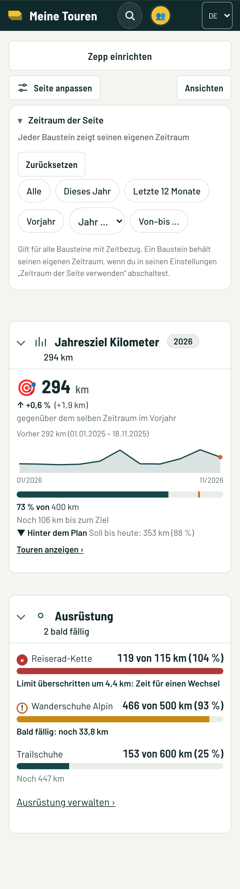

*Abbildung 71: Eigene Kennzahl und Ausrüstung am Handy (die untere Leiste ist für die Aufnahme ausgeblendet).*

**Tour am Handy:** Statt vieler einzelner Knöpfe gibt es drei große: **Ansehen**, **Teilen & Export**, **Bearbeiten**.

[↑ Inhaltsverzeichnis](#inhalt)

---

## 17. Mein Tourentagebuch (Begleit-App)

**Mein Tourentagebuch** ist eine **eigenständige Android-App**, die ganz ohne Server auskommt: Touren, Fotos, Aufzeichnung, Planung und Routing liegen **lokal auf dem Handy**. Sie ist ein separates Projekt ([hilde0407/mein-tourentagebuch](https://github.com/hilde0407/mein-tourentagebuch)) und nicht Teil von Meine Touren.

Laut Projektbeschreibung kann sie unter anderem: Touren mit Karte und Höhenprofil, Fotos (automatisch den Touren zugeordnet), GPS-Aufzeichnung mit Sprachansagen, Tourplanung mit Routing, Import aus Dateien (GPX, FIT, TCX, ZIP) sowie aus Komoot, Strava und Zepp, eine Statistik und eine Sicherung. Wer unterwegs lieber ohne Server arbeitet, nutzt sie; Meine Touren ist das Archiv für den eigenen Server. Alles Weitere steht in der Beschreibung des Projekts auf GitHub.

Beide Apps ordnen die Sportarten seit 3.50.0 gleich zu: Läufe der Zepp-Uhr sind „Laufen“, Schneeschuhwandern zählt als „Wandern“ (Schlagwort „Schneeschuh“). Nordic Walking ist hier eine eigene Sportart, im Tagebuch zählt es als Wandern.

[↑ Inhaltsverzeichnis](#inhalt)

---

## 18. Tipps, Tastenkürzel, Fehlersuche und häufige Fragen

### 18.1 Tastenkürzel

| Taste | Wirkung |
|---|---|
| **/** | Suchfeld oben anspringen (nicht in Eingabefeldern) |
| **← →** | In der Foto-Großansicht und in der Diashow blättern |
| **Esc** | Foto-Großansicht oder Dialog schließen |
| **Leertaste** | Diashow anhalten und fortsetzen |
| **F** | Diashow im Vollbild |
| **Pfeiltasten** am Griff (⋮⋮) | Baustein im Bearbeitungsmodus verschieben |
| **Home / End** am Griff | Baustein an den Anfang bzw. das Ende setzen |
| **Strg+Z / Cmd+Z**, **Strg+Umschalt+Z** | Im Bearbeitungsmodus Änderung zurücknehmen bzw. wiederholen (nicht in Eingabefeldern) |
| **Tab** | Durch Knöpfe und Felder gehen; Dialoge halten den Fokus bei sich |

### 18.2 Tipps

* **Jahresziele** setzen (Statistik → Ziele): Prognose und „im Plan“ motivieren.
* **Notiz und Bewertung** direkt in der Tour eintragen – sie sind später auch in Suche und Filter nutzbar.
* **Tags** ordnen Touren zu Alben (Bearbeiten → Tags & Alben).
* **Ansichten** nutzen: eine Ansicht für „Wandern“, eine für „Rad“, eine kompakte fürs Handy.
* **Neuland** zeigt dir, wie viel einer Tour wirklich neu war.
* **Auffällige Touren** (Seilbahn, Auto) bereinigt „Track korrigieren“; das Original lässt sich wiederherstellen.
* **Backup prüfen:** Der Zustand in der Verwaltung zeigt, wann die letzte Sicherung war. Fotos und Routen sind nicht in der Sicherung – sichere sie zusätzlich.

### 18.3 Fehlersuche

| Problem | Ursache und Lösung |
|---|---|
| **Die Karte ist grau.** | Die Kartenkacheln kommen aus dem Internet. Prüfe die Verbindung des Servers und des Browsers. Offline helfen vorbereitete Touren („Für Offline vorbereiten“). |
| **Ein Foto liegt bei keiner Tour.** | Die Aufnahmezeit passt nicht (falsche Kamerauhr, Zeitzone). Im Tourdetail **Zeit per GPS prüfen**, oder auf der Fotos-Seite **Fotos zuordnen**. Fotos mehr als 10 km neben der Strecke werden nicht zugeordnet. |
| **Eine Reise fehlt.** | Reisen brauchen mindestens vier Tage weit weg von zu Hause. Prüfe den **Heimatort** (Verwaltung → Übersicht). Mit **＋ Mehrtagestour bilden …** legst du eine von Hand an. |
| **Zepp-Import bricht ab.** | Der Token kann abgelaufen sein. In der Verwaltung unter „Zepp-Zugang / Token holen“ neu holen. Zepp und Komoot haben keine offizielle Schnittstelle. |
| **„Garmin-Konto: Nicht verfügbar“.** | Das Zusatzpaket fehlt. Nutze den Dateiweg (Kapitel 4). |
| **Statistik „Auswertung“ ist leer.** | Regionen, Gipfel oder Wetter müssen erst bestimmt werden (Knöpfe in den Abschnitten). Sie brauchen Internet. |
| **Pulszonen wirken falsch.** | Maximalpuls in der Verwaltung (Heimatort und Puls) eintragen. |
| **Das Teilen-Menü der Android-App fehlt in der Web-App.** | Installation als App braucht HTTPS. Siehe Kapitel 16. |
| **Ein Link zeigt „nicht mehr gültig“.** | Er ist abgelaufen oder widerrufen. Erzeuge einen neuen oder verlängere ihn unter „Laufzeit ändern …“. |
| **Eine Seite sieht nach dem Anpassen falsch aus.** | **Seite anpassen → Standard wiederherstellen**, oder eine andere Ansicht wählen. |
| **Nach einem Update fehlt etwas.** | Browser-Seite neu laden (Strg+F5). Die App zwischenspeichert Seiten. |
| **Server nicht erreichbar.** | Läuft der Dienst? Beim Proxmox- oder Debian-Setup: `journalctl -u meine-touren -f`. Bei Docker: `docker compose logs`. |

### 18.4 Häufige Fragen

**Werden meine Touren bei Komoot, Zepp oder Strava verändert?** Nein. Es wird nie etwas dort gelöscht; Hochladen geschieht nur auf ausdrücklichen Wunsch.

**Kann ich Meine Touren ohne Internet benutzen?** Die Seiten und deine gespeicherten Strecken ja; Karten, Höhen, Wetter und Ortsnamen brauchen Internet. Mit „Für Offline vorbereiten“ speicherst du Touren samt Kartenkacheln auf dem Gerät.

**Wie viele Benutzer gibt es?** Beliebig viele; jeder hat eigene Daten. Betrachter sehen die Daten eines gewählten Benutzers nur lesend.

**Geht das Handbuch auch auf Englisch?** Die Oberfläche gibt es auf Deutsch, Englisch, Französisch und Spanisch; dieses Handbuch ist auf Deutsch.

**Wie lösche ich eine Tour?** Tour → **Bearbeiten → Tour löschen**. Sie wird nur aus Meine Touren entfernt, nie bei Komoot oder Zepp.

**Wie ziehe ich auf einen neuen Server um?** Verwaltung → Sicherung & Zugang → **Umzugspaket erstellen**, auf dem neuen Server installieren, dann `meine-touren-restore <Paket>`.

[↑ Inhaltsverzeichnis](#inhalt)

---

## 19. Datenschutz und Sicherheit

**Grundsatz:** Deine Daten liegen **lokal** bei dir. Es gibt keine Cloud und keinen Zwang, einen Dienst zu nutzen. Strecken, Fotos, Notizen und Datenbank liegen im Datenordner deiner Installation und sind Teil deiner Sicherung (Fotos und Routen separat sichern).

**Was ins Internet geht:**

* **Kartenkacheln** (OpenStreetMap u. a.), **Höhen- und Wetterdaten** (Open-Meteo) und **Ortsnamen** (Nominatim, Overpass). Dabei erfahren diese Dienste, welche Gegend du ansiehst. Beachte die Nutzungsrichtlinien.
* **Komoot, Zepp, Garmin, Strava** nur, wenn du sie einrichtest und nutzt. Hochgeladen wird nur auf ausdrücklichen Wunsch.
* **Tourplanung:** Nutzt du den öffentlichen BRouter (brouter.de), werden die Koordinaten der geplanten Punkte dorthin gesendet. Mit eigenem BRouter bleibt alles bei dir.
* **Update-Prüfung** fragt bei GitHub nach der neuesten Version.

**Zugang schützen:**

* Schalte die **Benutzerverwaltung** ein (Kapitel 3), nutze lange, einmalige Passwörter und – wo möglich – die **Zwei-Faktor-Anmeldung**.
* Betreibe die App im Heimnetz oder hinter einem VPN. Für den Zugriff von unterwegs empfiehlt die README **Tailscale** (`tailscale serve`): Die Adresse ist nur für deine eigenen Geräte erreichbar, und es ist kein Router-Port offen. Das Zertifikat ist gültig, die App installierbar.
* **Tailscale Funnel** macht die Adresse für jeden im Internet erreichbar – nötig nur, wenn Empfänger ohne Tailscale einen Link öffnen sollen. Dann ist die **ganze Anmeldeseite öffentlich**. Schalte Funnel nur zeitweise ein, nutze starke Passwörter und halte die Software aktuell. Die Risiken stehen ausführlich in der [README](../README.md) (Abschnitt „Tailscale Funnel“).
* Öffne die App nie ungeschützt ins Internet; hinter einem Reverse-Proxy vertraut sie den `X-Forwarded-*`-Headern.

**Teilen mit Bedacht:**

* Tour-Links blenden standardmäßig Anfang und Ende (300 m) aus. Lass das so, wenn du von zu Hause startest.
* Wähle beim Teilen nur, was der Empfänger sehen soll; was du nicht wählst, verlässt den Server nicht.
* Widerrufe Links, die nicht mehr gebraucht werden (**Freigegebene Links**).
* Der **Live-Standort-Link** zeigt den zuletzt gemeldeten Punkt; er läuft nach der gewählten Zeit ab und lässt sich widerrufen.

**Sicherheitslücken melden:** Bitte nicht als öffentliches Issue, sondern auf GitHub im Reiter **Security → Report a vulnerability** (siehe `SECURITY.md`).

**Rechtliches:** Das Projekt steht in keiner Verbindung zu Komoot, Strava, Zepp/Huami, Garmin, Suunto, Proxmox oder community-scripts. Alle Marken gehören ihren Inhabern. Lizenz: MIT.

[↑ Inhaltsverzeichnis](#inhalt)

---

## 20. Glossar

| Begriff | Bedeutung |
|---|---|
| **Ansicht** | Eine gespeicherte Anordnung einer anpassbaren Seite (z. B. „Wandern“). |
| **Layoutcode** | Kurzer Text, der eine Ansicht beschreibt und sich per Nachricht weitergeben lässt (beginnt mit `MTA1.`). |
| **Gruppe** | Mehrere Bausteine als einklappbarer Abschnitt mit eigenem Titel. |
| **Zeitraum der Seite** | Gemeinsamer Zeitraum für alle Bausteine der Übersicht mit Zeitbezug; die Leiste ist standardmäßig ausgeblendet und lässt sich über Seite anpassen einblenden. |
| **Baustein** | Ein Abschnitt einer Seite, den du verschieben, ausblenden, einklappen und in der Breite ändern kannst. |
| **BRouter** | Routing-Dienst für die Tourplanung. |
| **Eigene Kennzahl** | Ein von dir zusammengestellter Wert (z. B. Höhenmeter je km). |
| **Erzählung** | Die Tour als Zeitleiste mit Start, Fotos und Ziel. |
| **FIT / GPX / TCX** | Dateiformate für aufgezeichnete Aktivitäten. |
| **Foto-Eingang** | Ordner, in dem abgelegte Fotos automatisch übernommen werden. |
| **Funnel** | Tailscale-Funktion, die die App im Internet öffentlich erreichbar macht. |
| **Heatmap** | Darstellung, wo (Karte) oder wann (Kalender) du am häufigsten unterwegs warst. |
| **Heimatort** | Ort, von dem aus Touren nicht als Reise zählen. |
| **Mehrtagestour** | Mehrere Touren mit Namen wie „… Tag 3“, zusammengefasst. |
| **Neuland** | Anteil einer Tour, der auf keiner früheren Tour lag. |
| **Perlenkette** | Ausrichten von Fotos: Ein Foto wird verschoben, die anderen folgen im Zeitabstand. |
| **Pulszonen (Z1–Z5)** | Bereiche der Herzfrequenz in Prozent des Maximalpulses. |
| **Reise** | Touren weit weg von zu Hause an mindestens vier Tagen am Stück. |
| **Tailscale / Tailnet** | Privates Netz deiner Geräte, über das du die App von unterwegs erreichst. |
| **Tourblatt / Reiseblatt** | Druckbare Seite einer Tour bzw. Reise (PDF). |
| **Umzugspaket** | Vollständige Sicherung samt Fotos und Schlüsseln für den Umzug auf einen neuen Server. |
| **Vorlage** | Fertige Anordnung einer Seite, die du als neue Ansicht übernehmen kannst. |
| **Widerrufen** | Einen geteilten Link sofort ungültig machen. |

[↑ Inhaltsverzeichnis](#inhalt)
